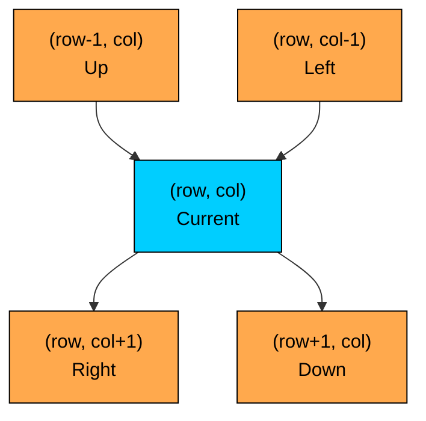
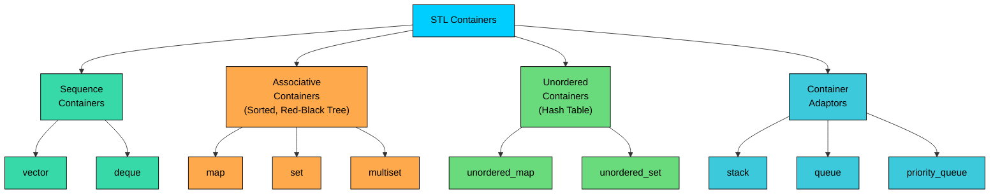
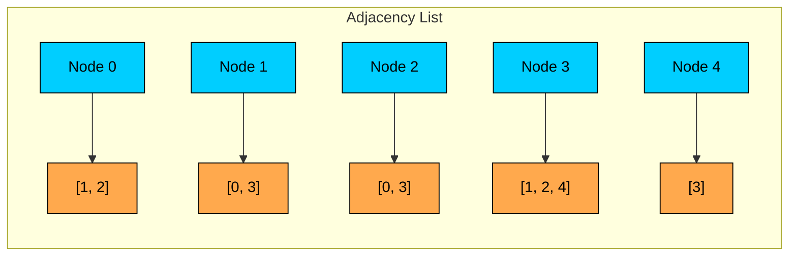

<LessonCard>

<IntroCard>

This chapter is a focused crash course on C++ features that come up repeatedly in DSA and coding interviews. Instead of covering the entire language, we will concentrate only on the parts that matter for solving problems efficiently in interviews.

</IntroCard>

<h1 id="common-includes">Common Includes</h1>

On LeetCode, most headers are included automatically. But when writing C++ locally or on some interview platforms, you need to know what to include. Here are the headers that cover 95% of DSA problems:

```cpp
#include <vector>
#include <string>
#include <unordered_map>
#include <unordered_set>
#include <map>
#include <set>
#include <queue>          // queue and priority_queue
#include <stack>
#include <deque>
#include <algorithm>      // sort, lower_bound, reverse, etc.
#include <climits>        // INT_MAX, INT_MIN, LLONG_MAX
#include <numeric>        // accumulate, iota, gcd
#include <functional>     // greater<>, function<>
#include <sstream>        // stringstream for parsing
#include <cmath>          // sqrt, abs, pow, ceil, floor

using namespace std;      // acceptable in interviews, not in production
```

Each header serves a specific purpose in DSA:

| Header            | What It Provides                       | DSA Use Case                               |
| ----------------- | -------------------------------------- | ------------------------------------------ |
| `<vector>`        | `vector`                               | Dynamic arrays, adjacency lists, DP tables |
| `<string>`        | `string`                               | String manipulation, character operations  |
| `<unordered_map>` | `unordered_map`                        | Frequency counting, Two Sum, O(1) lookups  |
| `<unordered_set>` | `unordered_set`                        | Visited tracking, duplicate detection      |
| `<map>` / `<set>` | `map`, `set`                           | Sorted access, range queries               |
| `<queue>`         | `queue`, `priority_queue`              | BFS, heaps, Dijkstra                       |
| `<stack>`         | `stack`                                | Monotonic stack, iterative DFS             |
| `<deque>`         | `deque`                                | Sliding window, double-ended operations    |
| `<algorithm>`     | `sort`, `lower_bound`, `reverse`, etc. | Sorting, binary search, STL algorithms     |
| `<climits>`       | `INT_MAX`, `INT_MIN`, `LLONG_MAX`      | Sentinel values, overflow boundaries       |
| `<numeric>`       | `accumulate`, `iota`, `gcd`            | Prefix sums, number theory                 |
| `<functional>`    | `greater&lt;>`, `function&lt;>`        | Min-heap comparator, recursive lambdas     |
| `<sstream>`       | `stringstream`                         | String tokenization, parsing               |
| `<cmath>`         | `sqrt`, `ceil`, `floor`, `abs`         | Math operations                            |

A note on `using namespace std;`. In production code, this is considered bad practice because it pollutes the global namespace. In coding interviews and competitive programming, it is universally accepted and saves you from typing `std::` before every STL type. Use it in interviews without hesitation.

<h1 id="variables-types-and-the-overflow-trap">
  Variables, Types, and the Overflow Trap
</h1>

C++ is a statically typed language, meaning every variable must have a declared type. For DSA, a small set of types covers most problems.

| Type        | Size             | Range                       | DSA Use Case                                     |
| ----------- | ---------------- | --------------------------- | ------------------------------------------------ |
| `int`       | 4 bytes          | -2.1B to 2.1B               | Array indices, counters, most values             |
| `long long` | 8 bytes          | -9.2 x 10^18 to 9.2 x 10^18 | Prefix sums, large products, overflow-prone math |
| `char`      | 1 byte           | -128 to 127 (signed)        | Characters, frequency arrays                     |
| `bool`      | 1 byte           | `true` / `false`            | Visited arrays, flags                            |
| `double`    | 8 bytes          | ±1.7 x 10^308               | Rarely used, some geometry problems              |
| `size_t`    | 8 bytes (64-bit) | 0 to 18.4 x 10^18           | Return type of `.size()` (unsigned!)             |

The most dangerous pitfall with types in C++ is **integer overflow**. In C++, **signed integer overflow is undefined behavior**. The compiler can do literally anything, including optimizing away your bounds checks or producing incorrect results silently.

Consider the classic binary search:

```cpp
// BUG: if left + right > INT_MAX, this is undefined behavior
int mid = (left + right) / 2;

// CORRECT: safe from overflow
int mid = left + (right - left) / 2;
```

This is not a theoretical concern. When `left` and `right` are both above 1 billion, their sum exceeds `int` range. In C++, the compiler might optimize the code in ways that make the bug impossible to debug.

When should you use `long long` instead of `int`? Use `long long` in these cases:

The `1LL *` trick is the idiomatic way to promote an expression to `long long` before overflow happens:

```cpp
// Overflow: 100000 * 99999 > INT_MAX, undefined behavior
int wrong = n * (n - 1);

// Safe: 1LL promotes the entire expression to long long
long long correct = 1LL * n * (n - 1);

// Also safe: explicit cast BEFORE multiplication
long long alsoCorrect = (long long)n * (n - 1);

// WRONG: casting AFTER multiplication is too late, UB already happened
long long stillWrong = (long long)(n * (n - 1));
```

The placement of the cast matters. `(long long)n * (n - 1)` first promotes `n` to `long long`, then performs `long long` multiplication. But `(long long)(n * (n - 1))` performs `int` multiplication first (which is UB if it overflows), then casts the corrupted result.

<h3 id="the-size_t-trap">The `size_t` Trap</h3>

Every STL container's `.size()` method returns `size_t`, which is an **unsigned** integer. This creates a subtle and dangerous bug:

```cpp
vector<int> v;  // empty vector
// BUG: v.size() is 0 (unsigned), subtracting 1 wraps to 18446744073709551615
for (int i = 0; i < v.size() - 1; i++) {
    // This loop runs ~18 quintillion times
}

// SAFE: cast to int first
for (int i = 0; i < (int)v.size() - 1; i++) {
    // Correctly does not execute
}

// ALSO SAFE: check emptiness first
if (v.size() >= 2) {
    for (int i = 0; i < v.size() - 1; i++) { ... }
}
```

**The ternary operator** is a compact alternative to if-else for inline decisions:

```cpp
int result = (a > b) ? a : b;  // Same as max(a, b)
string label = (count == 1) ? "item" : "items";
```

```cpp
auto it = map.find(key);                    // instead of unordered_map<int,int>::iterator
auto [key, value] = *map.begin();           // structured binding (C++17)
for (auto& [k, v] : myMap) { ... }         // clean map iteration
```

<h1 id="operators-and-control-flow">Operators and Control Flow</h1>

Most operators in C++ work as you would expect, but a few deserve special attention for DSA.

**Modular arithmetic** with `%` appears in hashing, cyclic array problems, and math-heavy questions. In C++, integer division truncates toward zero, so `%` can return a negative result when an operand is negative: `-7 % 3` gives `-1`, not `2`. To get a positive result:

```cpp
int positiveMod = ((n % m) + m) % m;
```

Many problems ask you to return the result "modulo 10^9 + 7" to prevent overflow in the output:

```cpp
const int MOD = 1e9 + 7;

// Apply modulo during computation, not just at the end
long long result = 0;
for (int i = 0; i < n; i++) {
    result = (result + values[i]) % MOD;
}
return (int)result;
```

<h3 id="bitwise-operations">Bitwise Operations</h3>

Bit manipulation problems are common in DSA. Here are the operators and patterns you need:

| Operator   | Meaning     | Example                  | DSA Use                  |
| ---------- | ----------- | ------------------------ | ------------------------ |
| `&`        | AND         | `n & 1`                  | Check odd/even           |
| `\|`       | OR          | `mask \| (1 &lt;&lt; i)` | Set bit i                |
| `^`        | XOR         | `a ^ b`                  | Find single number, swap |
| `~`        | NOT         | `~mask`                  | Invert bits              |
| `&lt;&lt;` | Left shift  | `1 &lt;&lt; i`           | Create bit mask          |
| `>>`       | Right shift | `n >> 1`                 | Divide by 2              |

Common bitmask patterns:

```cpp
// Check if bit i is set
bool isSet = (mask >> i) & 1;

// Set bit i
mask |= (1 << i);

// Clear bit i
mask &= ~(1 << i);

// Toggle bit i
mask ^= (1 << i);

// Count set bits (GCC/Clang built-in, works on LeetCode)
int bits32 = __builtin_popcount(mask);       // for int (use either)
int bits64 = __builtin_popcountll(mask64);   // for long long
```

`__builtin_popcount` is available on every major online judge including LeetCode. Using it shows you know the C++ toolchain. The alternative is the Brian Kernighan algorithm (`n &= (n - 1)` clears the lowest set bit on each iteration), which works in any C++ environment but is more verbose.

Note that C++ does not have a dedicated unsigned right shift operator. Right shift on a signed type sign-extends (arithmetic shift). If you need unsigned (logical) shift behavior, cast to the matching unsigned type first: `unsigned int` for `int`, `unsigned long long` for `long long`.

<h3 id="control-flow-and-loops">Control Flow and Loops</h3>

C++ has four loop forms commonly used in DSA:

```cpp
// Index-based (most common)
for (int i = 0; i &lt; n; i++) { ... }

// Backward iteration
for (int i = n - 1; i &ge; 0; i--) { ... }

// Range-based for (C++11): iterating over containers
for (int num : nums) { ... }           // by value (copies element)
for (int& num : nums) { ... }          // by reference (can modify)
for (const int& num : nums) { ... }    // by const reference (read-only, no copy)

// Structured bindings in range-based for (C++17)
for (auto& [key, val] : myMap) { ... }  // clean map iteration
```

**Structured bindings** (C++17) let you unpack pairs, tuples, and map entries directly:

```cpp
auto [key, value] = *myMap.begin();
for (auto& [k, v] : myMap) {
    // k is the key, v is the value
}
pair<int, int> p = {3, 4};
auto [x, y] = p;
```

**Short-circuit evaluation** with `&&` and `||` matters for bounds checking:

```cpp
// Safe: if i is out of bounds, grid[i][j] is never accessed
if (i &ge; 0 && i &lt; rows && j &ge; 0 && j &lt; cols && grid[i][j] == 1) { ... }
```

<h1 id="functions-and-pass-by-reference">Functions and Pass-by-Reference</h1>

This section covers a key performance concept in C++ DSA: how you pass arguments to functions.

C++ gives you three ways to pass parameters:

```cpp
void byValue(vector<int> v) { ... }         // copies entire vector, SLOW!
void byRef(vector<int>& v) { ... }          // modifies original, fast
void byConstRef(const vector<int>& v) { ... } // read-only, no copy, fast
```

When you pass a `vector<int>` by value, C++ copies the entire vector. For a recursive function called n times with a vector of size n, this turns your O(n) algorithm into O(n^2). This is a common C++ performance mistake.

The `swap` function is built into C++ and works with any type:

```cpp
swap(arr[i], arr[j]);  // swaps in-place, no temp variable needed
```

C++ `swap` is a single function call that swaps two values in-place with no temp variable needed.

<h3 id="lambda-functions">Lambda Functions</h3>

Lambdas are anonymous functions, used heavily for custom sort comparators and recursive helper functions. The syntax is:

```cpp
// Basic lambda
auto add = [](int a, int b) { return a + b; };

// Lambda with capture
int target = 5;
auto matches = [target](int x) { return x == target; };    // capture target by value
auto matches2 = [&target](int x) { return x == target; };  // capture target by reference

// Capture everything by reference (most common in DSA)
auto fn = [&]() { /* can access all outer variables */ };

// Capture everything by value
auto fn2 = [=]() { /* copies of all outer variables */ };
```

The capture clause `[]` controls which variables from the surrounding scope the lambda can access:

| Capture   | Meaning                  | When to Use            |
| --------- | ------------------------ | ---------------------- |
| `[]`      | Nothing                  | Standalone comparators |
| `[&]`     | All by reference         | Recursive helpers, DFS |
| `[=]`     | All by value             | Rarely needed in DSA   |
| `[&x, y]` | `x` by ref, `y` by value | Fine-grained control   |

<h3 id="recursive-lambdas-with-function">Recursive Lambdas with `function&lt;>`</h3>

For recursive helper functions inside a method (common for DFS, backtracking), you need `function&lt;>` because a lambda cannot refer to itself through `auto`:

```cpp
// DFS using a recursive lambda
function<void(int)> dfs = [&](int node) {
    visited[node] = true;
    for (int neighbor : graph[node]) {
        if (!visited[neighbor]) dfs(neighbor);
    }
};
dfs(startNode);
```

<h3 id="backtracking-pattern">Backtracking Pattern</h3>

Here is the classic backtracking template in C++, showing pass-by-reference semantics:

```cpp
void backtrack(vector<int>& path, vector<vector<int>>& results, vector<int>& nums) {
    if (path.size() == nums.size()) {
        results.push_back(path);  // C++ copies the vector automatically
        return;
    }
    for (int i = 0; i &lt; nums.size(); i++) {
        path.push_back(nums[i]);
        backtrack(path, results, nums);
        path.pop_back();  // undo choice
    }
}
```

`results.push_back(path)` creates a copy of the current `path` vector. C++ containers are value types and copy automatically on insertion, so you do not need to write any extra code to avoid storing a reference.

<h1 id="pointers-and-memory-dsa-essentials">
  Pointers and Memory (DSA Essentials)
</h1>

Pointers are central to working with linked structures in C++. You only need a small subset of pointer knowledge for coding interviews.

<h3 id="why-pointers-in-dsa">Why Pointers in DSA?</h3>

Linked lists and trees are defined using pointers in C++. On LeetCode and in interviews, the node definitions look like this:

```cpp
struct ListNode {
    int val;
    ListNode* next;
    ListNode(int val) : val(val), next(nullptr) {}
};

struct TreeNode {
    int val;
    TreeNode* left;
    TreeNode* right;
    TreeNode(int val) : val(val), left(nullptr), right(nullptr) {}
};
```

The `*` in `ListNode* next` means "next is a pointer to a ListNode." A pointer holds the memory address of an object, not the object itself.

<h3 id="essential-pointer-operations">Essential Pointer Operations</h3>

```cpp
// Creating nodes on the heap
ListNode* head = new ListNode(1);
head->next = new ListNode(2);
head->next->next = new ListNode(3);

// Accessing members through a pointer
int value = head->val;         // arrow operator for pointers
ListNode* nextNode = head->next;

// Null check
if (head == nullptr) { ... }   // always check before dereferencing
if (head != nullptr && head->next != nullptr) { ... }

// Building a linked list concisely
ListNode* head = new ListNode(1, new ListNode(2, new ListNode(3)));
// (Requires a two-argument constructor)
```

The **arrow operator** `->` is used to access members through a pointer. It is equivalent to `(*ptr).member`. It is used heavily in linked list and tree problems.

<h3 id="new-and-memory-leaks">`new` and Memory Leaks</h3>

`new` allocates memory on the heap and returns a pointer. In production C++, you must eventually call `delete` to free that memory. But in coding interviews, **memory leaks are universally accepted**. No interviewer will ask you to free tree nodes after solving a problem.

```cpp
TreeNode* root = new TreeNode(1);
root->left = new TreeNode(2);
root->right = new TreeNode(3);
// No need to delete in interviews
```

<h3 id="pointers-vs-references">Pointers vs References</h3>

A reference (`&`) is an alias for an existing variable. It cannot be null and cannot be reassigned. A pointer (`*`) can be null, can be reassigned, and requires explicit dereferencing.

```cpp
int x = 5;
int& ref = x;    // ref IS x, any change to ref changes x
int* ptr = &x;   // ptr POINTS TO x, use *ptr to access the value

ref = 10;         // x is now 10
*ptr = 20;        // x is now 20
ptr = nullptr;    // valid: pointer can be null
// ref = nullptr;  // INVALID: reference cannot be null
```

For DSA, the rule is simple: use references for function parameters (to avoid copies), use pointers for linked structures (nodes that can be null and need to be reassigned).

<h1 id="arrays-and-vectors">Arrays and Vectors</h1>

```cpp
int arr[5] = {0};              // C-style, fixed size, stack-allocated
vector<int> vec(5, 0);         // vector, dynamic, heap-allocated
vector<int> vec2 = {1, 2, 3};  // initializer list
```

<h3 id="vector-operations">Vector Operations</h3>

| Operation          | Syntax                    | Time           | DSA Use                          |
| ------------------ | ------------------------- | -------------- | -------------------------------- |
| Append             | `v.push_back(x)`          | O(1) amortized | Building results                 |
| Construct in-place | `v.emplace_back(args...)` | O(1) amortized | Constructing pairs/objects       |
| Pop last           | `v.pop_back()`            | O(1)           | Stack operations                 |
| Access by index    | `v[i]`                    | O(1)           | Random access                    |
| Size               | `v.size()`                | O(1)           | Loop bounds                      |
| Empty check        | `v.empty()`               | O(1)           | Guard clauses                    |
| Front/Back         | `v.front()`, `v.back()`   | O(1)           | Peek operations                  |
| Insert at position | `v.insert(it, x)`         | O(n)           | Avoid in tight loops             |
| Erase at position  | `v.erase(it)`             | O(n)           | Avoid in tight loops             |
| Reserve capacity   | `v.reserve(n)`            | O(n)           | Pre-allocate, avoid reallocation |
| Resize             | `v.resize(n, val)`        | O(n)           | Set size with default value      |
| Clear              | `v.clear()`               | O(n)           | Reset container                  |

<h3 id="2d-vectors">2D Vectors</h3>

The standard way to create a matrix in C++:

```cpp
int rows = 3, cols = 4;
vector<vector<int>> matrix(rows, vector<int>(cols, 0));

// Access
matrix[row][col] = 5;

// Dimensions
int numRows = matrix.size();
int numCols = matrix[0].size();
```

DP table initialization follows the same pattern:

```cpp
// 1D DP
vector<int> dp(n + 1, 0);

// 2D DP
vector<vector<int>> dp(m + 1, vector<int>(n + 1, 0));

// 2D boolean visited array
vector<vector<bool>> visited(rows, vector<bool>(cols, false));
```

<h3 id="4-directional-movement">4-Directional Movement</h3>

Grid problems frequently require visiting neighbors in four directions. Here is the standard pattern:

```cpp
int dirs[4][2] = {{-1, 0}, {1, 0}, {0, -1}, {0, 1}};  // up, down, left, right

for (auto& [dr, dc] : dirs) {
    int nr = row + dr, nc = col + dc;
    if (nr &ge; 0 && nr &lt; rows && nc &ge; 0 && nc &lt; cols && !visited[nr][nc]) {
        // process neighbor (nr, nc)
    }
}
```



<h3 id="useful-vector-operations">Useful Vector Operations</h3>

```cpp
// Fill with a value
fill(dp.begin(), dp.end(), INT_MAX);

// Copy a vector (vectors are value types, this is a deep copy)
vector<int> copy = original;

// Copy a range
vector<int> sub(original.begin() + 2, original.begin() + 5);

// Initialize with iota (0, 1, 2, 3, ...)
vector<int> ids(n);
iota(ids.begin(), ids.end(), 0);
```

<h1 id="strings">Strings</h1>

C++ `std::string` is **mutable**. You can modify characters in-place without creating a new string.

```cpp
string s = "hello";
s[0] = 'H';       // Direct modification, no StringBuilder or join() needed
s += " world";     // Append (amortized O(1) for single chars)
s.push_back('!');  // Append a single character
s.pop_back();      // Remove last character
```

<h3 id="essential-string-methods">Essential String Methods</h3>

| Method                    | Example            | DSA Use                                      |
| ------------------------- | ------------------ | -------------------------------------------- |
| `s[i]`                    | `s[0]`             | Access/modify character                      |
| `s.size()` / `s.length()` | `s.size()`         | Both work identically                        |
| `s.empty()`               | `s.empty()`        | Check if empty                               |
| `s.substr(pos, len)`      | `s.substr(0, 3)`   | Extract substring                            |
| `s.find(sub)`             | `s.find("ab")`     | Find substring (`string::npos` if not found) |
| `s.push_back(c)`          | `s.push_back('a')` | Append character                             |
| `s.pop_back()`            | `s.pop_back()`     | Remove last character                        |
| `s.front()` / `s.back()`  | `s.back()`         | First/last character                         |
| `s == t`                  | `s == t`           | Content comparison                           |
| `s &lt; t`                | `s &lt; t`         | Lexicographic comparison                     |
| `s + t`                   | `s + t`            | Concatenation                                |

`s == t` compares content directly. All comparison operators (`==`, `!=`, `&lt;`, `>`, `&lt;=`, `&ge; `) work on strings in C++ and compare lexicographically.

<h3 id="string-number-conversions">String-Number Conversions</h3>

```cpp
// Number to string
string s = to_string(42);        // "42"
string s = to_string(3.14);      // "3.140000"

// String to number
int n = stoi("42");              // 42
long long big = stoll("999999999999");  // for large numbers
double d = stod("3.14");         // 3.14
```

<h3 id="string-parsing-with-stringstream">
  String Parsing with `stringstream`
</h3>

When you need to split a string by spaces or other delimiters:

```cpp
stringstream ss("hello world foo");
string word;
while (ss >> word) {
    // processes "hello", "world", "foo"
}

// Split by custom delimiter
stringstream ss2("a,b,c,d");
string token;
while (getline(ss2, token, ',')) {
    // processes "a", "b", "c", "d"
}
```

<h3 id="character-arithmetic">Character Arithmetic</h3>

Character-to-index conversion uses simple arithmetic:

```cpp
char c = 'f';
int index = c - 'a';         // Maps 'a'-'z' to 0-25
char back = (char)('a' + 5); // Maps 5 back to 'f'
int digit = c - '0';         // Maps '0'-'9' to 0-9
```

The **frequency array** pattern appears in dozens of problems:

```cpp
int freq[26] = {0};
for (char c : s) {
    freq[c - 'a']++;
}
// freq[0] = count of 'a', freq[1] = count of 'b', etc.
```

<h3 id="character-utility-functions">Character Utility Functions</h3>

From `<cctype>`:

```cpp
isalpha(c)   // true if letter (a-z, A-Z)
isdigit(c)   // true if digit (0-9)
isalnum(c)   // true if letter or digit
tolower(c)   // lowercase version
toupper(c)   // uppercase version
```

These are especially useful for the "Valid Palindrome" family of problems where you need to ignore non-alphanumeric characters.

<h1 id="stl-containers">STL Containers</h1>

The Standard Template Library (STL) is C++'s collection framework, and the foundation of C++ DSA code. This section covers every container commonly used in coding interviews.



<h3 id="unordered_map-the-hashmap-o1-average">
  `unordered_map`: The HashMap (O(1) Average)
</h3>

`unordered_map` is C++'s hash map. It appears in nearly every other problem for frequency counting, lookups, and memoization.

```cpp
unordered_map<int, int> map;

// Insert / Update
map[key] = value;         // insert or overwrite
map[key]++;               // auto-inserts 0 if missing, then increments

// Lookup
if (map.count(key)) { ... }          // 1 if exists, 0 if not
if (map.find(key) != map.end()) { ... }  // iterator-based check
int val = map[key];                   // WARNING: auto-inserts default if missing!

// Safe lookup (no auto-insert)
auto it = map.find(key);
if (it != map.end()) {
    int val = it->second;
}

// Delete
map.erase(key);

// Size
map.size();
map.empty();

// Iterate
for (auto& [key, val] : map) {
    // process key-value pair
}
```

`map[key]` auto-inserts a default value if the key is missing. For `unordered_map<char, int>`, writing `map[c]++` works without checking if `c` exists first because the default value for `int` is 0. This makes frequency counting a one-liner in C++.

**Two Sum** using `unordered_map`:

```cpp
vector<int> twoSum(vector<int>& nums, int target) {
    unordered_map<int, int> seen;  // value -> index
    for (int i = 0; i < nums.size(); i++) {
        int complement = target - nums[i];
        if (seen.count(complement)) {
            return {seen[complement], i};
        }
        seen[nums[i]] = i;
    }
    return {};
}
```

<h3 id="unordered_set-the-hashset-o1-average">
  `unordered_set`: The HashSet (O(1) Average)
</h3>

`unordered_set` stores unique elements with O(1) average lookup. Use it for visited tracking, duplicate detection, and membership testing.

```cpp
unordered_set<int> visited;

// Insert
visited.insert(node);
// insert returns pair<iterator, bool>, the bool tells if insertion happened
auto [it, inserted] = visited.insert(node);
if (!inserted) { /* node was already in the set */ }

// Check membership
if (visited.count(node)) { ... }

// Delete
visited.erase(node);

// Iterate
for (int val : visited) { ... }
```

<h3 id="map-and-set-the-treemap-and-treeset-olog-n-sorted">
  `map` and `set`: The TreeMap and TreeSet (O(log n), Sorted)
</h3>

`map` and `set` are backed by red-black trees, keeping elements sorted at all times. Use them when you need sorted iteration, range queries, or floor/ceiling operations.

```cpp
map<int, string> sortedMap;
sortedMap[3] = "three";
sortedMap[1] = "one";
sortedMap[5] = "five";
// Iteration order: 1, 3, 5 (always sorted by key)

set<int> sortedSet = {5, 3, 1, 4, 2};
// Iteration order: 1, 2, 3, 4, 5
```

The power of `map` and `set` lies in their `lower_bound` and `upper_bound` methods:

```cpp
set<int> s = {10, 20, 30, 40, 50};

auto it = s.lower_bound(25);   // points to 30 (first element >= 25)
auto it2 = s.upper_bound(30);  // points to 40 (first element > 30)

// "Floor" (largest element <= target)
auto it = s.upper_bound(25);
if (it != s.begin()) {
    --it;
    int floor = *it;  // 20
}

// First and last elements
int smallest = *s.begin();
int largest = *s.rbegin();
```

Use `map`/`set` when the problem requires finding the nearest element, range queries, or maintaining a sorted window. Common examples include sliding window median, meeting room scheduling, and interval problems. For everything else, prefer `unordered_map`/`unordered_set` for O(1) performance.

<h3 id="multiset-sorted-set-with-duplicates">
  `multiset`: Sorted Set with Duplicates
</h3>

`multiset` allows duplicate elements, which `set` does not. This is useful for problems like "Sliding Window Median" where you need a sorted container that supports duplicates.

```cpp
multiset<int> ms = {3, 1, 4, 1, 5};
// Contents: {1, 1, 3, 4, 5}

ms.insert(3);
// Contents: {1, 1, 3, 3, 4, 5}

// CAREFUL: erase(value) removes ALL occurrences
ms.erase(3);     // removes BOTH 3s: {1, 1, 4, 5}

// To remove only ONE occurrence, erase by iterator
ms.insert(3);
ms.insert(3);    // {1, 1, 3, 3, 4, 5}
ms.erase(ms.find(3));  // removes ONE 3: {1, 1, 3, 4, 5}
```

The main `multiset` pitfall: `erase(value)` removes ALL occurrences. Always use `erase(find(value))` to remove a single occurrence. This mistake appears frequently in sliding window problems.

<h3 id="stack">`stack`</h3>

The stack adaptor provides LIFO access:

```cpp
stack<int> stk;

stk.push(1);          // push onto top
stk.push(2);
int top = stk.top();  // peek: 2
stk.pop();             // remove top (returns void!)
bool empty = stk.empty();
int sz = stk.size();
```

Note that `pop()` returns `void`, not the removed element. You must call `top()` before `pop()` if you need the value.

<h3 id="queue">`queue`</h3>

The queue adaptor provides FIFO access, used extensively for BFS:

```cpp
queue<int> q;

q.push(1);           // enqueue
q.push(2);
int front = q.front(); // peek: 1
q.pop();              // dequeue (returns void!)
bool empty = q.empty();
int sz = q.size();
```

**BFS template:**

```cpp
queue<pair<int, int>> q;
vector<vector<bool>> visited(rows, vector<bool>(cols, false));

q.push({startRow, startCol});
visited[startRow][startCol] = true;

while (!q.empty()) {
    auto [row, col] = q.front();
    q.pop();

    for (auto& [dr, dc] : dirs) {
        int nr = row + dr, nc = col + dc;
        if (nr &ge; 0 && nr &lt; rows && nc &ge; 0 && nc &lt; cols
            && !visited[nr][nc] && grid[nr][nc] == 1) {
            visited[nr][nc] = true;
            q.push({nr, nc});
        }
    }
}
```

**Level-order BFS** (processing one level at a time):

```cpp
int level = 0;
while (!q.empty()) {
    int levelSize = q.size();  // capture size BEFORE processing
    for (int i = 0; i &lt; levelSize; i++) {
        auto [row, col] = q.front();
        q.pop();
        // process and add neighbors
    }
    level++;
}
```

<h3 id="deque">`deque`</h3>

`deque` (double-ended queue) supports O(1) insertion and removal at both ends:

```cpp
deque<int> dq;

dq.push_back(1);     // add to back
dq.push_front(0);    // add to front
dq.pop_back();       // remove from back
dq.pop_front();      // remove from front
dq.front();          // peek front
dq.back();           // peek back
dq[i];               // random access (O(1))
```

The classic use case is the **monotonic deque** for sliding window maximum/minimum:

```cpp
// Sliding window maximum
deque<int> dq;  // stores indices, front is always the max
vector<int> result;

for (int i = 0; i < nums.size(); i++) {
    // Remove indices outside the window
    while (!dq.empty() && dq.front() < i - k + 1) {
        dq.pop_front();
    }
    // Remove smaller elements from back (they can never be the max)
    while (!dq.empty() && nums[dq.back()] <= nums[i]) {
        dq.pop_back();
    }
    dq.push_back(i);

    if (i >= k - 1) {
        result.push_back(nums[dq.front()]);
    }
}
```

<h3 id="priority_queue-max-heap-by-default">
  `priority_queue`: MAX-Heap by Default!
</h3>

```cpp
// MAX-heap (default), largest element on top
priority_queue<int> maxHeap;

// MIN-heap, smallest element on top
priority_queue<int, vector<int>, greater<int>> minHeap;
```

The three template arguments for a min-heap are:

```cpp
// Max-heap operations
priority_queue<int> pq;
pq.push(3);
pq.push(1);
pq.push(4);
int top = pq.top();  // 4 (largest)
pq.pop();             // removes 4 (returns void!)
```

C++ `priority_queue` is a MAX-heap by default. To get a min-heap, use `priority_queue<int, vector<int>, greater<int>>`. Forgetting this will make your Dijkstra return the longest path instead of the shortest.

**Dijkstra's algorithm** using a min-heap of pairs:

```cpp
// Min-heap of {distance, node}
priority_queue<pair<int, int>, vector<pair<int, int>>, greater<pair<int, int>>> pq;
vector<int> dist(n, INT_MAX);

dist[start] = 0;
pq.push({0, start});

while (!pq.empty()) {
    auto [d, u] = pq.top();
    pq.pop();

    if (d > dist[u]) continue;  // skip outdated entries

    for (auto& [v, w] : graph[u]) {
        if (dist[u] + w < dist[v]) {
            dist[v] = dist[u] + w;
            pq.push({dist[v], v});
        }
    }
}
```

Note that pairs in the priority queue compare lexicographically (by first element, then second). Putting distance as the first element ensures the min-heap orders by distance.

<h3 id="containers-quick-reference">Containers Quick Reference</h3>

| Container        | Key Ops                      | Time               | When to Use                  |
| ---------------- | ---------------------------- | ------------------ | ---------------------------- |
| `vector`         | `push_back`, `[]`, `size`    | O(1) access/append | Dynamic arrays, DP tables    |
| `unordered_map`  | `[]`, `count`, `find`        | O(1) avg           | Frequency counting, lookups  |
| `unordered_set`  | `insert`, `count`            | O(1) avg           | Visited tracking, dedup      |
| `map`            | `lower_bound`, `upper_bound` | O(log n)           | Sorted access, range queries |
| `set`            | `lower_bound`, `upper_bound` | O(log n)           | Sorted unique elements       |
| `multiset`       | `insert`, `erase(find())`    | O(log n)           | Sorted with duplicates       |
| `stack`          | `push`, `pop`, `top`         | O(1)               | Monotonic stack, DFS         |
| `queue`          | `push`, `pop`, `front`       | O(1)               | BFS                          |
| `deque`          | `push_front`, `push_back`    | O(1) both ends     | Sliding window               |
| `priority_queue` | `push`, `pop`, `top`         | O(log n)           | Heaps (**MAX** default!)     |

<h1 id="sorting-and-comparators">Sorting and Comparators</h1>

Sorting is one of the most frequent operations in DSA. C++ provides `sort()` from `<algorithm>`, which uses Introsort (a hybrid of quicksort, heapsort, and insertion sort) and is guaranteed O(n log n).

```cpp
vector<int> nums = {3, 1, 4, 1, 5};

// Ascending (default)
sort(nums.begin(), nums.end());

// Descending
sort(nums.begin(), nums.end(), greater<int>());

// Custom comparator with lambda
sort(nums.begin(), nums.end(), [](int a, int b) {
    return a > b;  // descending
});
```

<h3 id="sorting-complex-types">Sorting Complex Types</h3>

Sorting intervals by start time (Merge Intervals pattern):

```cpp
vector<vector<int>> intervals = {{3, 5}, {1, 4}, {2, 6}};
sort(intervals.begin(), intervals.end(), [](auto& a, auto& b) {
    return a[0] < b[0];  // sort by first element
});
```

Sorting by multiple keys:

```cpp
// Sort by second element, then by first element as tiebreaker
vector<pair<int, int>> points = {{1, 3}, {2, 1}, {3, 1}};
sort(points.begin(), points.end(), [](auto& a, auto& b) {
    if (a.second != b.second) return a.second < b.second;
    return a.first < b.first;
});
```

<h3 id="stable_sort">`stable_sort`</h3>

`stable_sort` preserves the relative order of equal elements. Use it when the original order matters for elements that compare equal:

```cpp
stable_sort(v.begin(), v.end(), comparator);
```

<h3 id="nth_element-on-kth-element">`nth_element`: O(n) Kth Element</h3>

For "Kth Largest Element" type problems, `nth_element` rearranges the vector so the kth element is in its sorted position, with all smaller elements before it and all larger elements after. It runs in O(n) average time:

```cpp
vector<int> nums = {3, 1, 4, 1, 5, 9, 2, 6};
int k = 3;
nth_element(nums.begin(), nums.begin() + k, nums.end());
// nums[k] is now the (k+1)th smallest element
// Elements before k are all &lt;= nums[k], elements after are all &ge; nums[k]
```

<h3 id="safe-comparators">Safe Comparators</h3>

C++ comparators return `bool`, not an `int`. This means there is no overflow risk from subtraction tricks:

```cpp
// SAFE in C++: returns bool, no subtraction needed
sort(nums.begin(), nums.end(), [](int a, int b) { return a &lt; b; });

// C++ does not have this problem because comparators are boolean
```

One rule matters for custom comparators: use strict comparison (`&lt;` or `>`), never `&lt;=` or `&ge; `. The comparator must return `false` when two elements are equal. Returning `true` for equal elements violates the strict weak ordering that `sort` and the ordered containers require, which is undefined behavior and can crash.

<h1 id="stl-algorithms-and-idioms">STL Algorithms and Idioms</h1>

The `<algorithm>` and `<numeric>` headers provide dozens of functions that eliminate common boilerplate.

<h3 id="binary-search-family">Binary Search Family</h3>

These work on **sorted** ranges:

```cpp
vector<int> v = {1, 3, 5, 7, 9};

// First element &ge; target
auto it = lower_bound(v.begin(), v.end(), 5);   // points to 5

// First element > target
auto it2 = upper_bound(v.begin(), v.end(), 5);  // points to 7

// Boolean: does target exist?
bool found = binary_search(v.begin(), v.end(), 5);  // true

// Get index from iterator
int idx = lower_bound(v.begin(), v.end(), 5) - v.begin();  // 2
```

`lower_bound` and `upper_bound` together can count occurrences of a value in a sorted range:

```cpp
int count = upper_bound(v.begin(), v.end(), target) - lower_bound(v.begin(), v.end(), target);
```

`lower_bound` returns an iterator to the first element &ge; target. `upper_bound` returns an iterator to the first element > target. If the element is not found, both return where it would be inserted to maintain sorted order.

<h3 id="numeric-algorithms">Numeric Algorithms</h3>

```cpp
// Sum of elements
int sum = accumulate(v.begin(), v.end(), 0);

// CAREFUL: use 0LL for long long sum to avoid overflow
long long bigSum = accumulate(v.begin(), v.end(), 0LL);

// GCD (C++17)
int g = gcd(12, 8);  // 4

// Fill with sequential values (0, 1, 2, 3, ...)
vector<int> ids(n);
iota(ids.begin(), ids.end(), 0);
```

<h3 id="element-queries">Element Queries</h3>

```cpp
// Max and min element (returns iterator)
int maxVal = *max_element(v.begin(), v.end());
int minVal = *min_element(v.begin(), v.end());

// Count occurrences
int cnt = count(v.begin(), v.end(), target);

// Find first occurrence (returns iterator, end() if not found)
auto it = find(v.begin(), v.end(), target);
if (it != v.end()) {
    int idx = it - v.begin();
}
```

<h3 id="transformation-algorithms">Transformation Algorithms</h3>

```cpp
// Reverse
reverse(v.begin(), v.end());
reverse(s.begin(), s.end());  // works on strings too

// Remove consecutive duplicates (must sort first for all duplicates)
sort(v.begin(), v.end());
auto newEnd = unique(v.begin(), v.end());
v.erase(newEnd, v.end());  // actually shrink the vector

// Next permutation (for generating permutations in order)
sort(v.begin(), v.end());
do {
    // process current permutation
} while (next_permutation(v.begin(), v.end()));

// Fill with a value
fill(v.begin(), v.end(), 0);
fill(dp.begin(), dp.end(), INT_MAX);
```

<h1 id="iterators-and-iterator-invalidation">
  Iterators and Iterator Invalidation
</h1>

Iterators are C++'s way of pointing to elements in containers. You have already been using them implicitly with `begin()`, `end()`, and range-based for loops. This section covers the explicit iterator operations and, more importantly, the rules about when iterators become invalid.

<h3 id="iterator-basics">Iterator Basics</h3>

```cpp
vector<int> v = {10, 20, 30, 40, 50};

auto it = v.begin();       // points to first element (10)
auto end = v.end();        // points PAST the last element

// Advance and access
++it;                      // move to next element
int val = *it;             // dereference: 20

// Navigate
auto it2 = next(it);      // returns iterator to next element (30)
auto it3 = prev(it2);     // returns iterator to previous element (20)
advance(it, 2);           // moves it forward 2 positions (now at 40)

// Reverse iterators
auto rit = v.rbegin();    // points to last element (50)
auto rend = v.rend();     // points before first element
```

<h3 id="iterator-invalidation-rules">Iterator Invalidation Rules</h3>

This is a foundational C++ concept for DSA. When you modify a container, some or all existing iterators may become **invalid** (pointing to garbage memory). Using an invalid iterator is undefined behavior.

| Container                         | Insert Invalidates                                                                     | Erase Invalidates                      |
| --------------------------------- | -------------------------------------------------------------------------------------- | -------------------------------------- |
| `vector`                          | All iterators if reallocation occurs, otherwise iterators at and after insertion point | Iterators at and after erased position |
| `deque`                           | All iterators                                                                          | All iterators                          |
| `list`                            | No iterators                                                                           | Only the erased iterator               |
| `map` / `set`                     | No iterators                                                                           | Only the erased iterator               |
| `unordered_map` / `unordered_set` | All iterators if rehash occurs                                                         | Only the erased iterator               |

<h1 id="iterating-and-modifying-collections-safely">
  Iterating and Modifying Collections Safely
</h1>

<h3 id="safe-erase-pattern-for-maps-and-sets">
  Safe Erase Pattern for Maps and Sets
</h3>

The `erase` method returns an iterator to the next valid element. Use this in a loop:

```cpp
for (auto it = map.begin(); it != map.end(); ) {
    if (it->second &lt; threshold) {
        it = map.erase(it);   // erase returns next valid iterator
    } else {
        ++it;
    }
}
```

This pattern works for `map`, `set`, `unordered_map`, and `unordered_set`.

<h3 id="erase-remove-idiom-for-vectors">Erase-Remove Idiom for Vectors</h3>

`remove` and `remove_if` from `<algorithm>` do not actually remove elements from a vector. They move the unwanted elements to the end and return an iterator to the new logical end. You must call `erase` to actually shrink the vector:

```cpp
vector<int> v = {1, 2, 3, 4, 5, 6};

// Remove all even numbers
v.erase(
    remove_if(v.begin(), v.end(), [](int x) { return x % 2 == 0; }),
    v.end()
);
// v is now {1, 3, 5}
```

This is called the **erase-remove idiom** and is one of the most well-known C++ patterns.

C++20 added `erase_if` as a cleaner alternative:

```cpp
// C++20 (available on most modern judges)
erase_if(v, [](int x) { return x % 2 == 0; });
```

In practice, most DSA problems build new collections rather than modifying during iteration. But when the problem requires in-place modification (like "Remove Duplicates from Sorted Array"), these patterns matter.

<h1 id="recursion-and-the-call-stack">Recursion and the Call Stack</h1>

Recursive functions use the call stack, and C++ has a finite stack size, typically 1-8 MB depending on the platform. Each function call uses roughly 100-200 bytes of stack space, which means you can recurse about 10,000 to 50,000 levels deep before hitting a stack overflow.

| Scenario                  | Typical Depth | Risk                          |
| ------------------------- | ------------- | ----------------------------- |
| Balanced binary tree      | O(log n)      | Safe for n up to 10^6         |
| Linked list / skewed tree | O(n)          | Dangerous if n > 10,000       |
| Backtracking              | O(depth)      | Usually safe (depth is small) |
| DFS on graph              | O(V)          | Dangerous for large graphs    |

When recursion is too deep, convert to an iterative approach using an explicit stack:

```cpp
// Recursive DFS
void dfs(int node, vector<vector<int>>& graph, vector<bool>& visited) {
    visited[node] = true;
    for (int neighbor : graph[node]) {
        if (!visited[neighbor]) {
            dfs(neighbor, graph, visited);
        }
    }
}

// Iterative DFS (safe for any depth)
void dfsIterative(int start, vector<vector<int>>& graph, vector<bool>& visited) {
    stack<int> stk;
    stk.push(start);

    while (!stk.empty()) {
        int node = stk.top();
        stk.pop();

        if (visited[node]) continue;
        visited[node] = true;

        for (int neighbor : graph[node]) {
            if (!visited[neighbor]) {
                stk.push(neighbor);
            }
        }
    }
}
```

C++ does not reliably optimize tail recursion (it depends on the compiler and optimization level), so do not rely on it.

<h1 id="graph-representation">Graph Representation</h1>

There are two main ways to represent graphs in C++, and your choice depends on whether node IDs are contiguous integers.

<h3 id="approach-1-vectorvectorint-contiguous-node-ids">Approach 1: `vector<vector<int>>` (Contiguous Node IDs)</h3>

This is the most common approach when nodes are numbered 0 to n-1:

```cpp
int n = 5;
vector<vector<int>> graph(n);  // adjacency list

// Build from edge list
for (auto& edge : edges) {
    graph[edge[0]].push_back(edge[1]);
    graph[edge[1]].push_back(edge[0]);  // for undirected graphs
}

// Traverse neighbors of node u
for (int neighbor : graph[u]) {
    // process neighbor
}
```

<h3 id="approach-2-unordered_mapint-vectorint-sparsenon-contiguous-ids">Approach 2: `unordered_map<int, vector<int>>` (Sparse/Non-Contiguous IDs)</h3>

Use this when node IDs are not contiguous or can be arbitrary values:

```cpp
unordered_map<int, vector<int>> graph;

for (auto& edge : edges) {
    graph[edge[0]].push_back(edge[1]);
    graph[edge[1]].push_back(edge[0]);
}
```

<h3 id="weighted-graphs">Weighted Graphs</h3>

For weighted graphs, use pairs to store `{neighbor, weight}`:

```cpp
vector<vector<pair<int, int>>> graph(n);  // {neighbor, weight}

for (auto& edge : edges) {
    int u = edge[0], v = edge[1], w = edge[2];
    graph[u].push_back({v, w});
    graph[v].push_back({u, w});  // for undirected
}
```



| Representation                    | When to Use                      | Pros                              | Cons                           |
| --------------------------------- | -------------------------------- | --------------------------------- | ------------------------------ |
| `vector<vector<int>>`             | Nodes are 0 to n-1               | Fast, cache-friendly, O(1) access | Wastes space for sparse graphs |
| `unordered_map<int, vector<int>>` | Sparse/string/arbitrary node IDs | Flexible                          | Slightly slower due to hashing |

<h1 id="pair-and-tuple">Pair and Tuple</h1>

`pair` is a built-in two-element container, used constantly in C++ DSA. C++ pairs are first-class citizens that work with sorting, sets, maps, and priority queues.

<h3 id="pairt1-t2">`pair<T1, T2>`</h3>

```cpp
// Creating pairs
pair<int, int> p = {3, 4};
pair<int, int> p2 = make_pair(3, 4);

// Accessing elements
int first = p.first;
int second = p.second;

// Structured bindings (C++17): cleaner access
auto [x, y] = p;
```

Pairs compare **lexicographically** (by first element, then second), which is useful for:

```cpp
// Pairs in a set (like storing coordinates)
set<pair<int, int>> visited;
visited.insert({row, col});
if (visited.count({row, col})) { ... }

// Pairs in a priority_queue (sorted by first element)
// For Dijkstra: {distance, node} sorts by distance automatically
priority_queue<pair<int, int>, vector<pair<int, int>>, greater<pair<int, int>>> pq;
pq.push({0, start});

// Pairs in a vector (sorting by first, then second)
vector<pair<int, int>> edges;
sort(edges.begin(), edges.end());  // lexicographic sort, no comparator needed
```

<h3 id="tuplet1-t2-t3">`tuple<T1, T2, T3>`</h3>

For three or more elements, use `tuple`:

```cpp
// Creating tuples
tuple<int, int, int> t = {1, 2, 3};
auto t2 = make_tuple(1, 2, 3);

// Accessing elements
auto [a, b, c] = t;          // structured bindings (preferred)
int first = get&lt;0>(t);       // pre-C++17 access

// Tuples also compare lexicographically
set<tuple<int, int, int>> visited3D;
visited3D.insert({x, y, z});
```

For most DSA problems, `pair` is sufficient. Use `tuple` when you need three or more values (e.g., `{distance, row, col}` in a grid BFS with weights).

<h1 id="deduplication-patterns">Deduplication Patterns</h1>

Two patterns appear frequently for avoiding duplicate results in combination/permutation problems.

<h3 id="pattern-1-sort-and-skip">Pattern 1: Sort and Skip</h3>

Sort the input, then skip consecutive duplicates:

```cpp
sort(nums.begin(), nums.end());
for (int i = 0; i &lt; nums.size(); i++) {
    if (i > 0 && nums[i] == nums[i - 1]) continue;  // skip duplicate
    // process nums[i]
}
```

For backtracking problems (like 3Sum or Combination Sum II):

```cpp
void backtrack(int start, vector<int>& nums, vector<int>& path, vector<vector<int>>& results) {
    results.push_back(path);
    for (int i = start; i &lt; nums.size(); i++) {
        if (i > start && nums[i] == nums[i - 1]) continue;  // skip at this level
        path.push_back(nums[i]);
        backtrack(i + 1, nums, path, results);
        path.pop_back();
    }
}
```

<h3 id="pattern-2-sort-unique-erase">Pattern 2: Sort + `unique` + Erase</h3>

For removing all duplicates from a vector:

```cpp
sort(v.begin(), v.end());
v.erase(unique(v.begin(), v.end()), v.end());
```

<h3 id="pattern-3-set-based">Pattern 3: Set-Based</h3>

Use a set to track seen combinations:

```cpp
set<vector<int>> seen;
// ... during backtracking:
if (seen.insert(path).second) {
    results.push_back(path);
}
```

The sort-and-skip approach is preferred because it avoids the overhead of a set and is the standard technique for this pattern.

<h1 id="common-dsa-idioms">Common DSA Idioms</h1>

This section collects the small but important patterns that come up repeatedly across DSA problems.

<h3 id="swap">Swap</h3>

```cpp
swap(a, b);                  // works with any type
swap(nums[i], nums[j]);     // swap elements in a vector
// STL swap handles the temp variable internally
```

<h3 id="sentinel-values">Sentinel Values</h3>

```cpp
int minVal = INT_MAX;        // 2,147,483,647
int maxVal = INT_MIN;        // -2,147,483,648
long long llMax = LLONG_MAX; // 9,223,372,036,854,775,807
long long llMin = LLONG_MIN;

// Or using numeric_limits (more explicit)
int minVal2 = numeric_limits<int>::max();
int maxVal2 = numeric_limits<int>::min();
```

Be careful with `INT_MIN`: `abs(INT_MIN)` is undefined behavior because the positive equivalent exceeds the `int` range. If a problem involves absolute values, consider using `long long`.

<h3 id="math-utilities">Math Utilities</h3>

```cpp
max(a, b);       // returns larger
min(a, b);       // returns smaller
abs(a);          // absolute value (use with caution for INT_MIN)

// Ceiling division for positive a and b
int ceilDiv = (a + b - 1) / b;

// Three-way max/min
max({a, b, c});  // initializer list version
min({a, b, c});
```

<h3 id="the-1ll-trick-reiterated">The `1LL *` Trick (Reiterated)</h3>

```cpp
// Prevents int overflow in multiplication
long long result = 1LL * a * b;

// Common in modular arithmetic
long long mod_result = 1LL * a * b % MOD;
```

<h3 id="type-conversions">Type Conversions</h3>

```cpp
// Number to string
to_string(42);            // "42"

// String to number
stoi("42");               // int
stoll("999999999999");    // long long
stod("3.14");             // double

// size_t to int (safe for DSA constraints where n &lt; 2^31)
int n = (int)v.size();

// char to int (digit)
int d = c - '0';

// int to char (digit)
char c = '0' + d;
```

<h3 id="deep-copy">Deep Copy</h3>

C++ vectors are **value types**. Assigning one vector to another creates a complete deep copy:

```cpp
vector<int> original = {1, 2, 3};
vector<int> copy = original;       // deep copy
copy[0] = 99;                      // original is unchanged

// 2D vectors also deep copy
vector<vector<int>> matrix2 = matrix;  // full deep copy
```

In C++, assigning a container creates a full copy by default. If you want a reference instead, use `&`:

```cpp
vector<int>& ref = original;      // ref IS original, not a copy
ref[0] = 99;                      // original is changed
```

<h1 id="oop-basics-for-dsa">OOP Basics for DSA</h1>

In DSA, you use `struct` to define nodes for linked lists, trees, tries, and graphs. C++ `struct` is identical to `class` except that members are public by default, which is what you want for DSA nodes.

<h3 id="listnode">ListNode</h3>

```cpp
struct ListNode {
    int val;
    ListNode* next;
    ListNode(int val) : val(val), next(nullptr) {}
    ListNode(int val, ListNode* next) : val(val), next(next) {}
};

// Usage
ListNode* head = new ListNode(1);
head->next = new ListNode(2);
head->next->next = new ListNode(3);

// One-liner construction
ListNode* head = new ListNode(1, new ListNode(2, new ListNode(3)));
```

<h3 id="treenode">TreeNode</h3>

```cpp
struct TreeNode {
    int val;
    TreeNode* left;
    TreeNode* right;
    TreeNode(int val) : val(val), left(nullptr), right(nullptr) {}
};

// Usage
TreeNode* root = new TreeNode(1);
root->left = new TreeNode(2);
root->right = new TreeNode(3);
```

<h3 id="trienode">TrieNode</h3>

```cpp
struct TrieNode {
    TrieNode* children[26];
    bool isEndOfWord;

    TrieNode() : isEndOfWord(false) {
        fill(begin(children), end(children), nullptr);
    }
};

// Usage
TrieNode* root = new TrieNode();
```

<h3 id="graph-node-for-problems-with-custom-node-structures">
  Graph Node (for problems with custom node structures)
</h3>

```cpp
struct Node {
    int val;
    vector<Node*> neighbors;
    Node(int val) : val(val) {}
};
```

<h3 id="constructor-initializer-lists">Constructor Initializer Lists</h3>

The `: val(val), next(nullptr)` syntax is a **constructor initializer list**. It initializes members directly rather than assigning them in the constructor body. For DSA, the practical benefit is cleaner, more concise constructors.

```cpp
// Initializer list (preferred)
ListNode(int val) : val(val), next(nullptr) {}

// Equivalent but less idiomatic
ListNode(int val) {
    this->val = val;
    this->next = nullptr;
}
```

<h1 id="performance-considerations">Performance Considerations</h1>

C++ is the fastest mainstream language for DSA. If you are getting TLE (Time Limit Exceeded) in C++, the issue is almost certainly your algorithm, not the language. That said, a few performance habits can make a difference.

<h3 id="fast-io">Fast I/O</h3>

For problems with heavy input/output, add these two lines at the start of `main`:

```cpp
ios_base::sync_with_stdio(false);
cin.tie(nullptr);
```

This disconnects C++ streams from C streams and unties `cin` from `cout`, making I/O significantly faster. On LeetCode this rarely matters (input parsing is handled for you), but it matters for competitive programming and some interview platforms.

<h3 id="reserve-for-vectors">`reserve()` for Vectors</h3>

When you know the approximate size of a vector, `reserve` pre-allocates memory to avoid repeated reallocations:

```cpp
vector<int> result;
result.reserve(n);  // avoids reallocations during push_back
for (int i = 0; i &lt; n; i++) {
    result.push_back(i);
}
```

<h3 id="pass-by-const-">Pass by `const &`</h3>

Always pass containers by reference (covered in the functions section).

```cpp
// SLOW: copies the entire vector on every call
int solve(vector<int> nums) { ... }

// FAST: no copy
int solve(const vector<int>& nums) { ... }

// FAST: when you need to modify the vector
void solve(vector<int>& nums) { ... }
```

<h3 id="avoiding-tle-common-pitfalls">Avoiding TLE: Common Pitfalls</h3>

| Pitfall             | Slow                                    | Fast                                                      | Why                        |
| ------------------- | --------------------------------------- | --------------------------------------------------------- | -------------------------- |
| Passing containers  | By value                                | By `const &`                                              | Avoids O(n) copy per call  |
| Map lookup + access | `if (m.count(k)) x = m[k];`             | `auto it = m.find(k); if (it != m.end()) x = it->second;` | One lookup instead of two  |
| String in loop      | `s = s + char` (creates new string)     | `s += char` or `s.push_back(char)`                        | In-place append, no copy   |
| Large DP table      | `vector<vector<int>>` created each call | Declare once, reuse                                       | Avoids repeated allocation |
| Using `endl`        | `cout &lt;&lt; x &lt;&lt; endl;`        | `cout &lt;&lt; x &lt;&lt; '\n';`                          | `endl` flushes buffer      |

<CommentsSection />

</LessonCard>
