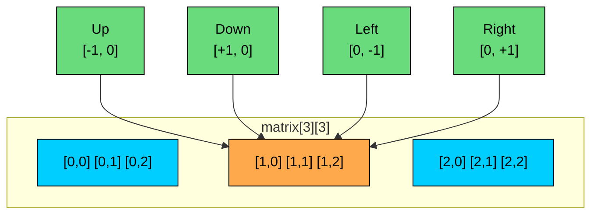
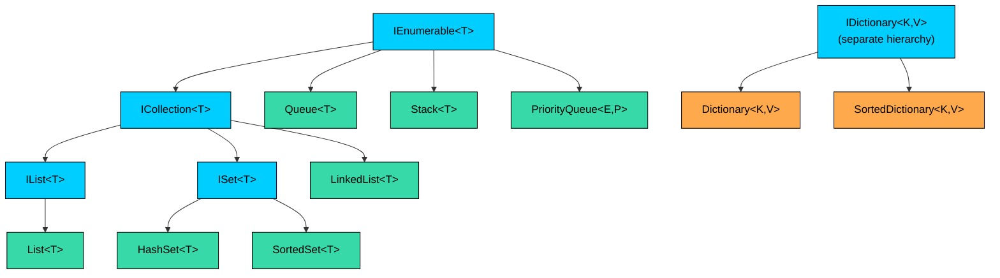
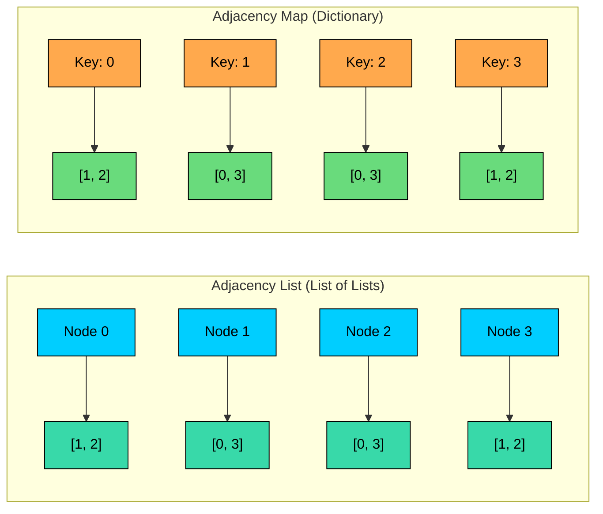
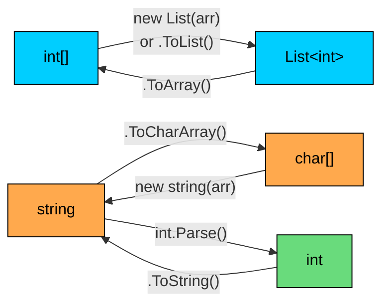

<LessonCard>

<IntroCard>

This chapter is a focused crash course on C# features that come up repeatedly in DSA and coding interviews. Instead of covering the entire language, we will concentrate only on the parts that matter for solving problems efficiently in interviews.

</IntroCard>

<h1 id="common-using-directives">Common Using Directives</h1>

On LeetCode, most namespaces are imported automatically. But when writing C# locally or on some interview platforms, you need to know what to include. Here are the using directives that cover 95% of DSA problems:

```csharp
using System;                    // Math, Array, String, Console
using System.Collections.Generic; // List, Dictionary, HashSet, Queue, Stack, PriorityQueue, etc.
using System.Linq;               // Min(), Max(), Sum(), OrderBy(), GroupBy(), etc.
using System.Text;               // StringBuilder
```

The `System.Collections.Generic` namespace contains heavily used types. It contains every collection commonly used in DSA. `System.Linq` adds query methods that can make your code more concise, though you should use them judiciously in performance-sensitive code. We will cover LINQ in its own section later.

In a real interview, write these at the top and move on.

<h1 id="variables-types-and-the-overflow-trap">
  Variables, Types, and the Overflow Trap
</h1>

C# is a statically typed language, which means every variable must have a declared type. For DSA, a small set of value types covers most problems.

| Type     | Size    | Range                       | DSA Use Case                                     |
| -------- | ------- | --------------------------- | ------------------------------------------------ |
| `int`    | 4 bytes | -2.1B to 2.1B               | Array indices, counters, most values             |
| `long`   | 8 bytes | -9.2 x 10^18 to 9.2 x 10^18 | Prefix sums, large products, overflow-prone math |
| `char`   | 2 bytes | 0 to 65,535                 | String characters, frequency arrays              |
| `bool`   | 1 byte  | `true` / `false`            | Visited arrays, flags                            |
| `double` | 8 bytes | ±1.7 x 10^308               | Rarely used, some geometry problems              |

C# also has the `var` keyword for implicit typing. The compiler infers the type from the right-hand side:

```csharp
var nums = new int[5];                    // int[]
var map = new Dictionary<string, int>();  // Dictionary<string, int>
var result = new List<List<int>>();        // List<List<int>>
```

Use `var` when the type is obvious from the assignment. It reduces verbosity without sacrificing readability, especially with long generic types like `Dictionary<string, List<int>>`.

The most dangerous pitfall with types is **integer overflow**. Consider the classic binary search:

```csharp
// BUG: if left + right > int.MaxValue, this overflows
int mid = (left + right) / 2;

// CORRECT: safe from overflow
int mid = left + (right - left) / 2;
```

This is not a theoretical concern. When `left` and `right` are both above 1 billion, their sum exceeds `int` range and wraps to a negative number. The safe version avoids this by computing the difference first.

C# has a unique feature here: the `checked` keyword. In a `checked` block, arithmetic overflow throws an `OverflowException` instead of silently wrapping:

```csharp
checked {
    int a = int.MaxValue;
    int b = a + 1; // Throws OverflowException at runtime
}
```

By default, C# arithmetic is `unchecked`, meaning it wraps silently on overflow. The `checked` keyword is useful for debugging but too slow for production DSA code. Know it exists, but rely on safe formulas instead.

When should you use `long` instead of `int`? Use `long` in these cases:

```csharp
// Overflow: 100000 * 99999 > int.MaxValue
int wrong = n * (n - 1);

// Safe: cast to long BEFORE multiplication
long correct = (long)n * (n - 1);

// WRONG: casting AFTER multiplication is too late, overflow already happened
long stillWrong = (long)(n * (n - 1));
```

The placement of the cast matters. `(long)n * (n - 1)` first promotes `n` to `long`, then performs `long` multiplication. But `(long)(n * (n - 1))` performs `int` multiplication first (which overflows), then casts the already-corrupted result to `long`.

**The ternary operator** is a compact alternative to if-else for inline decisions:

```csharp
int result = (a > b) ? a : b;  // Same as Math.Max(a, b)
string label = (count == 1) ? "item" : "items";
```

<h1 id="operators-and-control-flow">Operators and Control Flow</h1>

Most operators in C# work as you would expect, but a few deserve special attention for DSA.

**Modular arithmetic** with `%` appears in hashing, cyclic array problems, and math-heavy questions. Remember that C#'s `%` can return negative values for negative operands: `-7 % 3` gives `-1`, not `2`. To get a positive result, use `((n % m) + m) % m`.

Many problems ask you to return the result "modulo 10^9 + 7" to prevent overflow in the output. This is a standard pattern:

```csharp
const int MOD = 1_000_000_007;

// Apply modulo during computation, not just at the end
long result = 0;
for (int i = 0; i < n; i++) {
    result = (result + values[i]) % MOD;
}
return (int)result;
```

Note the underscore in `1_000_000_007`. C# allows underscores in numeric literals for readability. This is the same as writing `1000000007`, easier to read and verify.

**Bitwise operators** unlock an entire category of problems:

```csharp
// XOR trick: find the number that appears once (all others appear twice)
// nums = [4, 1, 2, 1, 2]
int single = 0;
foreach (int num in nums) {
    single ^= num;  // XOR cancels out duplicates
}
// single = 4
```

Key bitwise operators:

| Operator             | Symbol     | DSA Use                                                      |
| -------------------- | ---------- | ------------------------------------------------------------ |
| AND                  | `&`        | Masking, checking if bit is set: `(n & (1 &lt;&lt; i)) != 0` |
| OR                   | `\|`       | Setting bits: `n \| (1 &lt;&lt; i)`                          |
| XOR                  | `^`        | Finding unique elements, toggling bits                       |
| NOT                  | `~`        | Bit inversion                                                |
| Left shift           | `&lt;&lt;` | Multiply by powers of 2: `1 &lt;&lt; n` equals 2^n           |
| Right shift          | `>>`       | Divide by powers of 2 (arithmetic shift, preserves sign)     |
| Unsigned right shift | `>>>`      | Divide by powers of 2 (fills with 0, C# 11+)                 |

A common bit manipulation pattern is checking and setting individual bits, which shows up in problems using bitmasks to represent subsets:

```csharp
// Check if bit i is set
bool isSet = (mask & (1 << i)) != 0;

// Set bit i
mask = mask | (1 << i);

// Clear bit i
mask = mask & ~(1 << i);

// Toggle bit i
mask = mask ^ (1 << i);

// Count number of set bits
int count = BitOperations.PopCount((uint)mask); // System.Numerics
// Or without the import:
int count = Convert.ToString(mask, 2).Count(c => c == '1');
```

For bit counting, `BitOperations.PopCount` from `System.Numerics` is the most concise approach. It maps to a single CPU instruction on modern hardware.

**Control flow** in C# offers three loop forms. Use each where it fits:

```csharp
// Index-based for: when you need the index
for (int i = 0; i < nums.Length; i++) { ... }

// Backward traversal (used in some DP and stack problems)
for (int i = n - 1; i >= 0; i--) { ... }

// foreach: when you only need values
foreach (int num in nums) { ... }

// While: when the termination condition is not index-based
while (left < right) { ... }
```

One limitation to remember: the `foreach` loop does not give you the index, and you cannot modify the underlying collection while iterating. If you need the index or need to modify elements, use the standard `for` loop.

**Short-circuit evaluation** with `&&` and `||` is important for safety. C# evaluates left to right and stops as soon as the result is determined:

```csharp
// Safe: the second condition is only checked if the first is true
if (index < nums.Length && nums[index] == target) { ... }

// Without short-circuit, this would throw IndexOutOfRangeException
// when index >= nums.Length
```

<h1 id="methods-and-parameter-passing">Methods and Parameter Passing</h1>

In DSA problems, extracting logic into helper methods keeps the code clean. On LeetCode, your solution lives inside a class with instance or static methods.

```csharp
// Helper method for swapping elements in an array
private void Swap(int[] arr, int i, int j) {
    int temp = arr[i];
    arr[i] = arr[j];
    arr[j] = temp;
}
```

C# follows a convention of PascalCase for method names. Pick one style and stick with it.

C# passes value types (like `int`, `bool`, `char`) **by value** and reference types (like arrays, lists, classes) **by reference value**. This means:

This is why the `Swap` method above works: it modifies the array contents through the reference. But you cannot write a method that swaps two `int` variables without special keywords.

C# gives you two tools for this: `ref` and `out` parameters.

```csharp
// ref: pass by reference (variable must be initialized before the call)
private void SwapValues(ref int a, ref int b) {
    int temp = a;
    a = b;
    b = temp;
}

int x = 1, y = 2;
SwapValues(ref x, ref y); // x is now 2, y is now 1
```

```csharp
// out: like ref, but the variable does not need to be initialized before the call
// The method MUST assign a value before returning
private bool TryParse(string s, out int result) {
    // ... parsing logic ...
    result = 42;
    return true;
}

if (TryParse("42", out int value)) {
    // value is 42
}
```

The `out` pattern is used extensively in C#'s standard library, most notably in `Dictionary.TryGetValue()` which we will see in the collections section.

For DSA specifically, the pass-by-reference behavior of lists matters in recursive and backtracking problems. When you pass a `List` to a recursive call and add elements to it, those additions are visible to the caller. That is why the backtracking pattern works, adding and removing from a shared list as you explore different branches:

```csharp
private void Backtrack(List<int> path, List<List<int>> results) {
    if (IsComplete(path)) {
        results.Add(new List<int>(path)); // MUST copy, not add reference
        return;
    }
    foreach (int choice in choices) {
        path.Add(choice);          // Modify shared list
        Backtrack(path, results);  // Recurse with modified list
        path.RemoveAt(path.Count - 1); // Undo modification
    }
}
```

The `new List<int>(path)` when saving results creates a copy. If you wrote `results.Add(path)` instead, every entry in `results` would be a reference to the same list, and they would all end up empty after backtracking unwinds. This is a common bug in backtracking solutions.

**Variable scope** works the same as in most C-family languages. Variables declared inside a loop body exist only within that iteration:

```csharp
for (int i = 0; i < n; i++) {
    int temp = nums[i]; // temp is created and destroyed each iteration
}
// temp does not exist here
```

If you need a value to persist across iterations (like a running sum or a previous element), declare it before the loop.

<h1 id="arrays">Arrays</h1>

Arrays are the foundational data structure in C# and the starting point for almost every DSA problem.

```csharp
// Declaration and initialization
int[] nums = new int[5];            // [0, 0, 0, 0, 0] (defaults to 0)
int[] nums = {1, 2, 3, 4, 5};      // Literal initialization
bool[] visited = new bool[n];       // defaults to false
string[] words = new string[n];     // defaults to null
```

Default values matter and they differ by type:

| Array Type             | Default Value | DSA Significance                      |
| ---------------------- | ------------- | ------------------------------------- |
| `int[]`                | `0`           | Distance arrays, DP tables start at 0 |
| `long[]`               | `0L`          | Same, for large value computations    |
| `bool[]`               | `false`       | Visited arrays start as unvisited     |
| `char[]`               | `'\0'`        | Null character                        |
| `string[]`, `object[]` | `null`        | Must initialize before use            |

```csharp
int[] arr = {1, 2, 3};
arr.Length           // 3 (property)

string s = "hello";
s.Length             // 5 (property)

List<int> list = new List<int>();
list.Count           // 0 (property)
```

All three are properties (no parentheses). But the naming differs: arrays and strings use `Length`, while collections use `Count`.

**2D arrays** in C# come in two flavors:

```csharp
// Rectangular array (true 2D, single memory block)
int[,] matrix = new int[3, 4];
matrix[0, 0] = 1;
int rows = matrix.GetLength(0);  // 3
int cols = matrix.GetLength(1);  // 4

// Jagged array (array of arrays)
int[][] jagged = new int[3][];
for (int i = 0; i < 3; i++) {
    jagged[i] = new int[4];
}
jagged[0][0] = 1;
int rows = jagged.Length;        // 3
int cols = jagged[0].Length;     // 4
```

For DP problems, you often need a table with one extra row and column for the base case:

```csharp
// DP table with n+1 rows to handle 0-indexed base case
int[] dp = new int[n + 1];
int[][] dp = new int[m + 1][];
for (int i = 0; i <= m; i++) dp[i] = new int[n + 1];
```

The 4-directional neighbor pattern is common in matrix problems:

```csharp
int[][] directions = { new[]{-1, 0}, new[]{1, 0}, new[]{0, -1}, new[]{0, 1} };

foreach (int[] dir in directions) {
    int newRow = row + dir[0];
    int newCol = col + dir[1];
    if (newRow >= 0 && newRow < rows && newCol >= 0 && newCol < cols) {
        // Process neighbor
    }
}
```

For 8-directional movement (including diagonals), add the four diagonal pairs: ``{-1,-1}`, `{-1,1}`, `{1,-1}`, `{1,1}``.



The `Array` class provides static operations:

```csharp
Array.Sort(nums);                         // Sort in ascending order
Array.Fill(dist, int.MaxValue);           // Fill with a value
Array.Copy(nums, copy, nums.Length);      // Copy to another array
Array.Reverse(nums);                      // Reverse in place
int[] copy = (int[])nums.Clone();         // Shallow copy
```

```csharp
Array.Sort(nums, 1, 3); // Sort 3 elements starting at index 1
```

```csharp
int[] sorted = {1, 3, 5, 7, 9};
int index = Array.BinarySearch(sorted, 5);  // Returns 2
int missing = Array.BinarySearch(sorted, 4); // Returns -3 (bitwise complement of insertion point)
```

The return value for a missing element is the bitwise complement (`~`) of the index where it would be inserted. So `~missing` gives you the insertion point. This is useful but confusing, so writing your own binary search is often clearer.

`Array.Sort()` uses IntroSort for primitive types (a hybrid of Quicksort, Heapsort, and Insertion Sort) which guarantees O(n log n) worst case.

<h1 id="strings">Strings</h1>

Strings in C# are **immutable**. Every time you modify a string, C# creates a new object. This has a performance implication for DSA:

```csharp
// BAD: O(n^2) because each += creates a new string
string result = "";
foreach (char c in chars) {
    result += c;  // Creates a new string every iteration
}

// GOOD: O(n) with StringBuilder
var sb = new StringBuilder();
foreach (char c in chars) {
    sb.Append(c);
}
string result = sb.ToString();
```

```csharp
string a = "hello";
string b = string.Concat("hel", "lo");  // distinct instance (avoids interning)

a == b                  // true (C# overloads == to compare content)
a.Equals(b)             // also true
ReferenceEquals(a, b)   // false (they are different objects)
```

Both `==` and `.Equals()` work for content comparison.

Common string methods:

| Method                    | Returns    | Example              | DSA Use                                                |
| ------------------------- | ---------- | -------------------- | ------------------------------------------------------ |
| `s[i]`                    | `char`     | `s[0]`               | Access individual characters (indexer, not a method)   |
| `Length`                  | `int`      | `s.Length`           | Loop bounds (property, no parentheses)                 |
| `Substring(start, len)`   | `string`   | `s.Substring(0, 3)`  | Extract portions (start index, length, not end index!) |
| `ToCharArray()`           | `char[]`   | `s.ToCharArray()`    | When you need in-place modification                    |
| `Split(sep)`              | `string[]` | `s.Split(' ')`       | Tokenize strings                                       |
| `IndexOf(str)`            | `int`      | `s.IndexOf("ab")`    | Find substrings (-1 if not found)                      |
| `Equals(other)`           | `bool`     | `s.Equals(t)`        | Content comparison (same as ==)                        |
| `CompareTo(other)`        | `int`      | `s.CompareTo(t)`     | Lexicographic comparison                               |
| `Trim()`                  | `string`   | `s.Trim()`           | Remove leading/trailing whitespace                     |
| `string.IsNullOrEmpty(s)` | `bool`     |                      | Check for null or empty                                |
| `StartsWith(prefix)`      | `bool`     | `s.StartsWith("ab")` | Prefix check                                           |
| `Contains(seq)`           | `bool`     | `s.Contains("ab")`   | Substring check                                        |

**Watch out:** C#'s `Substring(startIndex, length)` takes a **length**, not an end index. Getting this wrong is a common bug:

```csharp
string s = "hello world";
s.Substring(0, 5)    // "hello" (start at 0, take 5 characters)
s.Substring(6, 5)    // "world" (start at 6, take 5 characters)
```

C# also supports range syntax with `..` (C# 8+) for slicing:

```csharp
string s = "hello world";
s[0..5]     // "hello"
s[6..]      // "world"
s[^5..]     // "world" (^5 means 5 from the end)
```

**StringBuilder** is your tool for building strings efficiently:

```csharp
var sb = new StringBuilder();
sb.Append("hello");        // Add to end
sb.Append(' ');             // Append char
sb.Insert(0, "say ");      // Insert at position
sb.Remove(0, 4);           // Remove 4 chars starting at index 0
sb.Replace('l', 'r');      // Replace all occurrences of a char
sb[2] = 'x';               // Direct character access via indexer
sb.Length;                  // Current length
string result = sb.ToString(); // Convert back to string
```

`StringBuilder` supports direct indexing with `sb[i]` for both reading and writing characters.

**Character utilities** come up in problems involving letter manipulation:

```csharp
char.IsLetterOrDigit(c)   // Alphanumeric check (valid palindrome)
char.IsLetter(c)           // Letter only
char.IsDigit(c)            // Digit only
char.IsUpper(c)            // Uppercase check
char.ToLower(c)            // Case conversion
char.ToUpper(c)            // Case conversion
c - 'a'                    // Map 'a'-'z' to 0-25 (frequency arrays)
c - '0'                    // Map '0'-'9' to 0-9 (digit extraction)
(char)('a' + index)        // Map 0-25 back to 'a'-'z'
```

The `c - 'a'` pattern works because characters are stored as numbers. Subtracting `'a'` from a lowercase letter gives its zero-based position. This is how you build frequency arrays without a `Dictionary`:

```csharp
// Frequency array for lowercase letters (26 slots)
int[] freq = new int[26];
foreach (char c in s) {
    freq[c - 'a']++;
}
// freq[0] = count of 'a', freq[1] = count of 'b', etc.
```

This is faster and more memory-efficient than `Dictionary<char, int>` when you know the character set is limited to lowercase (or uppercase, or digits).

<h1 id="collections-framework">Collections Framework</h1>

The `System.Collections.Generic` namespace provides the data structures used in nearly every DSA problem. Choosing the right collection is often the difference between an O(n) and an O(n^2) solution.



<h3 id="listt-dynamic-arrays">List\<T\>: Dynamic Arrays</h3>

When you do not know the size upfront, or need to build a result list, `List<T>` is your go-to:

```csharp
List<int> result = new List<int>();
result.Add(42);            // Append: O(1) amortized
result[0];                 // Access by index: O(1)
result[0] = 99;            // Update by index: O(1)
result.Count;              // Current size
result.Contains(42);       // Search: O(n)
result.RemoveAt(0);        // Remove by index: O(n) (shifts elements)
result.Remove(42);         // Remove first occurrence of value: O(n)
result.Insert(0, 10);      // Insert at index: O(n) (shifts elements)
result.IndexOf(42);        // Find index of value: O(n), returns -1 if not found
```

`RemoveAt` removes by index, `Remove` removes by value. The naming is clear: there is no ambiguity between the two.

A common pattern is building a list of lists for results like permutations or combinations:

```csharp
List<List<int>> results = new List<List<int>>();
results.Add(new List<int>(currentPath)); // Add a COPY of current state
```

**Useful List methods:**

```csharp
list.Sort();                      // Sort ascending in place
list.Reverse();                   // Reverse in place
list.ToArray();                   // Convert to array
list.AddRange(otherList);         // Append all elements from another collection
list.RemoveAll(x =&gt; x % 2 == 0); // Remove all even numbers (predicate)
list.BinarySearch(target);        // Binary search (list must be sorted)
```

<h3 id="dictionarytkey-tvalue-o1-lookups">Dictionary\<TKey, TValue\>: O(1) Lookups</h3>

`Dictionary` appears in most DSA problems. It provides O(1) average-case lookups, inserts, and deletes.

```csharp
// Frequency counting: the most common Dictionary pattern
var freq = new Dictionary<char, int>();
foreach (char c in s) {
    if (freq.ContainsKey(c))
        freq[c]++;
    else
        freq[c] = 1;
}

// Shorter with TryGetValue
foreach (char c in s) {
    freq.TryGetValue(c, out int count);
    freq[c] = count + 1;
}
```

The `TryGetValue` pattern is a C# idiom you should know well. It attempts to get the value and returns `false` if the key does not exist, without throwing an exception. When the key is missing, the `out` variable gets the default value for the type (`0` for `int`, `null` for reference types):

```csharp
var map = new Dictionary<string, int>();

// DANGEROUS: throws KeyNotFoundException if key is missing
int val = map["missing"]; // Throws!

// SAFE: TryGetValue returns false if key is missing
if (map.TryGetValue("missing", out int value)) {
    // key exists, value is set
} else {
    // key does not exist, value is 0 (default for int)
}

// Also safe: ContainsKey check first
if (map.ContainsKey("key")) {
    int val = map["key"];
}
```

Iterating over a dictionary:

```csharp
// Iterate over all entries (KeyValuePair)
foreach (var kvp in freq) {
    char key = kvp.Key;
    int value = kvp.Value;
}

// Deconstruct into key and value (C# 7+)
foreach (var (key, value) in freq) {
    // use key and value directly
}

// Iterate over keys only
foreach (char key in freq.Keys) { ... }

// Iterate over values only
foreach (int value in freq.Values) { ... }
```

The deconstruction syntax `var (key, value)` is more concise than `kvp.Key` and `kvp.Value`. Use it when you need both.

<h3 id="hashsett-o1-membership-testing">HashSet\<T\>: O(1) Membership Testing</h3>

```csharp
var visited = new HashSet<int>();
visited.Add(node);           // Returns true if newly added, false if already present
visited.Contains(node);      // O(1) lookup
visited.Remove(node);        // O(1) removal
visited.Count;               // Number of elements
```

`Add()` returns a boolean telling you whether the element was newly added (i.e., was not already present). This lets you detect duplicates in a single operation:

```csharp
var seen = new HashSet<int>();
foreach (int num in nums) {
    if (!seen.Add(num)) {
        // num is a duplicate
    }
}
```

`HashSet<T>` also supports set operations:

```csharp
var setA = new HashSet<int> {1, 2, 3, 4};
var setB = new HashSet<int> {3, 4, 5, 6};

setA.IntersectWith(setB);    // setA = {3, 4}
setA.UnionWith(setB);        // setA = {1, 2, 3, 4, 5, 6}
setA.ExceptWith(setB);       // setA = {1, 2} (elements in A but not in B)
setA.IsSubsetOf(setB);       // bool
setA.Overlaps(setB);         // true if any element in common
```

<h3 id="sorteddictionary-and-sortedset-sorted-collections">
  SortedDictionary and SortedSet: Sorted Collections
</h3>

When you need keys in sorted order, `SortedDictionary` and `SortedSet` provide O(log n) operations backed by a red-black tree.

```csharp
var map = new SortedDictionary<int, int>();
map[5] = 10;
map[1] = 20;
map[10] = 30;

// Iterate in sorted order of keys
foreach (var kvp in map) {
    // Keys come out as 1, 5, 10
}

// First and last keys
int firstKey = map.Keys.First();  // 1 (requires System.Linq)
int lastKey = map.Keys.Last();    // 10
```

However, `SortedDictionary` lacks direct floor/ceiling/lower/higher key navigation methods. For these operations, use `SortedSet<T>` which has `GetViewBetween()`, or consider a different approach.

`SortedSet<T>` provides richer navigation:

```csharp
var set = new SortedSet<int> {1, 3, 5, 7, 9};

set.Min;                          // 1 (smallest element)
set.Max;                          // 9 (largest element)
set.GetViewBetween(3, 7);        // {3, 5, 7} (inclusive range)
set.Count;                        // 5
```

For true floor/ceiling operations, you can use LINQ or write helper methods:

```csharp
var set = new SortedSet<int> {1, 3, 5, 7, 9};

// Floor: largest element &lt;= target
// Ceiling: smallest element &ge; target
int? floor = set.GetViewBetween(set.Min, 6).Max;  // 5
int? ceiling = set.GetViewBetween(6, set.Max).Min; // 7
```

<h3 id="queuet-bfs-foundation">Queue\<T\>: BFS Foundation</h3>

Every BFS implementation starts with a queue:

```csharp
var queue = new Queue<int[]>();
queue.Enqueue(new int[]{startRow, startCol}); // Enqueue
while (queue.Count > 0) {
    int size = queue.Count;  // Capture size for level-order traversal
    for (int i = 0; i &lt; size; i++) {
        int[] cell = queue.Dequeue();          // Dequeue
        // Process cell, add neighbors
        queue.Enqueue(new int[]{newRow, newCol});
    }
}
```

C# uses `Enqueue` and `Dequeue` for queue operations. The methods throw `InvalidOperationException` if you try to dequeue from an empty queue, so always check `queue.Count > 0` first. Use `queue.Peek()` to view the front element without removing it.

The `queue.Count` capture before the inner loop is a common pattern for level-order BFS, where you need to process all nodes at the current level before moving to the next.

<h3 id="stackt-lifo-operations">Stack\<T\>: LIFO Operations</h3>

C#'s `Stack<T>` is the standard LIFO collection:

```csharp
var stack = new Stack<int>();
stack.Push(42);       // Push to top
stack.Pop();          // Remove and return top (throws if empty)
stack.Peek();         // View top without removing (throws if empty)
stack.Count;          // Number of elements
stack.Contains(42);   // O(n) search
```

Always check `stack.Count > 0` before calling `Pop()` or `Peek()` to avoid exceptions.

<h3 id="linkedlistt-double-ended-operations">LinkedList\<T\>: Double-Ended Operations</h3>

`LinkedList<T>` in C# is a doubly-linked list that supports efficient operations at both ends, making it useful as a deque:

```csharp
var deque = new LinkedList<int>();
deque.AddFirst(1);       // Add to front: O(1)
deque.AddLast(2);        // Add to back: O(1)
deque.RemoveFirst();     // Remove from front: O(1)
deque.RemoveLast();      // Remove from back: O(1)
deque.First.Value;       // View front
deque.Last.Value;        // View back
deque.Count;             // Number of elements
```

This is useful for sliding window maximum and monotonic deque problems where you need to add/remove from both ends.

<h3 id="priorityqueuetelement-tpriority-heaps">PriorityQueue\<TElement, TPriority\>: Heaps</h3>

`PriorityQueue` was added in .NET 6 and separates the element from its priority. You enqueue both, and the queue dequeues the element with the smallest priority first.

```csharp
// Min-heap (default): smallest priority comes out first
var minHeap = new PriorityQueue<int, int>();
minHeap.Enqueue(42, 42);       // Enqueue element with priority
minHeap.Dequeue();             // Remove and return element with smallest priority
minHeap.Peek();                // View element with smallest priority
minHeap.Count;                 // Number of elements

// For DSA, element and priority are often the same value
minHeap.Enqueue(value, value);
```

**Making a max-heap** requires extra work because there is no built-in reverse comparator. You have three options:

```csharp
// Option 1: Negate the priority (works for numeric types)
var maxHeap = new PriorityQueue<int, int>();
maxHeap.Enqueue(42, -42);  // Negate priority to flip ordering

// Option 2: Custom comparer
var maxHeap = new PriorityQueue<int, int>(Comparer<int>.Create((a, b) => b.CompareTo(a)));
maxHeap.Enqueue(42, 42);   // Now largest priority comes out first

// Option 3: For complex objects, negate in the priority parameter
// Dijkstra example: process closest nodes first
var pq = new PriorityQueue<int, int>(); // (node, distance)
pq.Enqueue(startNode, 0);
```

For most DSA problems, Option 1 (negating the priority) is the simplest and fastest approach. Option 2 reads more clearly when you want explicit ordering.

C#'s `PriorityQueue` does not support decreasing an element's priority (there is no decrease-key operation) or removing arbitrary elements efficiently. It does have an `EnqueueDequeue` method that is useful for maintaining a fixed-size heap (like top-K problems). For problems that need priority updates (like Dijkstra), re-enqueue the node with its new priority and skip stale entries when dequeuing by checking whether the node was already finalized.

<h3 id="collections-quick-reference">Collections Quick Reference</h3>

| Collection    | C# Type                 | Key Methods                           | Time Complexity    | DSA Use Case                 |
| ------------- | ----------------------- | ------------------------------------- | ------------------ | ---------------------------- |
| Dynamic Array | `List<T>`               | `Add`, `[]`, `RemoveAt`, `Count`      | O(1) get, O(1) add | Result lists, dynamic arrays |
| Hash Map      | `Dictionary<K,V>`       | `[]`, `TryGetValue`, `ContainsKey`    | O(1) average       | Frequency counting, lookups  |
| Hash Set      | `HashSet<T>`            | `Add`, `Contains`, `Remove`           | O(1) average       | Visited tracking, duplicates |
| Sorted Map    | `SortedDictionary<K,V>` | `[]`, `Keys`, `ContainsKey`           | O(log n)           | Sorted access, range queries |
| Sorted Set    | `SortedSet<T>`          | `Add`, `Min`, `Max`, `GetViewBetween` | O(log n)           | Sorted unique elements       |
| Queue         | `Queue<T>`              | `Enqueue`, `Dequeue`, `Peek`          | O(1)               | BFS queues                   |
| Stack         | `Stack<T>`              | `Push`, `Pop`, `Peek`                 | O(1)               | DFS, monotonic stack         |
| Linked List   | `LinkedList<T>`         | `AddFirst`, `AddLast`, `RemoveFirst`  | O(1) ends          | Deque, sliding window        |
| Heap          | `PriorityQueue<E,P>`    | `Enqueue`, `Dequeue`, `Peek`          | O(log n) enq/deq   | Top-K, Dijkstra              |

<h1 id="sorting-and-comparators">Sorting and Comparators</h1>

Sorting is a prerequisite for many algorithms: binary search, two pointers on sorted arrays, merge intervals, and greedy approaches.

```csharp
// Sort primitive array
int[] nums = {3, 1, 4, 1, 5};
Array.Sort(nums); // [1, 1, 3, 4, 5]

// Sort a portion of an array (start index 1, count 3)
Array.Sort(nums, 1, 3);

// Sort a list
var list = new List<int> {3, 1, 4};
list.Sort();
```

For custom sorting, C# uses `Comparison<T>` delegates. The delegate receives two elements and returns a negative number if the first should come before the second, zero if they are equal, and a positive number if the first should come after:

```csharp
// Sort intervals by start time (merge intervals pattern)
int[][] intervals = new int[][] { new[]{1,3}, new[]{2,6}, new[]{8,10} };
Array.Sort(intervals, (a, b) => a[0].CompareTo(b[0]));

// Sort strings by length, then alphabetically for ties
Array.Sort(words, (a, b) => {
    if (a.Length != b.Length) return a.Length.CompareTo(b.Length);
    return a.CompareTo(b);
});

// Sort a List with a lambda
list.Sort((a, b) => a.CompareTo(b));
```

For descending order:

```csharp
// Sort array in descending order (two steps for primitive arrays)
Array.Sort(nums);
Array.Reverse(nums);

// Sort list descending with comparator
list.Sort((a, b) => b.CompareTo(a)); // Note: b.CompareTo(a), not a.CompareTo(b)

// For object arrays, use a reverse comparer
string[] words = {"banana", "apple", "cherry"};
Array.Sort(words, Comparer<string>.Create((a, b) => b.CompareTo(a)));
```

The pattern for descending order is either sort-then-reverse for arrays, or flip the comparison in the lambda.

<h1 id="linq-essentials-for-dsa">LINQ Essentials for DSA</h1>

LINQ (Language Integrated Query) is a C#-specific feature that adds query operations to collections. It can make certain DSA patterns significantly more concise, but you need to know when it helps and when it hurts.

**Useful LINQ methods for DSA:**

```csharp
using System.Linq;

int[] nums = {3, 1, 4, 1, 5, 9, 2, 6};

// Aggregation
nums.Min()                     // 1
nums.Max()                     // 9
nums.Sum()                     // 31
nums.Average()                 // 3.875

// Filtering and transformation
nums.Where(x =&gt; x > 3)        // {4, 5, 9, 6} (lazy, returns IEnumerable)
nums.Select(x =&gt; x * 2)       // {6, 2, 8, 2, 10, 18, 4, 12}
nums.Distinct()                // {3, 1, 4, 5, 9, 2, 6}

// Sorting
nums.OrderBy(x =&gt; x)          // ascending
nums.OrderByDescending(x =&gt; x) // descending
nums.OrderBy(x =&gt; x % 2).ThenBy(x =&gt; x) // evens first, then odds, each ascending

// Conversion
nums.ToList()                  // Convert to List<int>
nums.ToArray()                 // Convert to int[]
nums.ToHashSet()               // Convert to HashSet<int>

// Grouping (useful for anagram grouping problems)
string[] words = {"eat", "tea", "tan", "ate", "nat", "bat"};
var groups = words.GroupBy(w => new string(w.OrderBy(c => c).ToArray()));
// Groups: "aet" -> ["eat", "tea", "ate"], "ant" -> ["tan", "nat"], "abt" -> ["bat"]

// Zip (combine two sequences element-by-element)
int[] a = {1, 2, 3};
int[] b = {4, 5, 6};
var zipped = a.Zip(b, (x, y) =&gt; x + y); // {5, 7, 9}
```

**When to use LINQ in DSA:**

**When to avoid LINQ in DSA:**

```csharp
// LINQ: clean but allocates an iterator
int maxVal = nums.Max();

// Manual: slightly more verbose but zero allocation
int maxVal = int.MinValue;
foreach (int num in nums) {
    maxVal = Math.Max(maxVal, num);
}
```

For most interview problems, the performance difference is negligible. Use LINQ when it makes your code shorter, but be prepared to explain the trade-off if asked.

<h1 id="null-handling">Null Handling</h1>

`null` is a source of many runtime errors in C#. In DSA, you encounter it primarily in three situations: tree/linked list problems, dictionary lookups, and uninitialized reference type arrays.

**Rule 1: Always check for null before accessing fields or calling methods on an object.**

```csharp
// Tree traversal: always check for null children
if (node.Left != null) {
    queue.Enqueue(node.Left);
}

// Linked list: check before advancing
while (current != null) {
    // process current
    current = current.Next;
}
```

```csharp
// Dangerous: throws KeyNotFoundException if key missing
int count = map["key"];

// Safe: returns false if key missing, value gets default(int) = 0
map.TryGetValue("key", out int count);
```

**Rule 3: Use C#'s null-safety operators.**

C# provides null-handling operators that simplify common patterns:

```csharp
// Null-conditional operator (?.)
// Returns null if the left side is null, instead of throwing
int? length = node?.Left?.Right?.Val;

// Null-coalescing operator (??)
// Returns the left side if not null, otherwise the right side
string name = input ?? "default";
// ?? only works with nullable types. For int values, see TryGetValue above

// Null-coalescing assignment (??=)
// Assigns only if the left side is null
node.Left ??= new TreeNode(0);
```

**Rule 4: Combine null and empty checks.**

```csharp
if (nums == null || nums.Length == 0) return new int[0];
if (string.IsNullOrEmpty(s)) return "";
```

These checks at the top of your solution handle edge cases cleanly. They short-circuit on empty or null input so the rest of the method can assume valid data. `string.IsNullOrEmpty()` is a C# convenience that checks both conditions in one call.

**Nullable value types** use `?` syntax:

```csharp
int? result = null;   // Nullable int
if (result.HasValue) {
    int actual = result.Value;
}
int actual = result ?? -1;  // Use -1 if null
```

This is useful when you need to distinguish between "no value" and "zero" (e.g., a function that returns the index of a found element, or null if not found).

<h1 id="iterating-and-modifying-collections-safely">
  Iterating and Modifying Collections Safely
</h1>

One of C#'s most common runtime errors is `InvalidOperationException` with the message "Collection was modified; enumeration operation may not execute." This is thrown when you modify a collection while iterating over it with a `foreach` loop:

```csharp
// WRONG: throws InvalidOperationException
var list = new List<int> {1, 2, 3, 4, 5};
foreach (int num in list) {
    if (num % 2 == 0) {
        list.Remove(num);
    }
}
```

There are three safe alternatives:

```csharp
// Option 1: Iterate backward with index-based loop
for (int i = list.Count - 1; i >= 0; i--) {
    if (list[i] % 2 == 0) {
        list.RemoveAt(i);
    }
}

// Option 2: Collect items to remove, then remove after the loop
var toRemove = new List<int>();
foreach (int num in list) {
    if (num % 2 == 0) toRemove.Add(num);
}
foreach (int num in toRemove) list.Remove(num);

// Option 3: Use RemoveAll with a predicate (most concise for List<T>)
list.RemoveAll(num => num % 2 == 0);
```

Option 3 is idiomatic for `List<T>`. It is a single line, efficient (O(n)), and reads clearly.

For `HashSet` and `Dictionary`, the same rules apply. If you need to remove entries while iterating, collect the keys first, then remove:

```csharp
var keysToRemove = new List<string>();
foreach (var kvp in dictionary) {
    if (ShouldRemove(kvp.Value)) keysToRemove.Add(kvp.Key);
}
foreach (string key in keysToRemove) dictionary.Remove(key);
```

In practice though, most DSA problems do not require removing during iteration. You are far more likely to build a new collection with the desired elements.

<h1 id="recursion-and-the-call-stack">Recursion and the Call Stack</h1>

Recursion underlies tree traversal, graph DFS, backtracking, and divide-and-conquer. It helps to know how C# handles it.

Every method call in C# goes on the **call stack**, which has limited space (typically 1 MB by default on Windows, which translates to a few thousand frames depending on frame size). If your recursion goes too deep, you get a `StackOverflowException`:

```csharp
// This will crash for large n (the exact limit depends on stack
// size and frame size, often around 10,000 to 50,000)
int Factorial(int n) {
    if (n <= 1) return 1;
    return n * Factorial(n - 1);
}
```

**When to worry about stack depth:**

| Scenario                            | Typical Depth | Risk                          |
| ----------------------------------- | ------------- | ----------------------------- |
| Balanced binary tree (n nodes)      | O(log n)      | Safe for n up to 10^6         |
| Linked list / skewed tree (n nodes) | O(n)          | Dangerous if n > 5,000-10,000 |
| Backtracking (k choices, depth d)   | O(d)          | Usually safe (d is small)     |
| DFS on graph (n nodes)              | O(n)          | Dangerous for large n         |

**The fix:** Convert deep recursion to an iterative approach using an explicit stack:

```csharp
// Recursive DFS (risks stack overflow for deep graphs)
void Dfs(int node, bool[] visited) {
    visited[node] = true;
    foreach (int neighbor in graph[node]) {
        if (!visited[neighbor]) Dfs(neighbor, visited);
    }
}

// Iterative DFS (safe for any depth)
void Dfs(int start, bool[] visited) {
    var stack = new Stack<int>();
    stack.Push(start);
    while (stack.Count > 0) {
        int node = stack.Pop();
        if (visited[node]) continue;
        visited[node] = true;
        foreach (int neighbor in graph[node]) {
            if (!visited[neighbor]) stack.Push(neighbor);
        }
    }
}
```

Note that C# does **not** optimize tail recursion in the standard runtime (though the JIT compiler can sometimes do it in specific cases). If your recursion depth is proportional to input size and the input can be large, convert to iteration.

<h1 id="graph-representation-patterns">Graph Representation Patterns</h1>

Graphs appear in a large portion of DSA problems. C# does not have a built-in graph class, so you need to build representations yourself. There are two common approaches:

```csharp
int n = 5; // number of nodes
var graph = new List<List<int>>();
for (int i = 0; i < n; i++) {
    graph.Add(new List<int>());
}

// Add edges
foreach (int[] edge in edges) {
    graph[edge[0]].Add(edge[1]);
    graph[edge[1]].Add(edge[0]); // Omit for directed graphs
}

// Access neighbors
foreach (int neighbor in graph[node]) { ... }
```

```csharp
var graph = new Dictionary<int, List<int>>();
foreach (int[] edge in edges) {
    if (!graph.ContainsKey(edge[0])) graph[edge[0]] = new List<int>();
    if (!graph.ContainsKey(edge[1])) graph[edge[1]] = new List<int>();
    graph[edge[0]].Add(edge[1]);
    graph[edge[1]].Add(edge[0]);
}

// Access neighbors (with safety check)
if (graph.TryGetValue(node, out var neighbors)) {
    foreach (int neighbor in neighbors) { ... }
}
```

A shorter version using `TryGetValue` for building:

```csharp
foreach (int[] edge in edges) {
    if (!graph.TryGetValue(edge[0], out var list0)) {
        list0 = new List<int>();
        graph[edge[0]] = list0;
    }
    list0.Add(edge[1]);
}
```

**Weighted graphs** use tuples or `int[]` to store neighbor and weight:

```csharp
// Adjacency list for weighted graph using tuples
var graph = new List<List<(int node, int weight)>>();
for (int i = 0; i < n; i++) graph.Add(new List<(int, int)>());

graph[from].Add((to, weight));

// Used in Dijkstra:
var pq = new PriorityQueue<int, int>(); // (node, distance as priority)
pq.Enqueue(startNode, 0);
```



| Approach                     | Pros                                   | Cons                                | Use When                                   |
| ---------------------------- | -------------------------------------- | ----------------------------------- | ------------------------------------------ |
| `List<List<int>>`            | Fast index access, no hashing overhead | Wastes space if node IDs are sparse | Nodes are 0 to n-1                         |
| `Dictionary<int, List<int>>` | Handles any node IDs, no wasted space  | Slightly slower due to hashing      | Node IDs are large, sparse, or non-numeric |

<h1 id="tuples-and-valuetuple">Tuples and ValueTuple</h1>

C# has built-in tuple support with named fields, value equality, and the ability to use them as dictionary keys, all out of the box.

**Basic tuple syntax:**

```csharp
// Creating tuples
(int row, int col) cell = (0, 1);
var pair = (5, 10);        // Unnamed tuple
var named = (x: 3, y: 4); // Named tuple

// Accessing fields
int r = cell.row;   // Named access
int c = cell.col;
int a = pair.Item1;  // Default names when unnamed
int b = pair.Item2;
```

**Tuples as dictionary keys** (a common DSA pattern):

```csharp
// Track visited states in BFS with multiple dimensions
var visited = new HashSet<(int row, int col)>();
visited.Add((0, 0));
if (visited.Contains((newRow, newCol))) { ... }

// Memoization with multiple parameters
var memo = new Dictionary<(int index, int remaining), int>();
if (memo.TryGetValue((i, k), out int cached)) return cached;
memo[(i, k)] = result;
```

Tuples give you value-based hashing and equality out of the box, so they work directly as dictionary keys without writing a custom equality implementation.

**Tuple deconstruction:**

```csharp
// Deconstruct into individual variables
var (row, col) = queue.Dequeue();

// Deconstruct in foreach
foreach (var (key, value) in dictionary) {
    // use key and value directly
}

// Swap two variables using tuple deconstruction
(a, b) = (b, a);  // No temp variable needed!
```

That last pattern, swapping via tuple deconstruction, replaces the three-line temp variable swap with a single line.

**Tuple comparison** uses value equality (compares each field):

```csharp
(1, 2) == (1, 2)  // true (value equality)
(1, 2) == (1, 3)  // false
```

**Using tuples in priority queues:**

```csharp
// Dijkstra with tuple: (node, distance)
var pq = new PriorityQueue<(int node, int dist), int>();
pq.Enqueue((startNode, 0), 0); // element, priority

// BFS with state: (row, col, steps)
var queue = new Queue<(int row, int col, int steps)>();
queue.Enqueue((0, 0, 0));
var (r, c, steps) = queue.Dequeue();
```

<h1 id="deduplication-patterns">Deduplication Patterns</h1>

Many DSA problems require avoiding duplicate results (e.g., 3Sum, 4Sum, permutations with duplicates). C# offers two approaches:

**Approach 1: Sort and skip duplicates (preferred for sorted array problems)**

```csharp
Array.Sort(nums);
for (int i = 0; i < nums.Length; i++) {
    // Skip duplicates: if this value is the same as the previous, skip it
    if (i > 0 && nums[i] == nums[i - 1]) continue;
    // Process nums[i]
}
```

This is the standard approach for problems like 3Sum and 4Sum. It runs in O(1) extra space (beyond the sort) and produces results in sorted order.

**Approach 2: Use a HashSet to collect unique results**

```csharp
var resultSet = new HashSet<(int, int, int)>(); // Tuples have value equality!
// ... generate candidates ...
resultSet.Add((a, b, c)); // Duplicates are automatically ignored
return resultSet.Select(t => new List<int> {t.Item1, t.Item2, t.Item3}).ToList();
```

C# tuples work well here. Because tuples have value equality, you can put them directly in a `HashSet` for deduplication.

<h1 id="common-dsa-idioms-in-c">Common DSA Idioms in C#</h1>

This section collects the small patterns and utility calls that come up repeatedly across problems.

**Swapping elements:**

```csharp
// Traditional swap
int temp = arr[i];
arr[i] = arr[j];
arr[j] = temp;

// Tuple swap (shorter)
(arr[i], arr[j]) = (arr[j], arr[i]);
```

The tuple swap is a C# exclusive that makes your code shorter and less error-prone.

**Sentinel values** for tracking min/max:

```csharp
int minVal = int.MaxValue;   // 2,147,483,647
int maxVal = int.MinValue;   // -2,147,483,648
foreach (int num in nums) {
    minVal = Math.Min(minVal, num);
    maxVal = Math.Max(maxVal, num);
}
```

Be careful with `int.MinValue`. Negating it (`-int.MinValue`) overflows because the positive range is one less than the negative range. If you need to negate values that might be `int.MinValue`, use `long`.

**Math utilities:**

```csharp
Math.Max(a, b);              // Larger of two values
Math.Min(a, b);              // Smaller of two values
Math.Abs(a);                 // Absolute value (careful with MinValue)
(int)Math.Pow(2, 10);       // Power (returns double, cast to int)
Math.Sqrt(n);                // Square root (returns double)
Math.Log(n);                 // Natural logarithm
Math.Ceiling(a / (double)b); // Ceiling division (cast to double first!)
```

**Ceiling division** without floating point:

```csharp
// Integer ceiling division: ceil(a / b) for positive a, b
int ceil = (a + b - 1) / b;
// Or equivalently:
int ceil = (a - 1) / b + 1;
```

**Type conversions:**

```csharp
// int[] to List<int>
List<int> list = new List<int>(nums); // Constructor accepts IEnumerable
// Or with LINQ:
List<int> list = nums.ToList();

// List<int> to int[]
int[] arr = list.ToArray();

// string <-> char[]
char[] chars = str.ToCharArray();
string str = new string(chars);

// string <-> int
int num = int.Parse("42");
string str = 42.ToString();
// Safe parsing:
if (int.TryParse("42", out int result)) { ... }

// int <-> long
long big = (long)smallInt;
int small = (int)bigLong;  // Careful: truncates if value exceeds int range
```



Converting between `int[]` and `List<int>` is straightforward in C#. The `List<int>` constructor directly accepts arrays, and `.ToList()` / `.ToArray()` handle the reverse. No manual loops needed.

**Deep copy vs shallow copy:**

When you add a list to another list, you are adding a reference. If the original list changes later, the "copy" changes too:

```csharp
var path = new List<int> {1, 2};
var results = new List<List<int>>();

results.Add(path);              // BAD: adds reference
path.Add(3);
// results[0] now contains [1, 2, 3], not [1, 2]

results.Add(new List<int>(path)); // GOOD: adds a copy
```

For arrays, use `Clone()` or `Array.Copy()`:

```csharp
int[] copy = (int[])original.Clone();
// Or:
int[] copy = new int[original.Length];
Array.Copy(original, copy, original.Length);
```

For 2D jagged arrays, `Clone()` only copies the outer array. The inner arrays are still shared references. You need a manual deep copy:

```csharp
int[][] deepCopy = new int[matrix.Length][];
for (int i = 0; i < matrix.Length; i++) {
    deepCopy[i] = (int[])matrix[i].Clone();
}
```

<h1 id="oop-basics-for-dsa">OOP Basics for DSA</h1>

DSA problems often define custom node classes. These definitions appear throughout the course:

```csharp
// Linked list node
public class ListNode {
    public int val;
    public ListNode next;

    public ListNode(int val = 0, ListNode next = null) {
        this.val = val;
        this.next = next;
    }
}

// Binary tree node
public class TreeNode {
    public int val;
    public TreeNode left;
    public TreeNode right;

    public TreeNode(int val = 0, TreeNode left = null, TreeNode right = null) {
        this.val = val;
        this.left = left;
        this.right = right;
    }
}

// Graph node with neighbors
public class Node {
    public int val;
    public IList<Node> neighbors;

    public Node(int val = 0) {
        this.val = val;
        this.neighbors = new List<Node>();
    }
}

// Trie node
public class TrieNode {
    public TrieNode[] children;
    public bool isEndOfWord;

    public TrieNode() {
        this.children = new TrieNode[26]; // For lowercase a-z
        this.isEndOfWord = false;
    }
}
```

The `public` keyword on fields makes them accessible from anywhere. In production C#, you would use properties with getters and setters, but for DSA, public fields are standard practice. You are not building production software here. You are solving problems under time pressure, and the overhead of encapsulation adds no value.

C# supports **default parameter values** in constructors (like `val = 0, next = null`), which reduces the need for constructor overloading. One constructor can handle multiple call patterns.

LeetCode often provides these node definitions. The default parameter constructor is handy for building data structures concisely:

```csharp
// Build list: 1 -> 2 -> 3 -> null
ListNode head = new ListNode(1, new ListNode(2, new ListNode(3)));
```

<CommentsSection />

</LessonCard>
