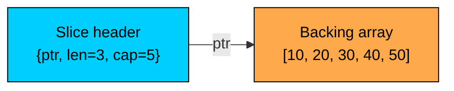

<LessonCard>

<IntroCard>

This chapter is a focused crash course on the Go features that come up repeatedly in DSA and coding interview preparation. Instead of covering the entire language, we will concentrate only on the parts that matter for solving problems efficiently in interviews.

</IntroCard>

<h1 id="common-imports">Common Imports</h1>

On LeetCode, your `package main` is set up for you and most standard library packages are available. You only need to import what your solution uses. Here are the packages that cover almost every DSA problem:

```go
import (
    "fmt"           // Formatted I/O (rarely needed on LeetCode)
    "sort"          // sort.Ints, sort.Slice, sort.Search
    "strings"       // Builder, Split, Join, Contains, Index
    "strconv"       // Atoi, Itoa, ParseInt
    "math"          // MaxInt, MinInt, Abs, Pow, Sqrt
    "math/bits"     // OnesCount, LeadingZeros, TrailingZeros
    "container/heap" // Heap interface for priority queues
    "container/list" // Doubly linked list (rarely needed)
)
```

Most DSA solutions need only three or four packages. Unused imports are compile errors in Go, so remove anything you do not use. Goimports and gofmt handle this automatically in a real editor, but on LeetCode you have to manage it by hand.

<h1 id="variables-types-and-the-overflow-trap">
  Variables, Types, and the Overflow Trap
</h1>

Go is a statically typed language with type inference using `:=`. For DSA, a small set of types covers most problems.

| Type                       | Size                                                 | Range                       | DSA Use Case                        |
| -------------------------- | ---------------------------------------------------- | --------------------------- | ----------------------------------- |
| `int`                      | platform-dependent (almost always 8 bytes on 64-bit) | -9.2 x 10^18 to 9.2 x 10^18 | Default integer for everything      |
| `int32`                    | 4 bytes                                              | -2.1B to 2.1B               | When you need exactly 32 bits       |
| `int64`                    | 8 bytes                                              | -9.2 x 10^18 to 9.2 x 10^18 | Explicit 64-bit math                |
| `byte` (alias for `uint8`) | 1 byte                                               | 0 to 255                    | ASCII characters, raw bytes         |
| `rune` (alias for `int32`) | 4 bytes                                              | -2.1B to 2.1B               | Unicode code points                 |
| `bool`                     | 1 byte                                               | `true` / `false`            | Visited arrays, flags               |
| `float64`                  | 8 bytes                                              | ±1.7 x 10^308               | Rarely used, some geometry problems |

Go's `int` is platform-dependent, but on every machine that runs LeetCode it is 64-bit. This makes overflow far less common than in many other languages because most DSA problems stay well under 2^63 - 1. Even so, two cases still need care:

```go
// Standard variable declarations
var n int = 10
var name string = "alice"

// Short declaration with type inference (most common in function bodies)
n := 10
name := "alice"

// Multiple assignment
a, b := 1, 2
a, b = b, a   // Swap without a temp variable

// Zero values (no need to initialize)
var count int       // 0
var visited bool    // false
var s string        // ""
var ptr *int        // nil
```

The short declaration `:=` only works inside functions. Package-level variables must use `var`.

```go
const MOD = 1_000_000_007  // Underscores for readability

const (
    UP = iota   // 0
    RIGHT       // 1
    DOWN        // 2
    LEFT        // 3
)
```

**Min and Max.** Go 1.21 added built-in `min` and `max` functions that work on any ordered type. For older Go versions or when you want explicit float handling, use `math.Min` and `math.Max` (which only work on `float64`).

```go
// Go 1.21+: built-in generic min/max
x := min(a, b)         // Works on int, float64, string, etc.
y := max(a, b, c, d)   // Variadic

// math package (float64 only)
m := math.Max(1.5, 2.5)
```

```go
math.MaxInt       // Largest int value
math.MinInt       // Smallest int value
math.MaxInt32     // 2^31 - 1
math.MaxInt64     // 2^63 - 1
math.Inf(1)       // +Inf (float64)
math.Inf(-1)      // -Inf (float64)
```

Go has no ternary operator. The idiomatic replacement is an `if-else` block, or `min`/`max` for the common "pick the bigger one" case.

<h1 id="operators-and-control-flow">Operators and Control Flow</h1>

Most operators in Go work as you would expect, but a few deserve special attention for DSA.

**Modular arithmetic** with `%` appears in hashing, cyclic array problems, and math-heavy questions. Go's `%` can return negative values for negative operands: `-7 % 3` gives `-1`, not `2`. To get a non-negative result, use `((n % m) + m) % m`.

Many problems ask you to return the result "modulo 10^9 + 7" to prevent overflow in the output:

```go
const MOD = 1_000_000_007

result := (a + b) % MOD
result = (a * b) % MOD     // Safe on 64-bit int as long as a, b < ~3e9
```

**Integer division** in Go truncates toward zero, not toward negative infinity. This differs from some other languages, so be careful with negative numerators:

```go
7 / 2     // 3
-7 / 2    // -3 (truncates toward zero)
7 / -2    // -3
```

**Bitwise operators** appear in subset enumeration, bitmask DP, and bit-tricks problems:

| Operator   | Meaning             | Example                                 |
| ---------- | ------------------- | --------------------------------------- |
| `&`        | AND                 | `n & 1` checks if `n` is odd            |
| `\|`       | OR                  | `mask \| (1 &lt;&lt; i)` sets bit `i`   |
| `^`        | XOR                 | `a ^ b` flips differing bits            |
| `&^`       | AND NOT (bit clear) | `mask &^ (1 &lt;&lt; i)` clears bit `i` |
| `&lt;&lt;` | Left shift          | `1 &lt;&lt; k` equals `2^k`             |
| `>>`       | Right shift         | `n >> 1` divides by 2                   |

Key bitwise operators:

```go
// Set bit i
mask |= 1 << i

// Clear bit i (Go's &^ operator is unique to Go)
mask &^= 1 << i

// Toggle bit i
mask ^= 1 << i

// Check bit i
if mask&(1<<i) != 0 { /* bit is set */ }

// Count set bits
count := bits.OnesCount(uint(mask))
```

The `&^` (AND NOT) operator is specific to Go. `a &^ b` is equivalent to `a & (^b)`, which clears the bits in `a` that are set in `b`. It is convenient for bit clearing.

**Short-circuit evaluation** with `&&` and `||` matters for bounds checking. The right side of the operator is not evaluated if the left side determines the result:

```go
// Safe: bounds check before array access
if i >= 0 && i < len(arr) && arr[i] == target {
    // ...
}

// Common pattern in 2D grid traversal
if r >= 0 && r < rows && c >= 0 && c < cols && grid[r][c] == 1 {
    // ...
}
```

<h3 id="control-flow">Control Flow</h3>

Go has only one loop keyword: `for`. It serves as while, do-while, and traditional for:

```go
// Classic three-part for
for i := 0; i < n; i++ {
    // ...
}

// While loop
for left < right {
    // ...
}

// Infinite loop (use break to exit)
for {
    if done { break }
    // ...
}

// Range over a slice
for i, v := range nums {
    // i is index, v is a copy of the value
}

// Range over a slice, index only
for i := range nums {
    // ...
}

// Range over a slice, value only (use _ to discard the index)
for _, v := range nums {
    // ...
}

// Range over a map (iteration order is randomized!)
for k, v := range m {
    // ...
}

// Range over a string yields rune values, not bytes
for i, r := range s {
    // i is byte index, r is the rune at that position
}
```

The `for-range` form copies the value. For large structs this can be expensive. For DSA on primitives like `int` it is fine.

**Map iteration is randomized.** Each pass over a map visits keys in a different order. If you need deterministic iteration, sort the keys first.

```go
switch c {
case '(', '[', '{':           // Multiple values per case
    stack = append(stack, c)
case ')', ']', '}':
    // ...
default:
    // ...
}

// Expression switch (cleaner than chained if-else)
switch {
case x < 0:
    return -1
case x == 0:
    return 0
default:
    return 1
}
```

<h1 id="functions-and-multiple-return-values">
  Functions and Multiple Return Values
</h1>

Go functions can return multiple values, which is the idiomatic way to signal success or failure without exceptions:

```go
// Returns the index and a boolean indicating "found"
func find(nums []int, target int) (int, bool) {
    for i, v := range nums {
        if v == target {
            return i, true
        }
    }
    return -1, false
}

// Usage
if idx, ok := find(nums, 5); ok {
    fmt.Println("Found at", idx)
}
```

The `value, ok` pattern is everywhere in Go. Map lookups, type assertions, and channel receives all follow it.

**Named return values** can act as documentation and let you use a bare `return`. In DSA they are mostly used for readability:

```go
func divmod(a, b int) (quotient, remainder int) {
    quotient = a / b
    remainder = a % b
    return    // bare return uses the named values
}
```

**Variadic functions** accept a variable number of arguments:

```go
func sum(nums ...int) int {
    total := 0
    for _, n := range nums {
        total += n
    }
    return total
}

sum(1, 2, 3)               // 6
sum(arr...)                // spread a slice as variadic args
```

<h3 id="pass-by-value-semantics">Pass-by-Value Semantics</h3>

Go is always **pass-by-value**. Primitives, structs, and arrays are copied. However, **slices, maps, and channels are reference types** internally, so passing them to a function lets the function modify the underlying data:

```go
func increment(n int) {
    n++   // Modifies a local copy
}

func incrementSlice(s []int) {
    for i := range s {
        s[i]++   // Modifies the caller's slice
    }
}

func incrementPointer(n *int) {
    *n++   // Modifies through the pointer
}

x := 5
increment(x)         // x is still 5

nums := []int{1, 2, 3}
incrementSlice(nums) // nums becomes [2, 3, 4]

incrementPointer(&x) // x becomes 6
```

This distinction matters when you write helper functions for DSA. If you want to mutate an integer or a struct from a helper, take a pointer. If you want to mutate a slice's elements, pass the slice directly.

<h3 id="closures">Closures</h3>

Functions are first-class in Go. Closures capture variables from the enclosing scope by reference:

```go
func twoSum(nums []int, target int) []int {
    seen := map[int]int{}
    for i, v := range nums {
        if j, ok := seen[target-v]; ok {
            return []int{j, i}
        }
        seen[v] = i
    }
    return nil
}

// Recursive helpers as closures are common in DSA
func subsets(nums []int) [][]int {
    var result [][]int
    var dfs func(i int, path []int)
    dfs = func(i int, path []int) {
        if i == len(nums) {
            cp := make([]int, len(path))
            copy(cp, path)
            result = append(result, cp)
            return
        }
        dfs(i+1, path)                       // skip
        dfs(i+1, append(path, nums[i]))      // include
    }
    dfs(0, nil)
    return result
}
```

The closure pattern lets a recursive helper share `result`, `nums`, and other state without passing them as parameters. This is the standard Go style for backtracking and DFS in DSA.

There is a subtle gotcha when capturing loop variables in older Go versions. Before Go 1.22, the loop variable was shared across iterations:

```go
// Go 1.22+: each iteration creates a fresh i. This works as expected.
funcs := []func(){}
for i := 0; i < 3; i++ {
    funcs = append(funcs, func() { fmt.Println(i) })
}
// Calling each func prints 0, 1, 2

// Before Go 1.22: all closures would print 3 because they shared the same i.
// Defensive fix that works in any version:
for i := 0; i < 3; i++ {
    i := i  // shadow the loop variable
    funcs = append(funcs, func() { fmt.Println(i) })
}
```

LeetCode typically runs Go 1.21+, so the modern semantics apply. The `i := i` shadow is still a safe habit if you are unsure.

<h1 id="slices-gos-dynamic-array">Slices: Go's Dynamic Array</h1>

Slices are the core dynamic-array type in Go. They look like arrays but behave very differently, and the differences are where most Go bugs in DSA come from.

A slice is a **three-word descriptor**: a pointer to an underlying array, a length, and a capacity. Multiple slices can point into the same backing array, which is the source of most slice surprises.



<h3 id="creating-slices">Creating Slices</h3>

```go
// Slice literal
nums := []int{1, 2, 3, 4, 5}

// Nil slice, idiomatic when you do not know the size
var result []int
result = append(result, 1)

// Fixed-length slice with zero values
zeros := make([]int, 5)         // [0, 0, 0, 0, 0]

// Fixed-length and capacity (avoids reallocations if you know the upper bound)
buf := make([]int, 0, 100)      // len=0, cap=100

// 2D slice (slice of slices)
grid := make([][]int, rows)
for i := range grid {
    grid[i] = make([]int, cols)
}
```

<h3 id="slice-operations">Slice Operations</h3>

```go
nums := []int{1, 2, 3, 4, 5}

len(nums)               // 5
cap(nums)               // 5 (or more, depending on how the slice was built)

nums[0]                 // 1
nums[len(nums)-1]       // 5 (last element)
nums = append(nums, 6)  // append a value (returns a new slice header)
nums = append(nums, 7, 8, 9)  // append multiple

// Slice expression: low:high (half-open, like most languages)
nums[1:4]               // [2, 3, 4]
nums[:3]                // [1, 2, 3]
nums[2:]                // [3, 4, 5, ...]
nums[:]                 // entire slice (often used to clone via copy)
```

```go
// WRONG: ignores the return value
append(nums, 6)

// CORRECT
nums = append(nums, 6)
```

<h3 id="the-aliasing-trap">The Aliasing Trap</h3>

The key Go gotcha for DSA: **slicing does not copy data**. The new slice shares the same backing array as the original. Mutating one can change the other.

```go
nums := []int{1, 2, 3, 4, 5}
sub := nums[1:4]   // sub shares storage with nums

sub[0] = 99
fmt.Println(nums)  // [1, 99, 3, 4, 5] (the original changed!)
```

This is especially dangerous in backtracking, where you build up a `path` slice and want to save snapshots of it. If you save the slice directly, every saved entry will be a window into the same backing array:

```go
// WRONG: every entry in result points to the same array
result = append(result, path)

// CORRECT: copy the slice contents
cp := make([]int, len(path))
copy(cp, path)
result = append(result, cp)

// ALSO CORRECT: append([]int(nil), path...) creates a fresh slice
result = append(result, append([]int(nil), path...))
```

The `append([]int(nil), path...)` idiom is the shortest way to clone a slice in one expression. The `copy` plus `make` version is more explicit.

<h3 id="the-2d-slice-pitfall">The 2D Slice Pitfall</h3>

When initializing a 2D slice, do not try to share a single inner slice across rows:

```go
// WRONG: every row points to the same inner slice
row := make([]int, cols)
grid := make([][]int, rows)
for i := range grid {
    grid[i] = row   // all rows alias the same memory
}

// CORRECT: allocate each row independently
grid := make([][]int, rows)
for i := range grid {
    grid[i] = make([]int, cols)
}
```

<h3 id="removing-elements">Removing Elements</h3>

Go has no built-in delete for slices. You concatenate the two sides:

```go
// Remove element at index i (preserves order, O(n))
nums = append(nums[:i], nums[i+1:]...)

// Remove element at index i (does NOT preserve order, O(1))
nums[i] = nums[len(nums)-1]
nums = nums[:len(nums)-1]

// Remove last (O(1)), standard stack pop
last := nums[len(nums)-1]
nums = nums[:len(nums)-1]

// Remove first (O(n))
nums = nums[1:]   // beware: the backing array still holds the original first element
```

For DSA stacks, growing and shrinking from the end with `append` and `nums[:len(nums)-1]` gives amortized O(1) operations. This is the standard way to implement a stack in Go.

<h3 id="common-slice-operations-reference">
  Common Slice Operations Reference
</h3>

| Operation        | Code                                                                                            | Time           | Notes                     |
| ---------------- | ----------------------------------------------------------------------------------------------- | -------------- | ------------------------- |
| Length           | `len(nums)`                                                                                     | O(1)           |                           |
| Append           | `nums = append(nums, x)`                                                                        | O(1) amortized | Returns new header        |
| Pop last         | `nums[len(nums)-1]; nums = nums[:len(nums)-1]`                                                  | O(1)           | Stack pattern             |
| Reverse in place | `for i, j := 0, len(nums)-1; i &lt; j; i, j = i+1, j-1 { nums[i], nums[j] = nums[j], nums[i] }` | O(n)           |                           |
| Clone            | `append([]int(nil), nums...)`                                                                   | O(n)           | Independent backing array |
| Contains         | linear scan                                                                                     | O(n)           | No built-in helper        |

<h1 id="strings-and-runes">Strings and Runes</h1>

Go strings are **immutable** sequences of bytes. UTF-8 encoded by convention, but the type itself is just bytes. This dual nature, raw bytes underneath and UTF-8 text by convention, is central to Go string problems.

```go
s := "hello"

len(s)        // 5 (bytes, not code points)
s[0]          // 104 (byte value of 'h'), not "h"
s[1:3]        // "el" (substring is also a string)

// Strings are immutable: s[0] = 'H' is a compile error
```

<h3 id="byte-vs-rune">Byte vs Rune</h3>

`s[i]` returns a `byte` (uint8). This is correct for ASCII strings, which covers most DSA problems. For Unicode, you need runes.

```go
s := "abc"

// Iterate as bytes
for i := 0; i < len(s); i++ {
    b := s[i]            // byte
    // ...
}

// Iterate as runes (Unicode code points)
for i, r := range s {
    // i is byte index, r is rune
}

// Convert
bytes := []byte(s)       // []byte slice (mutable)
runes := []rune(s)       // []rune slice (mutable)

s = string(bytes)        // back to string
s = string(runes)
```

For LeetCode problems, the input is typically ASCII. Use `[]byte` for in-place mutation. Reserve `[]rune` for problems that explicitly mention Unicode.

<h3 id="common-string-methods">Common String Methods</h3>

| Operation     | Code                              | Returns    | Notes                                   |
| ------------- | --------------------------------- | ---------- | --------------------------------------- |
| Length        | `len(s)`                          | `int`      | Byte length                             |
| Character at  | `s[i]`                            | `byte`     | Use `[]rune(s)[i]` for Unicode          |
| Substring     | `s[i:j]`                          | `string`   | Half-open, O(1) (shares backing memory) |
| Concatenation | `s + t`                           | `string`   | O(n + m), allocates                     |
| Contains      | `strings.Contains(s, "ab")`       | `bool`     |                                         |
| Index of      | `strings.Index(s, "ab")`          | `int`      | -1 if not found                         |
| Split         | `strings.Split(s, " ")`           | `[]string` | Tokenize                                |
| Join          | `strings.Join(parts, "-")`        | `string`   |                                         |
| Replace       | `strings.ReplaceAll(s, "a", "b")` | `string`   |                                         |
| Trim          | `strings.TrimSpace(s)`            | `string`   |                                         |
| Lowercase     | `strings.ToLower(s)`              | `string`   |                                         |
| Uppercase     | `strings.ToUpper(s)`              | `string`   |                                         |
| Repeat        | `strings.Repeat("ab", 3)`         | `string`   | "ababab"                                |
| Prefix check  | `strings.HasPrefix(s, "ab")`      | `bool`     |                                         |
| Suffix check  | `strings.HasSuffix(s, "ab")`      | `bool`     |                                         |

<h3 id="building-strings-efficiently">Building Strings Efficiently</h3>

Concatenating in a loop with `+` is O(n^2) because each `+` allocates a new string. Use `strings.Builder` for O(n) string building:

```go
// BAD: O(n^2) because each += allocates a new string
result := ""
for _, c := range chars {
    result += string(c)
}

// GOOD: O(n)
var sb strings.Builder
for _, c := range chars {
    sb.WriteByte(byte(c))   // or sb.WriteRune(c)
}
result := sb.String()
```

For ASCII-only problems, working directly with a `[]byte` and converting to string at the end is even simpler and often faster:

```go
buf := make([]byte, 0, len(s))
for i := 0; i < len(s); i++ {
    if s[i] != ' ' {
        buf = append(buf, s[i])
    }
}
result := string(buf)
```

<h3 id="character-arithmetic">Character Arithmetic</h3>

Go's `byte` and `rune` are integer types, so you can do arithmetic directly:

```go
// Map 'a'-'z' to 0-25 (common for frequency arrays)
idx := s[i] - 'a'

// Convert 0-25 back to 'a'-'z'
ch := byte('a' + idx)

// Digit character to int value
d := int(s[i] - '0')

// Check character class without a regex
isLower := s[i] >= 'a' && s[i] <= 'z'
isDigit := s[i] >= '0' && s[i] <= '9'
```

This is faster and more memory-efficient than a `map[byte]int` when the character set is limited to lowercase (or uppercase, or digits).

<h3 id="string-to-int-conversion">String to Int Conversion</h3>

```go
n, err := strconv.Atoi("42")    // 42, nil
n, err = strconv.Atoi("abc")    // 0, error

// In DSA, the error rarely matters; the input is guaranteed to be valid
n, _ := strconv.Atoi(token)

// Int to string
s := strconv.Itoa(42)            // "42"

// Parse with a base
n, _ = strconv.ParseInt("ff", 16, 64)  // 255 (hex)
```

<h1 id="maps">Maps</h1>

Go's `map` is a hash map. It appears in most DSA problems alongside slices, providing O(1) average-case lookups, inserts, and deletes.

```go
// Declare and initialize
freq := map[string]int{}                    // empty map
freq := make(map[string]int)                // same thing
ages := map[string]int{"alice": 30, "bob": 25}

// Insert or update
freq["go"] = 1
freq["go"]++                                // increment (zero value if missing)

// Lookup
v := freq["go"]              // 1
v = freq["missing"]          // 0 (zero value, no error)

// "Comma ok" idiom to distinguish missing from zero
v, ok := freq["go"]          // v=1, ok=true
v, ok = freq["missing"]      // v=0, ok=false

// Delete
delete(freq, "go")

// Size
len(freq)
```

The zero-value-on-miss behavior is convenient for counters. `freq[key]++` works correctly even when `key` is new. If you need to distinguish "missing" from "present but zero", use the `value, ok := m[key]` form.

<h3 id="frequency-counting">Frequency Counting</h3>

The most common DSA pattern is counting characters or numbers:

```go
freq := map[byte]int{}
for i := 0; i < len(s); i++ {
    freq[s[i]]++
}

// For lowercase letters only, a fixed-size array is faster
var count [26]int
for i := 0; i < len(s); i++ {
    count[s[i]-'a']++
}
```

The `[26]int` array is faster than `map[byte]int` when the character set is known and small. It is also simpler to compare two such arrays directly (`count1 == count2`), which is useful for anagram checking.

<h3 id="sets-in-go">Sets in Go</h3>

Go has no built-in set type. The idiomatic substitute is `map[T]bool` or `map[T]struct{}`. The `struct{}` version uses zero bytes per entry, which can matter for very large sets:

```go
// Boolean set: clearer, slightly larger
seen := map[int]bool{}
seen[42] = true
if seen[42] { /* ... */ }

// Empty-struct set: zero bytes per entry, slightly less readable
visited := map[int]struct{}{}
visited[42] = struct{}{}
if _, ok := visited[42]; ok { /* ... */ }
```

For most DSA problems, `map[T]bool` is fine and reads more naturally. Save `map[T]struct{}` for problems with tight memory limits.

<h3 id="composite-keys">Composite Keys</h3>

Maps require comparable keys. You can use structs as keys when you need to track a multi-dimensional state (e.g., `(row, col)` in BFS, `(index, remaining)` in DP):

```go
type Cell struct{ r, c int }

visited := map[Cell]bool{}
visited[Cell{0, 0}] = true
if visited[Cell{r, c}] { /* ... */ }

// Memoization with multi-key
type State struct{ i, remaining int }
memo := map[State]int{}
if v, ok := memo[State{i, k}]; ok {
    return v
}
```

Slices are not comparable, so you cannot use a `[]int` as a map key. Convert to an array or to a string instead. For fixed-size keys, an array type works:

```go
// [26]int is an array (fixed size), which IS comparable
groups := map[[26]int][]string{}
for _, word := range words {
    var key [26]int
    for i := 0; i < len(word); i++ {
        key[word[i]-'a']++
    }
    groups[key] = append(groups[key], word)
}
```

This is the standard Go idiom for grouping anagrams: the `[26]int` frequency array becomes the map key.

<h3 id="map-iteration-is-randomized">Map Iteration Is Randomized</h3>

Iteration order over a Go map is intentionally randomized to discourage code that depends on order. If you need deterministic iteration, collect the keys, sort them, then iterate:

```go
keys := make([]int, 0, len(m))
for k := range m {
    keys = append(keys, k)
}
sort.Ints(keys)
for _, k := range keys {
    v := m[k]
    // ...
}
```

<h1 id="sorting-and-comparators">Sorting and Comparators</h1>

The `sort` package covers the common DSA needs. Most sorting is done with the convenience helpers `sort.Ints`, `sort.Strings`, and the generic `sort.Slice`.

```go
nums := []int{3, 1, 4, 1, 5, 9, 2, 6}

sort.Ints(nums)                       // sort ascending in place
sort.Sort(sort.Reverse(sort.IntSlice(nums)))  // descending
sort.Strings(strs)                    // sort string slice
sort.Float64s(floats)                 // sort float64 slice
```

<h3 id="custom-comparators">Custom Comparators</h3>

For anything more complex, use `sort.Slice` with a `less` function:

```go
intervals := [][]int{{1, 3}, {2, 6}, {8, 10}, {15, 18}}

// Sort by start time
sort.Slice(intervals, func(i, j int) bool {
    return intervals[i][0] < intervals[j][0]
})

// Sort by length, descending
sort.Slice(words, func(i, j int) bool {
    return len(words[i]) > len(words[j])
})

// Multi-key: by first element ascending, then by second descending
sort.Slice(pairs, func(i, j int) bool {
    if pairs[i][0] != pairs[j][0] {
        return pairs[i][0] < pairs[j][0]
    }
    return pairs[i][1] > pairs[j][1]
})
```

The `less` function returns `true` when element `i` should come **before** element `j`. Given that rule, multi-key sorts become a matter of chaining returns.

```go
sort.SliceStable(items, func(i, j int) bool {
    return items[i].priority < items[j].priority
})
```

`sort.Slice` uses introsort with a pattern-defeating optimization and is not guaranteed stable. Use the `Stable` variant whenever stability matters.

<h3 id="binary-search">Binary Search</h3>

`sort.Search` does a generic binary search over an index range. The trick is that you provide a predicate that is `false` for low indices and `true` for high indices, and it returns the first `true` index:

```go
nums := []int{1, 3, 5, 7, 9, 11}

// lower_bound: first index where nums[i] >= target
i := sort.Search(len(nums), func(i int) bool {
    return nums[i] >= 5
})
// i is 2 (nums[2] = 5)

// upper_bound: first index where nums[i] > target
j := sort.Search(len(nums), func(i int) bool {
    return nums[i] > 5
})
// j is 3 (nums[3] = 7)

// Convenience helpers for sorted []int and []string
idx := sort.SearchInts(nums, 5)          // same as lower_bound
idx = sort.SearchStrings(strs, "abc")
```

If the target is missing, `sort.Search` returns `len(nums)`. Always check the returned index against the length before accessing the slice.

<h3 id="reverse-sort">Reverse Sort</h3>

There is no `Collections.reverseOrder()` equivalent. Two idioms cover almost every case:

```go
// Flip the comparator
sort.Slice(nums, func(i, j int) bool {
    return nums[i] > nums[j]   // descending
})

// Sort then reverse (clean for primitive types)
sort.Ints(nums)
for i, j := 0, len(nums)-1; i < j; i, j = i+1, j-1 {
    nums[i], nums[j] = nums[j], nums[i]
}
```

<h1 id="the-heap-interface">The Heap Interface</h1>

Go does not have a built-in priority queue. The `container/heap` package provides the algorithm; you write the storage and the comparator.

Implementing a heap takes five methods: `Len`, `Less`, `Swap`, `Push`, and `Pop`. The first three come from `sort.Interface`. The last two grow and shrink the underlying slice.

```go
// Min-heap of ints
type IntHeap []int

func (h IntHeap) Len() int           { return len(h) }
func (h IntHeap) Less(i, j int) bool { return h[i] < h[j] }   // < for min-heap, > for max-heap
func (h IntHeap) Swap(i, j int)      { h[i], h[j] = h[j], h[i] }

func (h *IntHeap) Push(x any)        { *h = append(*h, x.(int)) }
func (h *IntHeap) Pop() any {
    old := *h
    n := len(old)
    x := old[n-1]
    *h = old[:n-1]
    return x
}
```

Use the heap through the `heap.Push` and `heap.Pop` functions (note the package-level functions, not the methods you wrote):

```go
h := &IntHeap{2, 1, 5}
heap.Init(h)                  // O(n) heapify

heap.Push(h, 3)               // O(log n) insert
top := (*h)[0]                // O(1) peek at the min
min := heap.Pop(h).(int)      // O(log n) remove the min (type assertion required)
```

The `heap.Push` and `heap.Pop` calls handle the sift-up and sift-down. Your `Push` and `Pop` methods just add or remove the last element. Mixing them up is a common bug; always go through the package functions to maintain the heap invariant.

<h3 id="max-heap">Max-Heap</h3>

To make a max-heap, flip the comparator:

```go
type MaxHeap []int
func (h MaxHeap) Less(i, j int) bool { return h[i] > h[j] }  // ONLY change
// Len, Swap, Push, Pop are identical to IntHeap
```

Or, for a quick fix, push negative values into a min-heap and negate them when popping.

<h3 id="heap-of-pairs">Heap of Pairs</h3>

For Dijkstra and priority-queue patterns, you usually need to push a `(priority, payload)` pair:

```go
type Item struct {
    cost, node int
}

type PQ []Item

func (p PQ) Len() int            { return len(p) }
func (p PQ) Less(i, j int) bool  { return p[i].cost < p[j].cost }
func (p PQ) Swap(i, j int)       { p[i], p[j] = p[j], p[i] }
func (p *PQ) Push(x any)         { *p = append(*p, x.(Item)) }
func (p *PQ) Pop() any           {
    old := *p
    n := len(old)
    x := old[n-1]
    *p = old[:n-1]
    return x
}

// Usage in Dijkstra
pq := &PQ{}
heap.Push(pq, Item{0, source})
for pq.Len() > 0 {
    cur := heap.Pop(pq).(Item)
    // ...
}
```

Writing the heap once and copying the boilerplate per problem is the standard Go workflow. Some people keep a templated implementation handy for interviews.

<h1 id="nil-handling">Nil Handling</h1>

Go has no exceptions for null access; instead, dereferencing a `nil` pointer triggers a runtime panic. In DSA, `nil` shows up in tree traversal, linked list traversal, and map lookups.

```go
// Tree traversal: always check before accessing fields
if node != nil {
    visit(node.Val)
    dfs(node.Left)
    dfs(node.Right)
}

// Linked list: check before advancing
for current != nil {
    // process current
    current = current.Next
}

// Nil slice is fine for most operations
var nums []int           // nil slice
len(nums)                // 0
nums = append(nums, 1)   // works (append handles nil)
for _, v := range nums { // works (loops 0 times)
    _ = v
}
```

A `nil` slice behaves like an empty slice for most read operations. `len`, `range`, and `append` all handle it gracefully. The same is **not** true for maps: a `nil` map can be read from (returns zero values), but writing to it panics.

```go
var m map[string]int
v := m["key"]            // 0, no panic
m["key"] = 1             // PANIC: assignment to entry in nil map

// Always initialize a map before writing
m = map[string]int{}
m["key"] = 1             // OK
```

This bites when you build a `map[K]V` by walking input and lazily creating sub-maps:

```go
// Adjacency list with nested maps
graph := map[int]map[int]int{}

// WRONG: graph[u] is nil until you create it
graph[u][v] = weight   // panic if graph[u] is nil

// CORRECT: initialize the inner map first
if graph[u] == nil {
    graph[u] = map[int]int{}
}
graph[u][v] = weight
```

<h1 id="iterating-and-modifying-collections-safely">
  Iterating and Modifying Collections Safely
</h1>

Modifying a slice or map while iterating over it is a source of subtle bugs. The rules for each container differ.

<h3 id="slices">Slices</h3>

You can mutate elements of a slice during a `range` loop, but be careful: `range` copies the value. Modifying the copy does not modify the slice:

```go
nums := []int{1, 2, 3}

// WRONG: v is a copy
for _, v := range nums {
    v *= 2   // local change, lost after the iteration
}

// CORRECT: use index
for i := range nums {
    nums[i] *= 2
}
```

Appending to the slice while ranging is well-defined (the loop reads the original length captured at the start), but it usually creates confusing code. Build a new slice instead.

For in-place filtering, the standard idiom uses a write pointer:

```go
// Remove all zeros, in place
w := 0
for _, v := range nums {
    if v != 0 {
        nums[w] = v
        w++
    }
}
nums = nums[:w]
```

This is the Go version of the classic two-pointer filter from "Remove Element" and "Remove Duplicates from Sorted Array".

<h3 id="maps">Maps</h3>

You **can** delete entries from a map during iteration. It is safe and well-defined: the entry will not be visited again. You **cannot** rely on whether a newly added entry will be visited; the spec leaves this implementation-defined.

```go
// Safe: delete during iteration
for k, v := range counts {
    if v == 0 {
        delete(counts, k)
    }
}
```

For most DSA problems, building a new map or slice is clearer than mutating one during iteration.

<h1 id="recursion-and-the-call-stack">Recursion and the Call Stack</h1>

Recursion is the natural fit for tree traversal, DFS, backtracking, and divide-and-conquer. Go's default goroutine stack starts small (around 8 KB) and grows on demand, so deep recursion is supported, but stack overflows can still happen for very deep recursion on adversarial input.

```go
// DFS on a binary tree
func maxDepth(root *TreeNode) int {
    if root == nil {
        return 0
    }
    return 1 + max(maxDepth(root.Left), maxDepth(root.Right))
}
```

Go does **not** optimize tail recursion. A recursive function that does its work in the tail position still consumes a stack frame per call. For problems with potentially very deep recursion (a skewed tree of 10^5 nodes, for example), convert to an iterative solution with an explicit stack:

```go
// Iterative inorder traversal using a slice as a stack
func inorder(root *TreeNode) []int {
    var result []int
    var stack []*TreeNode
    cur := root
    for cur != nil || len(stack) > 0 {
        for cur != nil {
            stack = append(stack, cur)
            cur = cur.Left
        }
        cur = stack[len(stack)-1]
        stack = stack[:len(stack)-1]
        result = append(result, cur.Val)
        cur = cur.Right
    }
    return result
}
```

<h3 id="backtracking-template">Backtracking Template</h3>

The pattern for backtracking in Go uses a closure to share state with a recursive helper:

```go
func permute(nums []int) [][]int {
    var result [][]int
    var path []int
    used := make([]bool, len(nums))

    var backtrack func()
    backtrack = func() {
        if len(path) == len(nums) {
            cp := make([]int, len(path))
            copy(cp, path)
            result = append(result, cp)
            return
        }
        for i, v := range nums {
            if used[i] {
                continue
            }
            used[i] = true
            path = append(path, v)
            backtrack()
            path = path[:len(path)-1]   // undo
            used[i] = false
        }
    }

    backtrack()
    return result
}
```

The `cp := make([]int, len(path)); copy(cp, path)` pattern is essential. If you push `path` directly into `result`, every result entry will alias the same backing array, and they will all change as the backtrack unwinds. This is the Go equivalent of the classic backtracking copy bug.

<h1 id="graph-representation-patterns">Graph Representation Patterns</h1>

Go has no built-in graph type, so you build representations from slices and maps.

<h3 id="adjacency-list-with-a-slice">Adjacency List with a Slice</h3>

Best when node IDs are dense integers from 0 to n-1:

```go
graph := make([][]int, n)
for _, e := range edges {
    u, v := e[0], e[1]
    graph[u] = append(graph[u], v)
    graph[v] = append(graph[v], u)   // omit for directed graphs
}

// Walk neighbors
for _, nb := range graph[node] {
    // ...
}
```

<h3 id="adjacency-list-with-a-map">Adjacency List with a Map</h3>

Best when node IDs are arbitrary (strings, sparse integers):

```go
graph := map[string][]string{}
for _, e := range edges {
    u, v := e[0], e[1]
    graph[u] = append(graph[u], v)
    graph[v] = append(graph[v], u)
}
```

<h3 id="weighted-edges">Weighted Edges</h3>

For Dijkstra and shortest-path problems, store the weight alongside the neighbor:

```go
type Edge struct {
    to, weight int
}

graph := make([][]Edge, n)
for _, e := range edges {
    u, v, w := e[0], e[1], e[2]
    graph[u] = append(graph[u], Edge{v, w})
    graph[v] = append(graph[v], Edge{u, w})
}
```

<h3 id="bfs-template">BFS Template</h3>

```go
func bfs(graph [][]int, start int) []int {
    visited := make([]bool, len(graph))
    queue := []int{start}
    visited[start] = true
    var order []int
    for len(queue) > 0 {
        node := queue[0]
        queue = queue[1:]
        order = append(order, node)
        for _, nb := range graph[node] {
            if !visited[nb] {
                visited[nb] = true
                queue = append(queue, nb)
            }
        }
    }
    return order
}
```

The `queue = queue[1:]` pop is O(1) for the slice header update, but the unused element still occupies memory in the underlying array until the next `append` triggers reallocation. For very large BFS, this can matter; use an index-based head pointer instead:

```go
queue := []int{start}
for head := 0; head < len(queue); head++ {
    node := queue[head]
    for _, nb := range graph[node] {
        if !visited[nb] {
            visited[nb] = true
            queue = append(queue, nb)
        }
    }
}
```

This avoids the slice-head churn entirely and is faster for large graphs.

<h1 id="pairs-and-tuples">Pairs and Tuples</h1>

Go has no built-in tuple. The idiomatic replacement is a small `struct` for clarity, or a `[2]int` array when you need two ints.

```go
// Option 1: [2]int for coordinate or edge pairs (most concise, comparable, hashable)
type Cell = [2]int   // optional alias for readability
points := []Cell{{0, 0}, {1, 2}, {3, 4}}

// Option 2: a named struct (clearest intent, supports any field types)
type Edge struct {
    from, to, weight int
}
edges := []Edge{{0, 1, 5}, {1, 2, 3}}

// Option 3: []int slice (NOT comparable, NOT hashable, use only as values)
intervals := [][]int{{1, 3}, {2, 6}, {8, 10}}
```

The `[2]int` array is comparable and hashable, so it can be a map key. A `[]int` slice cannot be a map key because slices are not comparable. Use the array form whenever you need to put a pair into a `map` or `set`.

For more than two or three values, a named struct beats anonymous types for readability. Names like `Edge`, `State`, and `Step` document intent better than the third element of an array.

<h1 id="deduplication-patterns">Deduplication Patterns</h1>

Removing duplicates is a common DSA subtask. Three patterns cover most cases.

<h3 id="sort-and-skip">Sort and Skip</h3>

Best for problems where the result must be sorted anyway (3Sum, 4Sum):

```go
sort.Ints(nums)
for i := 0; i < len(nums); i++ {
    if i > 0 && nums[i] == nums[i-1] {
        continue   // skip duplicate at the same level
    }
    // ...
}
```

This runs in O(1) extra space beyond the sort and produces results in sorted order.

<h3 id="set-based-deduplication">Set-Based Deduplication</h3>

Best when input order is preserved or sorting is undesirable:

```go
seen := map[int]bool{}
var unique []int
for _, v := range nums {
    if !seen[v] {
        seen[v] = true
        unique = append(unique, v)
    }
}
```

<h3 id="deduplicating-slices-of-slices">Deduplicating Slices of Slices</h3>

Slices cannot be set keys. Convert each slice to a comparable form (an array or a string) first:

```go
// Deduplicate fixed-length triplets using a [3]int key
seen := map[[3]int]bool{}
var unique [][]int
for _, t := range triplets {
    key := [3]int{t[0], t[1], t[2]}
    if !seen[key] {
        seen[key] = true
        unique = append(unique, t)
    }
}
```

<h1 id="common-dsa-idioms-in-go">Common DSA Idioms in Go</h1>

A short reference of small patterns and utility calls that appear repeatedly across problems.

<h3 id="two-pointers">Two Pointers</h3>

```go
left, right := 0, len(nums)-1
for left < right {
    sum := nums[left] + nums[right]
    switch {
    case sum < target:
        left++
    case sum > target:
        right--
    default:
        return []int{left, right}
    }
}
```

<h3 id="sliding-window">Sliding Window</h3>

```go
left := 0
sum := 0
best := 0
for right := 0; right < len(nums); right++ {
    sum += nums[right]
    for sum > target {
        sum -= nums[left]
        left++
    }
    best = max(best, right-left+1)
}
```

<h3 id="stack-with-a-slice">Stack with a Slice</h3>

```go
var stack []int
stack = append(stack, 1)             // push
top := stack[len(stack)-1]            // peek
stack = stack[:len(stack)-1]          // pop
isEmpty := len(stack) == 0
```

<h3 id="queue-with-a-slice-and-index-head">
  Queue with a Slice (and Index Head)
</h3>

```go
queue := []int{start}
for head := 0; head < len(queue); head++ {
    node := queue[head]
    // ... enqueue neighbors with queue = append(queue, ...)
}
```

<h3 id="direction-arrays-for-grid-traversal">
  Direction Arrays for Grid Traversal
</h3>

```go
dirs := [4][2]int{{-1, 0}, {1, 0}, {0, -1}, {0, 1}}

for _, d := range dirs {
    nr, nc := r+d[0], c+d[1]
    if nr >= 0 && nr < rows && nc >= 0 && nc < cols {
        // ...
    }
}
```

<h3 id="counting-with-a-fixed-array">Counting with a Fixed Array</h3>

```go
var count [26]int
for i := 0; i < len(s); i++ {
    count[s[i]-'a']++
}
```

<h3 id="abs-and-sign">Abs and Sign</h3>

`math.Abs` only works on `float64`. For integers, write your own:

```go
func abs(x int) int {
    if x < 0 {
        return -x
    }
    return x
}
```

<h3 id="power-of-two-check">Power of Two Check</h3>

```go
isPowerOfTwo := n > 0 && n&(n-1) == 0
```

<h3 id="ceiling-division-for-positive-integers">
  Ceiling Division for Positive Integers
</h3>

```go
ceilDiv := (a + b - 1) / b
```

<h1 id="struct-basics-for-design-problems">
  Struct Basics for Design Problems
</h1>

DSA problems often define custom node types. These definitions appear throughout the course.

```go
// Linked list node
type ListNode struct {
    Val  int
    Next *ListNode
}

// Binary tree node
type TreeNode struct {
    Val         int
    Left, Right *TreeNode
}

// Graph node with neighbors
type Node struct {
    Val       int
    Neighbors []*Node
}

// Trie node
type TrieNode struct {
    Children [26]*TrieNode
    IsEnd    bool
}
```

LeetCode provides these definitions for you, so you only need to write your solution function. Fields use capitalized names because Go uses capitalization for visibility, and LeetCode's runners expect the exported form.

<h3 id="constructing-nodes">Constructing Nodes</h3>

Two common ways to construct a struct:

```go
// Struct literal (zero values for omitted fields)
node := &ListNode{Val: 1}                       // Next is nil by default
node := &ListNode{Val: 1, Next: nil}            // explicit
node := &ListNode{1, nil}                       // positional (order matters)

// Constructor function (clearer when there is logic)
func newTrieNode() *TrieNode {
    return &TrieNode{}
}
```

The `&T{}` form returns a pointer to a new value. This is the standard way to allocate a struct on the heap in Go. The compiler decides whether the value actually lives on the heap or the stack based on escape analysis, but you do not need to think about that for DSA.

<h3 id="methods">Methods</h3>

Go has no classes. You attach methods to types using a **receiver**:

```go
type Trie struct {
    root *TrieNode
}

func (t *Trie) Insert(word string) {
    node := t.root
    for i := 0; i < len(word); i++ {
        idx := word[i] - 'a'
        if node.Children[idx] == nil {
            node.Children[idx] = &TrieNode{}
        }
        node = node.Children[idx]
    }
    node.IsEnd = true
}

func (t *Trie) Search(word string) bool {
    node := t.root
    for i := 0; i < len(word); i++ {
        idx := word[i] - 'a'
        if node.Children[idx] == nil {
            return false
        }
        node = node.Children[idx]
    }
    return node.IsEnd
}
```

Use a **pointer receiver** (`*Trie`) when the method modifies the receiver or when the type is large enough that copying it would be wasteful. For DSA, pointer receivers are almost always the right choice on struct types.

<h3 id="leetcode-design-problem-skeleton">LeetCode Design Problem Skeleton</h3>

```go
type LRUCache struct {
    capacity int
    cache    map[int]*node
    head     *node   // most recently used
    tail     *node   // least recently used
}

func Constructor(capacity int) LRUCache {
    return LRUCache{
        capacity: capacity,
        cache:    map[int]*node{},
    }
}

func (c *LRUCache) Get(key int) int {
    // ...
    return -1
}

func (c *LRUCache) Put(key, value int) {
    // ...
}
```

The `Constructor` function returns the value, not a pointer. LeetCode's harness handles the pointer for you when it calls methods. Stick to this signature for design problems; deviating from it breaks the test runner.

This crash course covers the Go features that come up most often in DSA problems. The rest of the course assumes you can read and write these patterns fluently. When a later chapter shows a Go solution, the building blocks here are the ones it uses.

<CommentsSection />

</LessonCard>
