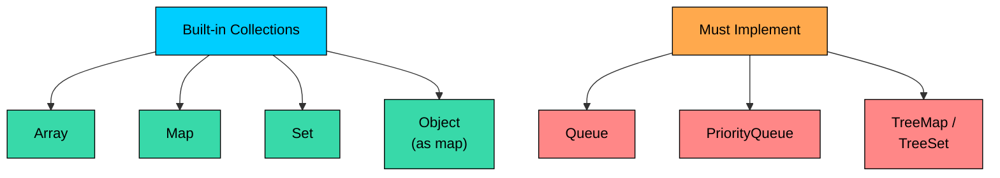
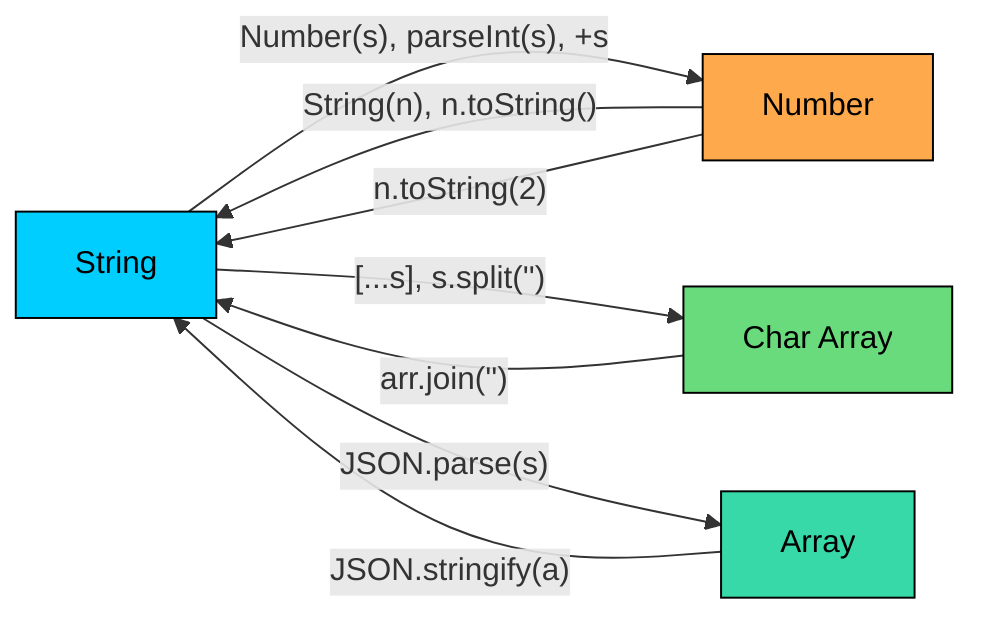

<LessonCard>

<IntroCard>

This chapter is a focused crash course on the JavaScript features that come up repeatedly in DSA and coding interviews. Instead of covering the entire language, we will concentrate only on the parts that matter for solving problems efficiently in interviews.

</IntroCard>

<h1 id="no-imports-needed">No Imports Needed</h1>

JavaScript does not require any imports for DSA work. Every data structure and utility function you need is globally available.

On LeetCode, your solution is a function. There is no class wrapping, no `import` statements, no `#include` directives. You write your function and submit. This is one of the reasons JavaScript is popular for coding interviews: zero boilerplate.

JavaScript ships with these built-in types:

| Built-in                 | What It Provides                                     | DSA Use Case                          |
| ------------------------ | ---------------------------------------------------- | ------------------------------------- |
| `Array`                  | Dynamic array with rich methods                      | Primary data structure for everything |
| `Map`                    | Hash map with any key type                           | Frequency counting, O(1) lookups      |
| `Set`                    | Hash set with any value type                         | Visited tracking, deduplication       |
| `Object`                 | Key-value pairs (string keys)                        | Simple frequency maps                 |
| `Math`                   | `max`, `min`, `floor`, `ceil`, `abs`, `sqrt`, `log2` | Utility calculations                  |
| `JSON`                   | `stringify`, `parse`                                 | Deep copy, composite keys             |
| `Infinity` / `-Infinity` | Global sentinel values                               | Min/max initialization                |

But JavaScript also has notable gaps. These are data structures common in DSA that have no built-in equivalent:

| Not Built-in      | What You Must Do                       |
| ----------------- | -------------------------------------- |
| Queue             | Use array with pointer, or linked list |
| Deque             | Use array (limited), or custom class   |
| PriorityQueue     | Implement a min-heap yourself          |
| TreeMap / TreeSet | Sorted array + binary search (limited) |

We will cover workarounds for each of these missing structures later in this chapter. For now, know that what JavaScript gives you out of the box is clean, concise, and fast to write.

<h1 id="variables-types-and-the-number-type-trap">
  Variables, Types, and the Number Type Trap
</h1>

JavaScript is dynamically typed. You do not declare types, you assign values and the engine figures it out:

```javascript
let count = 0; // number
const ratio = 3.14; // number (same type as count!)
const name = "hello"; // string
let found = true; // boolean
const nothing = null; // null
let missing; // undefined
```

```javascript
// var leaks out of blocks (dangerous)
for (var i = 0; i < 5; i++) {}
console.log(i); // 5 (still accessible!)

// let stays in its block (safe)
for (let j = 0; j < 5; j++) {}
console.log(j); // ReferenceError: j is not defined
```

For DSA, a small set of types covers most problems:

| Type        | Example                  | DSA Use Case                                       |
| ----------- | ------------------------ | -------------------------------------------------- |
| `number`    | `42`, `3.14`, `Infinity` | Everything numeric (no separate int/float!)        |
| `string`    | `"hello"`                | Immutable character sequences                      |
| `boolean`   | `true`, `false`          | Visited arrays, flags                              |
| `null`      | `null`                   | Intentional absence (tree/linked list terminators) |
| `undefined` | `undefined`              | Uninitialized variables, missing properties        |
| `bigint`    | `42n`                    | Values exceeding 2^53 - 1 (rare in DSA)            |

JavaScript has no integer type. Every number is an IEEE 754 64-bit floating-point double. The number `42` and the number `42.0` are the same value, the same type, stored the same way.

This has three critical implications for DSA:

**1. Division always produces a float.** In JavaScript, `7 / 2` gives `3.5`, not `3`. You must explicitly truncate when you need an integer:

```javascript
// Integer division in JavaScript
Math.floor(7 / 2); // 3 (rounds toward negative infinity)
Math.trunc(7 / 2); // 3 (rounds toward zero)
Math.ceil(7 / 2); // 4 (rounds toward positive infinity)

// For positive numbers, floor and trunc are the same
// For negative numbers, they differ:
Math.floor(-7 / 2); // -4 (rounds down)
Math.trunc(-7 / 2); // -3 (rounds toward zero)
```

**2. Integer precision is limited to 2^53 - 1.** The `Number.MAX_SAFE_INTEGER` is 9,007,199,254,740,991. Beyond this, integer arithmetic loses precision without warning:

```javascript
console.log(9007199254740992 === 9007199254740993); // true! (both round to the same float)
```

For most DSA problems where constraints are up to 10^9, this is not an issue. But for problems involving large prefix sums or multiplication of large values, be aware. If you need arbitrary precision, use `BigInt`:

```javascript
const big = 9007199254740993n; // note the 'n' suffix
const result = big * 2n; // BigInt arithmetic
// Cannot mix: big + 1 throws TypeError. Must use big + 1n
```

**3. Binary search midpoint does not overflow, but needs floor.** JavaScript numbers safely hold sums up to 2^53, so `(left + right)` will not overflow. But you need `Math.floor` because division produces a float:

```javascript
// WRONG: produces a float when left + right is odd
const mid = (left + right) / 2;

// CORRECT: floor to get integer index
const mid = Math.floor((left + right) / 2);

// Also correct, though unnecessary since JS uses 64-bit doubles
const mid = left + Math.floor((right - left) / 2);
```

When a problem says "return an integer," you still return a `number` in JavaScript. But always make sure your arithmetic produces an integer result. Using `Math.floor` in binary search and division is a habit that prevents bugs.

The **ternary operator** works the same as in other languages:

```javascript
const result = a > b ? a : b; // Same as Math.max(a, b)
const label = count === 1 ? "item" : "items";
```

The `typeof` operator has these quirks:

```javascript
typeof 42; // "number"
typeof "hello"; // "string"
typeof true; // "boolean"
typeof undefined; // "undefined"
typeof null; // "object"   // <-- Classic JS bug! null is NOT an object
typeof []; // "object"   // Arrays are objects
typeof {}; // "object"
Array.isArray([]); // true       // The correct way to check for arrays
```

The `typeof null === "object"` is a bug from the first version of JavaScript in 1995 that was never fixed because it would break existing code. You will not encounter this in DSA problems, but it sometimes shows up in trivia questions.

<h1 id="operators-and-control-flow">Operators and Control Flow</h1>

Most operators work as you would expect, but a few deserve special attention for DSA.

<h3 id="strict-equality">Strict Equality</h3>

```javascript
0 == ""          // true (empty string coerces to 0)
0 == false       // true (false coerces to 0)
null == undefined // true (special coercion rule)
"5" == 5         // true (string coerces to number)
[] == false      // true (array coerces to 0)

// With ===, none of these are true
0 === ""          // false
0 === false       // false
null === undefined // false
"5" === 5         // false
```

There is one acceptable use of `==`: checking for both `null` and `undefined` in a single comparison. `val == null` is `true` when `val` is either `null` or `undefined`, and `false` for everything else. Either `val === null || val === undefined` or `val == null` is acceptable; just pick one and be consistent.

<h3 id="modular-arithmetic">Modular Arithmetic</h3>

The `%` operator appears in hashing, cyclic array problems, and math-heavy questions. JavaScript's `%` can return negative values for negative operands: `-7 % 3` gives `-1`, not `2`. To guarantee a positive result:

```javascript
((n % m) + m) % m; // Always non-negative
```

Many problems ask you to return the result "modulo 10^9 + 7" to prevent large outputs. This is a standard pattern:

```javascript
const MOD = 1_000_000_007; // Underscores for readability (ES2021)

let result = 0;
for (let i = 0; i < n; i++) {
  result = (result + values[i]) % MOD;
}
return result;
```

<h3 id="bitwise-operators">Bitwise Operators</h3>

A JavaScript-specific gotcha: **bitwise operators convert operands to 32-bit signed integers.** This means:

```javascript
1 << 31; // -2147483648 (negative! bit 31 is the sign bit)
1 << 32; // 1 (wraps around, NOT 2^32)
```

This limits bitmask problems in JavaScript to **31 bits**. For most DSA problems, 31 bits (representing sets of up to 31 elements) is sufficient. But be aware of this if you are porting bitmask DP solutions from other languages.

The key bitwise operators:

| Operator             | Symbol     | DSA Use                                                         |
| -------------------- | ---------- | --------------------------------------------------------------- |
| AND                  | `&`        | Masking, checking if bit is set: `(n & (1 &lt;&lt; i)) !== 0`   |
| OR                   | `\|`       | Setting bits: `n \| (1 &lt;&lt; i)`                             |
| XOR                  | `^`        | Finding unique elements, toggling bits                          |
| NOT                  | `~`        | Bit inversion                                                   |
| Left shift           | `&lt;&lt;` | Multiply by powers of 2: `1 &lt;&lt; n` equals 2^n (up to n=30) |
| Right shift          | `>>`       | Divide by powers of 2 (preserves sign)                          |
| Unsigned right shift | `>>>`      | Divide by powers of 2 (fills with 0)                            |

Common bit manipulation patterns:

```javascript
// XOR trick: find the number that appears once (all others appear twice)
let single = 0;
for (const num of nums) {
  single ^= num; // XOR cancels out duplicates
}

// Check if bit i is set
const isSet = (mask & (1 << i)) !== 0;

// Set bit i
mask = mask | (1 << i);

// Clear bit i
mask = mask & ~(1 << i);

// Toggle bit i
mask = mask ^ (1 << i);

// Count set bits
function popcount(n) {
  let count = 0;
  while (n) {
    count += n & 1;
    n >>>= 1; // unsigned right shift to handle negative numbers
  }
  return count;
}
// Or use the string trick: n.toString(2).split('').filter(b => b === '1').length
```

<h3 id="control-flow">Control Flow</h3>

JavaScript offers several loop forms. Use each where it fits:

```javascript
// Index-based for (most common in DSA)
for (let i = 0; i < nums.length; i++) {
  // access nums[i]
}

// Backward iteration
for (let i = n - 1; i >= 0; i--) {
  // process in reverse
}

// for...of (iterates values, the correct way to iterate arrays)
for (const num of nums) {
  // no index access, just values
}

// while (two pointers, linked list traversal)
while (left < right) {
  // process
}
```

**Warning:** Never use `for...in` on arrays. It iterates over string keys (including inherited prototype properties), not values:

```javascript
// WRONG: for...in on arrays
const nums = [10, 20, 30];
for (const i in nums) {
  console.log(typeof i); // "string"! i is "0", "1", "2" (not 0, 1, 2)
}

// CORRECT: for...of for values, for loop for indices
for (const num of nums) {
  /* values */
}
for (let i = 0; i < nums.length; i++) {
  /* index + value */
}
```

<h3 id="short-circuit-evaluation-and-modern-operators">
  Short-Circuit Evaluation and Modern Operators
</h3>

JavaScript has two operators that are useful for DSA:

```javascript
const count = map.get(key) ?? 0; // 0 only if get returns null/undefined
```

```javascript
const val = node?.left?.val; // undefined if node or node.left is null/undefined
```

The `??` operator is safer than `||` for default values. `map.get(key) || 0` would incorrectly treat a stored `0` as missing and return `0` from the right side. The `??` operator only replaces `null` and `undefined`, preserving legitimate falsy values like `0`, `""`, and `false`.

<h1 id="functions-scope-and-closures">Functions, Scope, and Closures</h1>

JavaScript offers two main ways to define functions, and both appear frequently in DSA code:

```javascript
// Function declaration (hoisted, usable before its definition)
function dfs(node, visited) {
  if (!node || visited.has(node)) return;
  visited.add(node);
  for (const neighbor of node.neighbors) {
    dfs(neighbor, visited);
  }
}

// Arrow function (not hoisted, concise for callbacks)
const compare = (a, b) => a - b;

// Arrow function with body
const isValid = (s) => {
  const stack = [];
  // ... implementation
  return stack.length === 0;
};
```

For DSA, use function declarations for your main solution functions and arrow functions for comparators, callbacks, and short helper functions. The choice is mostly style, but there is one practical difference: function declarations are hoisted, so you can call them before they appear in the code. Arrow functions are not.

<h3 id="pass-by-value-for-primitives-pass-by-reference-for-objects">
  Pass-by-Value for Primitives, Pass-by-Reference for Objects
</h3>

JavaScript passes primitives (numbers, strings, booleans) by value and objects (arrays, maps, sets, plain objects) by reference. This distinction matters for many DSA problems:

```javascript
function addToArray(arr, val) {
  arr.push(val); // Modifies the original array
}

function tryToReassign(arr) {
  arr = [99, 100]; // This does NOT affect the original
}

const nums = [1, 2, 3];
addToArray(nums, 4); // nums is now [1, 2, 3, 4]
tryToReassign(nums); // nums is still [1, 2, 3, 4]
```

This matters for backtracking. When you add a path to your results, you must copy the array. Otherwise, all results point to the same array that gets modified during backtracking:

```javascript
function backtrack(path, results, choices) {
  if (isComplete(path)) {
    results.push([...path]); // MUST spread-copy! Not results.push(path)
    return;
  }
  for (const choice of choices) {
    path.push(choice);
    backtrack(path, results, choices);
    path.pop(); // undo the choice
  }
}
```

The `[...path]` spread creates a shallow copy of the array.

<h3 id="closures">Closures</h3>

Closures are useful in JavaScript for memoization patterns:

```javascript
// A function that remembers its enclosing scope
function createMemoizedDFS() {
  const memo = new Map();

  return function dfs(state) {
    if (memo.has(state)) return memo.get(state);
    // ... compute result
    memo.set(state, result);
    return result;
  };
}
```

You will not need closures for most standard DSA problems, but they come up in design problems (like LRU Cache) and can make memoization code cleaner.

Arrow functions and destructuring fit naturally with backtracking and callback patterns. The spread operator `[...path]` is the idiomatic way to copy arrays in JS, and destructuring `const [a, b] = pair` makes working with tuples clean and readable.

<h1 id="arrays">Arrays</h1>

Arrays are the core data structure for DSA in JavaScript. They are dynamic (no fixed size), zero-indexed, and come with many built-in methods. Arrays appear in nearly every problem.

<h3 id="creation-and-initialization">Creation and Initialization</h3>

```javascript
// Literal
const nums = [1, 2, 3, 4, 5];

// Fixed size, filled with a value
const visited = new Array(n).fill(false);
const dp = new Array(n + 1).fill(0);

// Empty array to build up
const result = [];
```

The `.length` property (no parentheses) gives the current size:

```javascript
nums.length; // 5
```

<h3 id="2d-array-initialization">2D Array Initialization</h3>

Watch for this pattern:

```javascript
// WRONG: all rows share the SAME inner array reference!
const matrix = new Array(rows).fill(new Array(cols).fill(0));
matrix[0][0] = 5; // This changes ALL rows' first element to 5!

// CORRECT: each row is a separate array
const matrix = Array.from({ length: rows }, () => new Array(cols).fill(0));
matrix[0][0] = 5; // Only affects row 0
```

The 2D array initialization gotcha is a JavaScript-specific trap. `fill(new Array(...))` evaluates `new Array(...)` once and fills every slot with a reference to that single array. Use `Array.from()` with a mapping function to create independent row arrays.

<h3 id="essential-array-methods">Essential Array Methods</h3>

| Method                       | Mutates? | Returns          | Time   | DSA Use                           |
| ---------------------------- | -------- | ---------------- | ------ | --------------------------------- |
| `push(val)`                  | Yes      | new length       | O(1)   | Append to end (stack push)        |
| `pop()`                      | Yes      | removed element  | O(1)   | Remove from end (stack pop)       |
| `shift()`                    | Yes      | removed element  | O(n)   | Remove from front (queue dequeue) |
| `unshift(val)`               | Yes      | new length       | O(n)   | Add to front                      |
| `splice(i, count, ...items)` | Yes      | removed elements | O(n)   | Remove/insert at index            |
| `slice(start, end)`          | No       | new array        | O(k)   | Copy a portion                    |
| `concat(arr2)`               | No       | new array        | O(n+m) | Merge arrays                      |
| `reverse()`                  | Yes      | same array       | O(n)   | Reverse in place                  |
| `includes(val)`              | No       | boolean          | O(n)   | Linear search                     |
| `indexOf(val)`               | No       | index or -1      | O(n)   | Find first occurrence             |
| `fill(val, start, end)`      | Yes      | same array       | O(n)   | Fill range with value             |
| `flat(depth)`                | No       | new array        | O(n)   | Flatten nested arrays             |

Methods like `sort()`, `reverse()`, `splice()`, `fill()` modify the array in place. Methods like `slice()`, `concat()`, `map()`, `filter()` return new arrays.

<h3 id="stack-operations-with-arrays">Stack Operations with Arrays</h3>

Arrays are your stack in JavaScript. No need for a separate class:

```javascript
const stack = [];
stack.push(42); // push: O(1)
stack.push(17);
stack.pop(); // pop: O(1), returns 17
stack[stack.length - 1]; // peek: O(1), returns 42
stack.length === 0; // isEmpty check
```

<h3 id="queue-operations-the-on-trap">Queue Operations: The O(n) Trap</h3>

JavaScript's limitations show up with the queue operations. The naive approach uses `shift()` as dequeue:

```javascript
// NAIVE queue (shift is O(n), avoid for large inputs!)
const queue = [];
queue.push(42); // enqueue: O(1)
queue.shift(); // dequeue: O(n)! Shifts all elements left
```

For BFS on a graph with 100,000 nodes, using `shift()` makes the algorithm O(n^2) instead of O(n). We will cover a proper queue implementation in the Collections section.

For problems with small inputs (n &lt; 10,000), `shift()` is acceptable on LeetCode. V8's internal optimizations make the constant factor small. Use your judgment based on the problem constraints.

<h3 id="the-4-directional-neighbor-pattern">
  The 4-Directional Neighbor Pattern
</h3>

Grid problems (number of islands, shortest path in maze) need to visit adjacent cells. This pattern appears in almost every grid BFS/DFS:

```javascript
const directions = [
  [-1, 0],
  [1, 0],
  [0, -1],
  [0, 1],
];

for (const [dr, dc] of directions) {
  const newRow = row + dr;
  const newCol = col + dc;
  if (newRow >= 0 && newRow < rows && newCol >= 0 && newCol < cols) {
    // process neighbor at (newRow, newCol)
  }
}
```

<h3 id="destructuring-swap">Destructuring Swap</h3>

A convenient feature for DSA. No temporary variable needed:

```javascript
[arr[i], arr[j]] = [arr[j], arr[i]]; // Swap elements
[a, b] = [b, a]; // Swap variables
```

<h3 id="spread-operator-for-copies">Spread Operator for Copies</h3>

```javascript
const copy = [...nums]; // Shallow copy
const merged = [...arr1, ...arr2]; // Concatenate
```

<h3 id="arrayfrom-utility">Array.from() Utility</h3>

`Array.from()` is a versatile tool in JavaScript for DSA:

```javascript
// Create array of specific length filled with value
Array.from({ length: 26 }, () => 0); // [0, 0, ..., 0] (26 zeros)

// Create array with index-based values
Array.from({ length: n }, (_, i) => i); // [0, 1, 2, ..., n-1]

// Convert string to character array
Array.from("hello"); // ['h', 'e', 'l', 'l', 'o']

// Create 2D array
Array.from({ length: rows }, () => new Array(cols).fill(0));
```

<h1 id="strings">Strings</h1>

Strings in JavaScript are **immutable**. Every time you modify a string, JavaScript creates a new object. This has an important performance implication:

```javascript
// BAD: O(n^2) because each += creates a new string
let result = "";
for (const c of chars) {
  result += c; // Creates a new string every iteration
}

// GOOD: O(n) with array join
const parts = [];
for (const c of chars) {
  parts.push(c);
}
const result = parts.join("");
```

JavaScript has no `StringBuilder` class. The `Array.push()` + `.join("")` pattern is the standard alternative. Array `join` concatenates all elements into a single string with the separator between them.

<h3 id="no-char-type">No Char Type</h3>

JavaScript has no character type. A "character" is just a string of length 1:

```javascript
const s = "hello";
s[0]; // "h" (a string, not a char)
typeof s[0]; // "string"
s.charAt(0); // "h" (equivalent to s[0])
```

This means you cannot compare characters with `&lt;` and `>` in the numeric sense directly. Character comparisons work lexicographically as string comparisons, which is what you want for most DSA problems.

<h3 id="string-methods">String Methods</h3>

| Method                  | Returns | Example              | DSA Use                                    |
| ----------------------- | ------- | -------------------- | ------------------------------------------ |
| `s[i]` or `s.charAt(i)` | string  | `s[0]`               | Access character                           |
| `s.length`              | number  | `s.length`           | Loop bounds (property, no parens)          |
| `s.slice(start, end)`   | string  | `s.slice(0, 3)`      | Substring (start inclusive, end exclusive) |
| `s.split(sep)`          | array   | `s.split(" ")`       | Tokenize                                   |
| `s.indexOf(str)`        | number  | `s.indexOf("ab")`    | Find substring (-1 if not found)           |
| `s.includes(str)`       | boolean | `s.includes("ab")`   | Substring check                            |
| `s.startsWith(pre)`     | boolean | `s.startsWith("ab")` | Prefix check                               |
| `s.endsWith(suf)`       | boolean | `s.endsWith("ab")`   | Suffix check                               |
| `s.repeat(n)`           | string  | `"ab".repeat(3)`     | Repeat: `"ababab"`                         |
| `s.trim()`              | string  | `s.trim()`           | Remove surrounding whitespace              |
| `s.toLowerCase()`       | string  |                      | Case conversion                            |
| `s.toUpperCase()`       | string  |                      | Case conversion                            |
| `s.replace(a, b)`       | string  |                      | Replace first occurrence                   |
| `s.replaceAll(a, b)`    | string  |                      | Replace all occurrences                    |

<h3 id="character-operations">Character Operations</h3>

JavaScript has no `Character` utility class. You use `charCodeAt()` and `String.fromCharCode()` instead:

```javascript
s.charCodeAt(0)             // Unicode code point of first character
String.fromCharCode(97)     // "a"

// Map 'a'-'z' to 0-25
s.charCodeAt(0) - 97        // 97 is the code for 'a'
// Or more readably:
s.charCodeAt(0) - 'a'.charCodeAt(0)

// Map '0'-'9' to 0-9
s.charCodeAt(0) - 48        // 48 is the code for '0'

// Character type checks (no built-in functions, use regex)
/[a-zA-Z]/.test(c)          // isLetter
/[0-9]/.test(c)             // isDigit
/[a-zA-Z0-9]/.test(c)       // isLetterOrDigit
c === c.toLowerCase()       // isLowerCase (for letters)
c === c.toUpperCase()       // isUpperCase (for letters)
```

<h3 id="frequency-array-pattern">Frequency Array Pattern</h3>

```javascript
// Frequency array for lowercase letters (26 slots)
const freq = new Array(26).fill(0);
for (const c of s) {
  freq[c.charCodeAt(0) - 97]++;
}
// freq[0] = count of 'a', freq[1] = count of 'b', etc.
```

This is faster and more memory-efficient than `Map` when the character set is known and small (lowercase letters, digits, etc.).

<h3 id="template-literals-for-composite-keys">
  Template Literals for Composite Keys
</h3>

Template literals (backtick strings) are one of JavaScript's most useful features for DSA:

```javascript
// Creating composite keys for Set or Map (very common pattern)
const key = `${row},${col}`;
visited.add(`${row},${col}`);

// Checking membership
if (visited.has(`${newRow},${newCol}`)) continue;
```

The template literal `` `$${row},${col}` `` pattern is common in JavaScript for creating composite keys in Sets and Maps. In grid BFS problems, this is the standard way to track visited cells.

<h1 id="collections-map-set-and-object">Collections: Map, Set, and Object</h1>

Choosing the right collection is often the difference between an O(n) and an O(n^2) solution. JavaScript's built-in collections are small in number, but each has its own quirks worth knowing.



<h3 id="map-the-hashmap-equivalent">Map: The HashMap Equivalent</h3>

ES6 `Map` is JavaScript's hash map. It offers O(1) average-case `get`, `set`, `has`, and `delete`:

```javascript
const freq = new Map();

// Frequency counting (most common Map pattern)
for (const c of s) {
  freq.set(c, (freq.get(c) ?? 0) + 1);
}

// Key operations
freq.has("a"); // Check if key exists: O(1)
freq.get("a"); // Get value (returns undefined if missing): O(1)
freq.set("a", 5); // Set value: O(1)
freq.delete("a"); // Remove key: O(1)
freq.size; // Number of entries (property, not method!)
freq.clear(); // Remove all entries

// Iteration (insertion order is preserved)
for (const [key, value] of freq) {
  /* key-value pairs */
}
for (const key of freq.keys()) {
  /* keys only */
}
for (const value of freq.values()) {
  /* values only */
}
```

<h3 id="map-vs-object">Map vs Object</h3>

Plain objects (`{}`) can also serve as hash maps, but with limitations:

| Feature            | `Map`                               | `Object`                                  |
| ------------------ | ----------------------------------- | ----------------------------------------- |
| Key types          | Any (numbers, objects, arrays)      | Strings and Symbols only                  |
| Size               | `.size` property                    | `Object.keys(obj).length`                 |
| Iteration order    | Insertion order guaranteed          | Mostly insertion order                    |
| Performance        | Optimized for frequent adds/deletes | Optimized for static structures           |
| Default keys       | None                                | Has prototype properties                  |
| DSA recommendation | **Default choice**                  | Fine for simple string-key frequency maps |

```javascript
// Object as a map (fine for simple string-key cases)
const freq = {};
for (const c of s) {
  freq[c] = (freq[c] ?? 0) + 1;
}

// Check existence
if (c in freq) {
  /* exists */
}
if (freq[c] !== undefined) {
  /* exists */
}

// Iterate
for (const key of Object.keys(freq)) {
  /* keys */
}
for (const [key, value] of Object.entries(freq)) {
  /* key-value pairs */
}
```

Use `Map` as your default. Use objects only when you are counting frequencies of characters or short strings and want the most concise code.

<h3 id="set-the-hashset-equivalent">Set: The HashSet Equivalent</h3>

```javascript
const visited = new Set();

visited.add(node); // Add element: O(1)
visited.has(node); // Check membership: O(1)
visited.delete(node); // Remove element: O(1)
visited.size; // Number of elements

// Create from array (deduplication!)
const unique = new Set(nums);
const uniqueArr = [...new Set(nums)]; // Back to array

// Iteration
for (const val of visited) {
  /* values */
}
```

JavaScript's `Set.add()` returns the Set itself, not a boolean indicating whether the element was new. To check if an element was already present, call `has()` before `add()`:

```javascript
// Detect duplicates
for (const num of nums) {
  if (visited.has(num)) return true; // Duplicate found
  visited.add(num);
}
return false;
```

**Important:** Sets use reference equality for objects and arrays. `new Set([[1,2], [1,2]])` has size 2, not 1, because the two `[1,2]` arrays are different objects. For composite keys, serialize to strings: `visited.add(row + "," + col)`.

<h3 id="queue-implementation">Queue Implementation</h3>

JavaScript has no built-in queue with O(1) dequeue. A lightweight implementation using an object as a sparse array with head/tail pointers:

```javascript
class Queue {
  constructor() {
    this.items = {};
    this.head = 0;
    this.tail = 0;
  }
  enqueue(val) {
    this.items[this.tail++] = val;
  }
  dequeue() {
    if (this.isEmpty()) return undefined;
    const val = this.items[this.head];
    delete this.items[this.head++];
    return val;
  }
  peek() {
    return this.items[this.head];
  }
  get size() {
    return this.tail - this.head;
  }
  isEmpty() {
    return this.tail === this.head;
  }
}
```

BFS using this queue:

```javascript
function bfs(graph, start) {
  const visited = new Set([start]);
  const queue = new Queue();
  queue.enqueue(start);

  while (!queue.isEmpty()) {
    const node = queue.dequeue();
    for (const neighbor of graph.get(node) ?? []) {
      if (!visited.has(neighbor)) {
        visited.add(neighbor);
        queue.enqueue(neighbor);
      }
    }
  }
}
```

For level-order traversal, capture the queue size at the start of each level:

```javascript
let level = 0;
while (!queue.isEmpty()) {
    const levelSize = queue.size;  // Capture before processing
    for (let i = 0; i &lt; levelSize; i++) {
        const node = queue.dequeue();
        // ... process node, enqueue children
    }
    level++;
}
```

<h3 id="priorityqueue-must-implement-yourself">
  PriorityQueue: Must Implement Yourself
</h3>

JavaScript has no built-in priority queue. For problems like top-K elements, Dijkstra's algorithm, or merge-K-sorted-lists, you need a min-heap. A minimal implementation:

```javascript
class MinHeap {
    constructor(compareFn = (a, b) => a - b) {
        this.heap = [];
        this.compare = compareFn;
    }

    push(val) {
        this.heap.push(val);
        this._siftUp(this.heap.length - 1);
    }

    pop() {
        if (this.heap.length === 0) return undefined;
        const top = this.heap[0];
        const last = this.heap.pop();
        if (this.heap.length > 0) {
            this.heap[0] = last;
            this._siftDown(0);
        }
        return top;
    }

    peek() {
        return this.heap[0];
    }

    get size() {
        return this.heap.length;
    }

    isEmpty() {
        return this.heap.length === 0;
    }

    _siftUp(i) {
        while (i > 0) {
            const parent = Math.floor((i - 1) / 2);
            if (this.compare(this.heap[i], this.heap[parent]) &ge; 0) break;
            [this.heap[i], this.heap[parent]] = [this.heap[parent], this.heap[i]];
            i = parent;
        }
    }

    _siftDown(i) {
        const n = this.heap.length;
        while (true) {
            let smallest = i;
            const left = 2 * i + 1;
            const right = 2 * i + 2;
            if (left &lt; n && this.compare(this.heap[left], this.heap[smallest]) &lt; 0) smallest = left;
            if (right &lt; n && this.compare(this.heap[right], this.heap[smallest]) &lt; 0) smallest = right;
            if (smallest === i) break;
            [this.heap[i], this.heap[smallest]] = [this.heap[smallest], this.heap[i]];
            i = smallest;
        }
    }
}
```

Usage:

```javascript
// Min-heap (default)
const minHeap = new MinHeap();
minHeap.push(5);
minHeap.push(2);
minHeap.push(8);
minHeap.pop(); // 2

// Max-heap (reverse comparator)
const maxHeap = new MinHeap((a, b) => b - a);

// Custom objects (sort by frequency, then by value)
const heap = new MinHeap((a, b) => (a[1] !== b[1] ? a[1] - b[1] : a[0] - b[0]));
heap.push([3, 5]); // [value, frequency]
```

State up front that you are using a simplified heap because JavaScript lacks a built-in PriorityQueue; in real interviews this is usually accepted, and showing that you know the heap interface and can implement it if needed is what matters.

<h3 id="no-treemap-treeset">No TreeMap / TreeSet</h3>

JavaScript has no sorted map or sorted set. This is a disadvantage for problems that need:

Workarounds:

<h3 id="collections-quick-reference">Collections Quick Reference</h3>

| Collection         | Type           | Key Methods                                       | Time Complexity                        | DSA Use                     |
| ------------------ | -------------- | ------------------------------------------------- | -------------------------------------- | --------------------------- |
| `Array`            | Dynamic array  | `push`, `pop`, `shift`, `splice`, `slice`, `sort` | push/pop O(1), shift O(n), access O(1) | Stacks, results, DP tables  |
| `Map`              | Hash map       | `set`, `get`, `has`, `delete`, `size`             | O(1) average                           | Frequency counting, two-sum |
| `Set`              | Hash set       | `add`, `has`, `delete`, `size`                    | O(1) average                           | Visited tracking, dedup     |
| `Object`           | String-key map | bracket access, `in`, `Object.keys`               | O(1) average                           | Simple frequency maps       |
| `Queue` (custom)   | FIFO queue     | `enqueue`, `dequeue`, `peek`, `size`              | O(1) all                               | BFS                         |
| `MinHeap` (custom) | Priority queue | `push`, `pop`, `peek`, `size`                     | O(log n) push/pop                      | Top-K, Dijkstra             |

<h1 id="sorting-and-comparators">Sorting and Comparators</h1>

Sorting is fundamental to DSA. And JavaScript's default sort behavior is a frequent source of bugs.

<h3 id="the-default-sort-trap">The Default Sort Trap</h3>

```javascript
[10, 9, 80, 1].sort();
// Result: [1, 10, 80, 9] (WRONG! Sorted as strings, not numbers!)
```

`Array.sort()` converts elements to strings and sorts lexicographically by default. The string `"10"` comes before `"9"` because `"1"` &lt; `"9"` in Unicode code points. **Always pass a comparator for numeric sorting:**

```javascript
[10, 9, 80, 1].sort((a, b) => a - b);
// Result: [1, 9, 10, 80] (correct!)
```

<h3 id="comparator-pattern">Comparator Pattern</h3>

The comparator function takes two elements and returns:

```javascript
// Sort intervals by start time
intervals.sort((a, b) => a[0] - b[0]);

// Sort by length, then alphabetically
words.sort((a, b) => {
  if (a.length !== b.length) return a.length - b.length;
  return a.localeCompare(b);
});

// Descending order
nums.sort((a, b) => b - a);

// Sort objects by a property
people.sort((a, b) => a.age - b.age);
```

<h3 id="sort-mutates-the-original-array">Sort Mutates the Original Array</h3>

Unlike methods like `map` and `filter` which return new arrays, `sort()` modifies the array in place and returns the same array reference. If you need to preserve the original:

```javascript
const sorted = [...nums].sort((a, b) => a - b); // Copy, then sort
```

<h3 id="stability">Stability</h3>

`Array.sort()` is guaranteed stable in all modern JavaScript engines since ES2019. This means elements with equal sort keys maintain their original relative order. The underlying algorithm varies by engine: V8 (Chrome, Node.js) uses TimSort, while JavaScriptCore (Safari) and SpiderMonkey (Firefox) use other stable sorts.

<h3 id="overflow-warning">Overflow Warning</h3>

The `(a, b) => a - b` comparator can theoretically overflow if `a` and `b` are very large numbers of opposite sign. This is rare in DSA because JavaScript numbers are doubles with a wide range. But if you need to be safe:

```javascript
const safeCompare = (a, b) => (a &lt; b ? -1 : a > b ? 1 : 0);
```

<h1 id="functional-patterns-for-dsa">Functional Patterns for DSA</h1>

JavaScript's functional array methods can make DSA code more concise. Use them when they improve readability, but do not force them when a simple loop is clearer.

<h3 id="map-filter-reduce">map, filter, reduce</h3>

```javascript
// Sum of array
const sum = nums.reduce((acc, val) => acc + val, 0);

// Filter even numbers
const evens = nums.filter((n) => n % 2 === 0);

// Transform values
const doubled = nums.map((n) => n * 2);

// Check if any/all meet condition
nums.some((n) => n > 10); // true if any element > 10
nums.every((n) => n > 0); // true if all elements > 0

// Find first matching element
nums.find((n) => n > 10); // first element > 10, or undefined
nums.findIndex((n) => n > 10); // index of first match, or -1
```

<h3 id="frequency-counting-patterns">Frequency Counting Patterns</h3>

```javascript
// With Map (recommended)
const freq = new Map();
for (const c of s) {
  freq.set(c, (freq.get(c) ?? 0) + 1);
}

// With Object (concise for string keys)
const freq = {};
for (const c of s) {
  freq[c] = (freq[c] ?? 0) + 1;
}

// With reduce (most compact, but less readable)
const freq = [...s].reduce((m, c) => {
  m[c] = (m[c] ?? 0) + 1;
  return m;
}, {});
```

<h3 id="adjacency-list-building">Adjacency List Building</h3>

```javascript
// With Map
const graph = new Map();
for (const [u, v] of edges) {
  if (!graph.has(u)) graph.set(u, []);
  if (!graph.has(v)) graph.set(v, []);
  graph.get(u).push(v);
  graph.get(v).push(u); // Omit for directed graph
}
```

<h3 id="destructuring-in-iterations">Destructuring in Iterations</h3>

```javascript
// Map entries
for (const [key, value] of map) {
  /* ... */
}

// Array with index
for (const [i, val] of nums.entries()) {
  /* ... */
}

// Nested array unpacking
for (const [u, v, weight] of edges) {
  /* ... */
}
```

<h3 id="arrayfrom-for-generation">Array.from() for Generation</h3>

```javascript
// Range [0, 1, 2, ..., n-1]
Array.from({ length: n }, (_, i) => i);

// Range [1, 2, 3, ..., n]
Array.from({ length: n }, (_, i) => i + 1);

// Initialize 2D grid
Array.from({ length: rows }, () => new Array(cols).fill(0));
```

<h1 id="null-and-undefined-handling">Null and Undefined Handling</h1>

JavaScript has two "nothing" values, and understanding the difference matters for DSA.

In DSA, `null` appears when a tree node has no left or right child, or when a linked list ends. `undefined` appears when you call `map.get(key)` for a missing key or access an array index out of bounds.

<h3 id="three-rules-for-null-safety">Three Rules for Null Safety</h3>

**Rule 1: Guard clauses for edge cases.**

```javascript
if (!root) return null; // Tree is empty
if (!head) return null; // Linked list is empty
if (!nums || nums.length === 0) return []; // Array is empty or null
```

Note: `!null` and `!undefined` are both `true`, so `if (!root)` catches both.

```javascript
const count = map.get(key) ?? 0; // Only replaces null/undefined
const count = map.get(key) || 0; // ALSO replaces 0, "", false (dangerous!)
```

If the map stores `0` as a legitimate value, `|| 0` would incorrectly treat it as missing. The `??` operator only triggers for `null` and `undefined`.

**Rule 3: Optional chaining for safe navigation.**

```javascript
const val = node?.left?.val; // undefined if any link is null/undefined
const len = arr?.[0]?.length; // Safe bracket access
const result = obj?.method?.(); // Safe method call
```

<h1 id="iterating-and-modifying-collections-safely">
  Iterating and Modifying Collections Safely
</h1>

JavaScript does not throw any error when you modify a collection during iteration. But modifying arrays during iteration still causes subtle bugs.

<h3 id="arrays-use-backward-loop-for-safe-removal">
  Arrays: Use Backward Loop for Safe Removal
</h3>

```javascript
// BUGGY: forward loop with splice skips elements
for (let i = 0; i &lt; arr.length; i++) {
    if (shouldRemove(arr[i])) {
        arr.splice(i, 1);
        // After splice, the next element shifts to index i,
        // but the loop increments i, so it gets skipped
    }
}

// CORRECT: backward loop
for (let i = arr.length - 1; i &ge; 0; i--) {
    if (shouldRemove(arr[i])) {
        arr.splice(i, 1);  // Removal does not affect earlier indices
    }
}

// ALSO CORRECT: build a new array
const filtered = arr.filter(item => !shouldRemove(item));
```

<h3 id="map-and-set-safe-deletion-during-iteration">
  Map and Set: Safe Deletion During Iteration
</h3>

JavaScript's `Map` and `Set` allow you to delete the current element during `for...of` iteration. This is part of the ES6 specification:

```javascript
for (const [key, value] of map) {
  if (shouldRemove(value)) {
    map.delete(key); // Safe in JavaScript!
  }
}

for (const val of set) {
  if (shouldRemove(val)) {
    set.delete(val); // Also safe!
  }
}
```

<h3 id="best-practice">Best Practice</h3>

In DSA, you rarely need to modify collections during iteration. Most problems build new collections from existing ones. When you do need to remove elements, prefer building a new array with `filter()` or using the backward loop pattern.

<h1 id="recursion-and-the-call-stack">Recursion and the Call Stack</h1>

Recursion is fundamental to DSA: tree traversals, DFS, backtracking, and divide-and-conquer all rely on it. JavaScript handles recursion the same as other languages, with one important limitation.

<h3 id="stack-depth-limit">Stack Depth Limit</h3>

V8 (the engine behind Chrome and Node.js) has a call stack limit of roughly **10,000 to 15,000 frames**, depending on the size of each frame. The limit cannot be changed from inside the running program, though Node can be launched with `--stack-size=N` (in KB) to raise it. Browsers offer no such flag, so for web code the limit is effectively fixed.

| Scenario                  | Typical Depth | Risk                               |
| ------------------------- | ------------- | ---------------------------------- |
| Balanced binary tree      | O(log n)      | Safe for n up to 10^6              |
| Linked list / skewed tree | O(n)          | Dangerous if n > 10,000            |
| Backtracking              | O(d)          | Usually safe (d is decision depth) |
| DFS on graph              | O(n)          | Dangerous for large n              |

<h3 id="converting-recursive-dfs-to-iterative">
  Converting Recursive DFS to Iterative
</h3>

When the input is large and recursion depth could exceed 10,000, convert to an iterative approach with an explicit stack:

```javascript
// Recursive DFS (risks stack overflow for large graphs)
function dfsRecursive(node, graph, visited) {
  visited.add(node);
  for (const neighbor of graph.get(node) ?? []) {
    if (!visited.has(neighbor)) {
      dfsRecursive(neighbor, graph, visited);
    }
  }
}

// Iterative DFS (safe for any size)
function dfsIterative(start, graph, visited) {
  const stack = [start];
  while (stack.length > 0) {
    const node = stack.pop();
    if (visited.has(node)) continue;
    visited.add(node);
    for (const neighbor of graph.get(node) ?? []) {
      if (!visited.has(neighbor)) {
        stack.push(neighbor);
      }
    }
  }
}
```

<h3 id="no-tail-call-optimization-in-practice">
  No Tail Call Optimization in Practice
</h3>

JavaScript's ES2015 specification defines proper tail calls, but only Safari (JavaScriptCore) implements them. Chrome and Node.js do not. This means even "tail-recursive" functions will still add a frame per call. Always assume recursion adds to the stack.

<h1 id="graph-representation-patterns">Graph Representation Patterns</h1>

Graphs appear in a huge number of DSA problems: shortest path, connected components, topological sort, and more. The two main representations map directly to when each is appropriate.

<h3 id="approach-1-array-of-arrays-contiguous-node-ids-0-to-n-1">
  Approach 1: Array of Arrays (Contiguous Node IDs 0 to n-1)
</h3>

When nodes are numbered 0 through n-1, use an array:

```javascript
const graph = Array.from({ length: n }, () => []);

for (const [u, v] of edges) {
  graph[u].push(v);
  graph[v].push(u); // Omit for directed graph
}

// Access neighbors
for (const neighbor of graph[node]) {
  // process neighbor
}
```

<h3 id="approach-2-map-sparse-or-non-contiguous-node-ids">
  Approach 2: Map (Sparse or Non-Contiguous Node IDs)
</h3>

When node IDs are not contiguous (like string labels or large integers):

```javascript
const graph = new Map();

for (const [u, v] of edges) {
  if (!graph.has(u)) graph.set(u, []);
  if (!graph.has(v)) graph.set(v, []);
  graph.get(u).push(v);
  graph.get(v).push(u);
}

// Access neighbors (with fallback for isolated nodes)
for (const neighbor of graph.get(node) ?? []) {
  // process neighbor
}
```

<h3 id="weighted-graphs">Weighted Graphs</h3>

Store edge weights alongside destination nodes using small arrays:

```javascript
// [destination, weight]
graph[from].push([to, weight]);

// Usage in Dijkstra-style traversal
for (const [neighbor, weight] of graph[node]) {
  const newDist = dist[node] + weight;
  // ...
}
```

<h3 id="comparison">Comparison</h3>

| Feature       | Array of Arrays           | Map                             |
| ------------- | ------------------------- | ------------------------------- |
| Node IDs      | Must be 0 to n-1          | Any type (int, string)          |
| Memory        | Compact, no hash overhead | Hash table overhead             |
| Access speed  | O(1) direct index         | O(1) average (hash lookup)      |
| Use when      | Nodes are numbered, dense | Nodes are sparse, string labels |
| Most problems | **This one**              | Graph with city names, etc.     |

<h1 id="pair-and-tuple-alternatives">Pair and Tuple Alternatives</h1>

JavaScript has no Pair or Tuple type, but the language provides clean alternatives through arrays and destructuring.

<h3 id="option-1-arrays-most-common">Option 1: Arrays (Most Common)</h3>

```javascript
// Store pairs/tuples as small arrays
queue.push([row, col]);
queue.push([row, col, distance]);
heap.push([cost, node]);

// Destructure when extracting
const [r, c] = queue.shift();
const [cost, node] = heap.pop();
```

<h3 id="option-2-objects-when-clarity-matters">
  Option 2: Objects (When Clarity Matters)
</h3>

```javascript
// Shorthand property names
queue.push({ row, col, dist });

// Destructure
const { row, col, dist } = queue.shift();
```

<h3 id="option-3-string-keys-for-composite-mapset-keys">
  Option 3: String Keys for Composite Map/Set Keys
</h3>

Since arrays use reference equality (`[1,2] !== [1,2]`), you cannot use arrays directly as Map keys or Set values for deduplication. Serialize to strings:

```javascript
// Track visited coordinates
const visited = new Set();
visited.add(`${row},${col}`);
if (visited.has(`${newRow},${newCol}`)) continue;

// Track visited states (row, col, direction)
visited.add(`${row},${col},${dir}`);
```

Destructuring makes arrays a good fit for tuples in JavaScript. `const [a, b] = pair` reads naturally and avoids verbose property access.

<h1 id="deduplication-patterns">Deduplication Patterns</h1>

Two main approaches for avoiding duplicates in results.

<h3 id="approach-1-sort-and-skip-preferred-for-sorted-input">
  Approach 1: Sort and Skip (Preferred for Sorted Input)
</h3>

```javascript
nums.sort((a, b) => a - b);

for (let i = 0; i &lt; nums.length; i++) {
    if (i > 0 && nums[i] === nums[i - 1]) continue;  // Skip duplicates
    // process nums[i]
}
```

This pattern appears in problems like 3Sum, Combination Sum II, and Subsets II. The sort brings duplicates adjacent, and the skip condition ensures each unique value is processed only once at each position.

<h3 id="approach-2-set-with-serialization">
  Approach 2: Set with Serialization
</h3>

Since JavaScript Sets compare objects and arrays by reference, you must serialize to strings for deduplication:

```javascript
const resultSet = new Set();

// Add results as serialized strings
resultSet.add(JSON.stringify([a, b, c]));

// Convert back to arrays
const results = [...resultSet].map((s) => JSON.parse(s));
```

This is useful when you cannot sort the input or when duplicate detection is not straightforward. But `JSON.stringify` and `JSON.parse` are slower than the sort-and-skip approach, so prefer Approach 1 when possible.

<h1 id="common-dsa-idioms-in-javascript">Common DSA Idioms in JavaScript</h1>

<h3 id="element-swapping">Element Swapping</h3>

```javascript
// Destructuring swap (no temp variable)
[arr[i], arr[j]] = [arr[j], arr[i]];

// Variable swap
[a, b] = [b, a];
```

<h3 id="sentinel-values">Sentinel Values</h3>

```javascript
let minVal = Infinity; // Will be replaced by any real value
let maxVal = -Infinity; // Will be replaced by any real value
// Note: Infinity is a global constant, not Math.Infinity
```

<h3 id="math-utilities">Math Utilities</h3>

```javascript
Math.max(a, b); // Maximum of two values
Math.min(a, b); // Minimum of two values
Math.abs(a); // Absolute value
Math.floor(a / b); // Floor division (toward negative infinity)
Math.ceil(a / b); // Ceiling division (toward positive infinity)
Math.trunc(a / b); // Truncation toward zero
Math.sqrt(n); // Square root
Math.log2(n); // Log base 2
Math.pow(a, b); // a^b (or use a ** b)
```

```javascript
// This works for small arrays
Math.max(...nums); // Spread array as arguments

// This THROWS RangeError for arrays with ~65,000+ elements!
// Exceeds maximum call stack size because spread creates that many arguments
Math.max(...largeArray); // RangeError!

// Safe alternative for large arrays
let max = -Infinity;
for (const num of nums) {
  if (num > max) max = num;
}
// Or: nums.reduce((max, n) => Math.max(max, n), -Infinity);
```

<h3 id="integer-ceiling-division-without-floating-point">
  Integer Ceiling Division Without Floating Point
</h3>

```javascript
// Using Math.ceil (works for positive numbers)
const ceil = Math.ceil(a / b);

// Without floating point (avoids precision issues)
const ceil = Math.floor((a + b - 1) / b);
```

<h3 id="type-conversions">Type Conversions</h3>

```javascript
// String to number
Number("42")              // 42
parseInt("42")            // 42
parseInt("42abc")         // 42 (stops at first non-digit, be aware!)
+"42"                     // 42 (unary plus, concise but less readable)

// Number to string
String(42)                // "42"
(42).toString()           // "42"
(42).toString(2)          // "101010" (binary representation)
(42).toString(16)         // "2a" (hexadecimal)

// String to character array
[..."hello"]              // ['h', 'e', 'l', 'l', 'o']
"hello".split("")         // ['h', 'e', 'l', 'l', 'o']

// Character array to string
['h', 'e', 'l', 'l', 'o'].join("")  // "hello"
```



<h3 id="deep-copy-patterns">Deep Copy Patterns</h3>

```javascript
// Shallow copy of 1D array
const copy = [...arr];
const copy2 = arr.slice();

// Deep copy of 2D array
const deep = arr.map((row) => [...row]);

// Deep copy of arbitrary objects (slow but universal)
const deep = JSON.parse(JSON.stringify(obj));

// Modern deep copy (Node 17+, Chrome 98+, available on LeetCode)
const deep = structuredClone(obj);
```

Remember: `[...arr]` and `slice()` are shallow copies. For 2D arrays, you must map over rows and spread each one individually, or the inner arrays will still be shared references.

<h1 id="oop-basics-for-design-problems">OOP Basics for Design Problems</h1>

JavaScript uses `class` syntax (ES6) for object-oriented code. In DSA, you need classes primarily for node definitions that LeetCode provides, and occasionally for design problems like LRU Cache.

<h3 id="standard-node-classes">Standard Node Classes</h3>

```javascript
// Linked list node
class ListNode {
  constructor(val = 0, next = null) {
    this.val = val;
    this.next = next;
  }
}

// Binary tree node
class TreeNode {
  constructor(val = 0, left = null, right = null) {
    this.val = val;
    this.left = left;
    this.right = right;
  }
}

// Graph node with neighbors
class GraphNode {
  constructor(val = 0, neighbors = []) {
    this.val = val;
    this.neighbors = neighbors;
  }
}

// Trie node
class TrieNode {
  constructor() {
    this.children = {}; // Object map: character -> TrieNode
    this.isEndOfWord = false;
  }
}
```

JavaScript constructors use default parameters (`val = 0, next = null`) so a single constructor handles all cases.

LeetCode provides `ListNode` and `TreeNode` definitions for you. You do not need to write them yourself, but understanding the structure is essential.

<h3 id="building-data-structures-concisely">
  Building Data Structures Concisely
</h3>

```javascript
// Build linked list: 1 -> 2 -> 3 -> null
const head = new ListNode(1, new ListNode(2, new ListNode(3)));

// Build binary tree:     1
//                       / \
//                      2   3
const root = new TreeNode(1, new TreeNode(2), new TreeNode(3));
```

<h3 id="no-access-modifiers">No Access Modifiers</h3>

JavaScript has no `private` or `public` keywords. Class fields declared with `#` prefix are truly private (ES2022), but this is never used in DSA. All properties are public and accessed directly:

```javascript
node.val; // direct access
node.next; // direct access
node.left; // direct access
```

This keeps DSA code concise and easy to read.

<CommentsSection />

</LessonCard>
